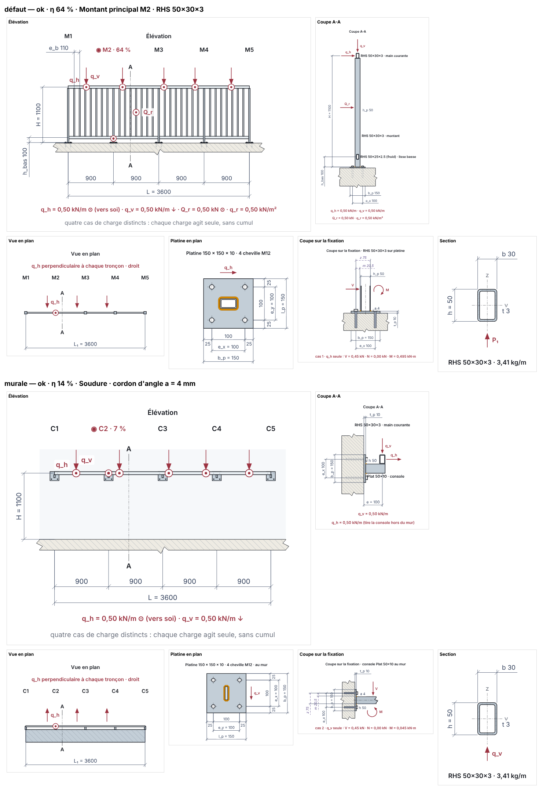
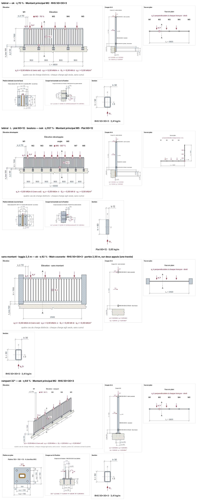
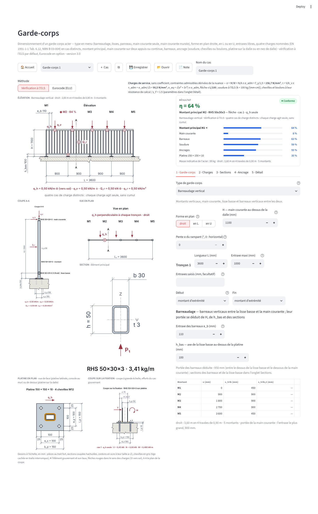
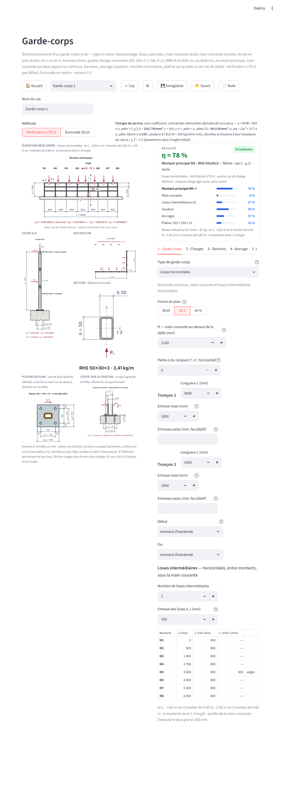
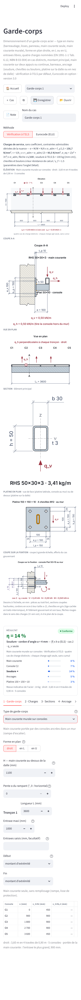
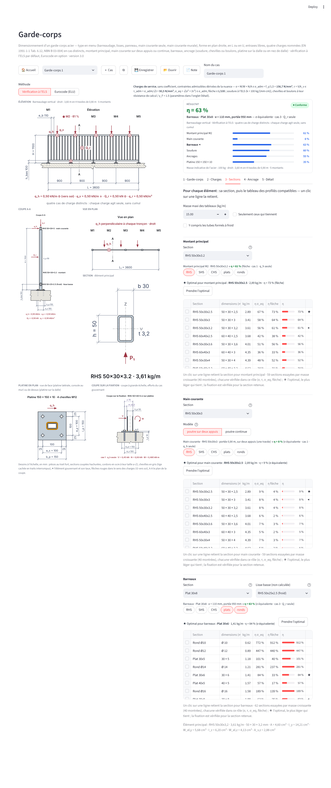
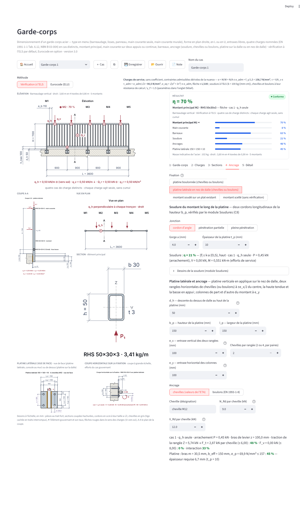
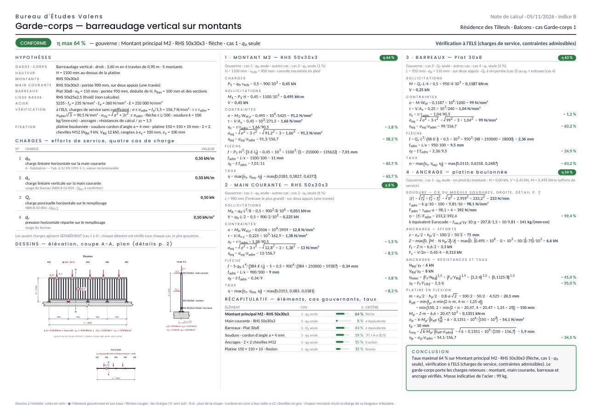
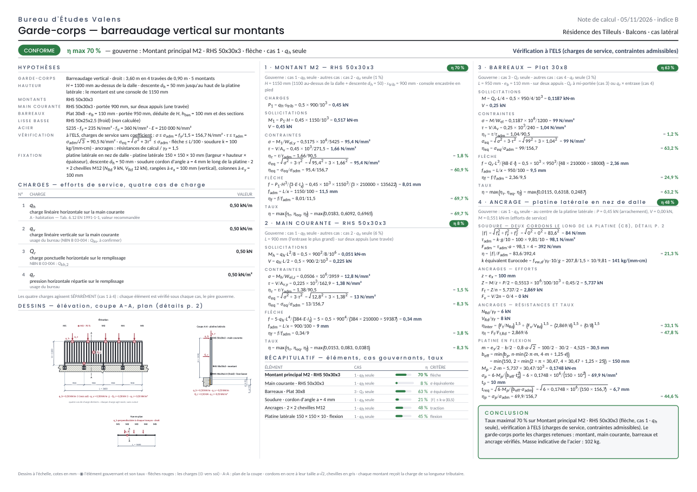
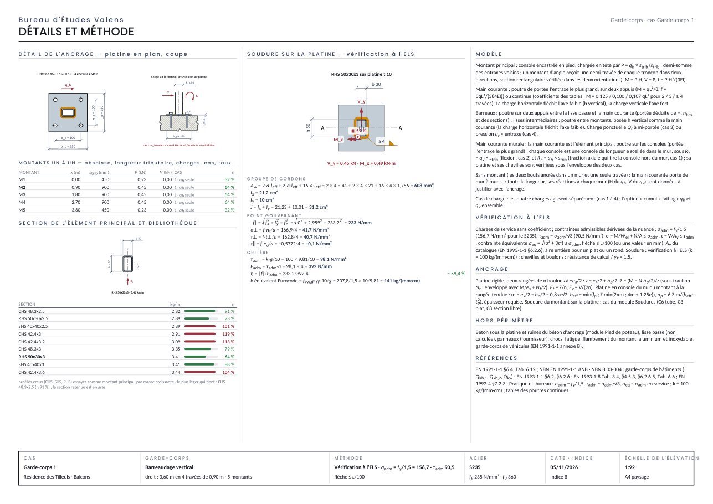

# Garde-corps — document de référence

*Version 3, livrée le 05/11/2026 (version 2 le 05/11/2026, version 1 le 04/11/2026). Page
« Garde-corps » (tuile Autres), moteur `acier/garde_corps/`, étude de conception
`docs/acier/GARDE_CORPS_ETUDE.md`.*

**Ce que la version 3 change.** Trois cas courants de plus, pour couvrir l'essentiel des
garde-corps d'un bureau : la FIXATION LATÉRALE en nez de dalle (platine verticale en applique,
couple d'ancrages, montant vérifié sur H + d_h, soudure par deux cordons longitudinaux), le
garde-corps SANS MONTANT entre deux murs (la main courante porte de mur à mur sur toute la
longueur, ses réactions aux murs sont données) et le garde-corps RAMPANT (escalier : la pente
incline l'élévation, les entraxes se mesurent suivant la pente) ; la catégorie « plateforme
industrielle » (EN ISO 14122-3, 0,3 kN/m à confirmer) ; les panneaux disent « verre, tôle,
câbles ». La NOTE est composée en vraie typographie (symboles indicés, formules par groupe dans
l'ordre de lecture, résultat À LA SUITE du calcul et seuls les taux η calés à droite), elle dit
« vérification à l'ELS » et non plus « méthode du bureau », l'épaisseur de la platine t_p est
imprimée face à l'épaisseur requise, et les chevilles sont au pluriel. La version 2 avait
apporté le menu des types, les quatre charges nommées en cas distincts, la main courante sur
deux appuis ou continue, la portée des barreaux déduite, les tableaux cliquables et les six
vues en dessin technique.

**Version 3.1 — relecture du bureau (05/11/2026).** Les contraintes admissibles sont DÉRIVÉES
de la nuance : σ_adm = f_y/1,5 (156,7 N/mm² pour le S235), τ_adm = σ_adm/√3 (90,5), et la
contrainte équivalente σ_eq = √(σ² + 3τ²) ≤ σ_adm est vérifiée (les constantes 160 et 90 étaient
fausses — P-12 de l'étude). Relecture complète des douze notes avec un RECALCUL INDÉPENDANT
(452 grandeurs, aucun écart) : six défauts corrigés — les lisses intermédiaires étaient prises
sur l'axe fort (P-13), un montant d'angle imprimait le cisaillement d'une direction et le taux
de l'autre, les blocs console et barreaux n'écrivaient ni V ni τ ni la formule de flèche, la
conclusion annonçait « remplissage et ancrage vérifiés » même sans remplissage ni ancrage
vérifié, la ligne des références se tronquait, et des détails de forme (σ_lim nommée σ_adm à
l'ELS, « 0.5 » et « 0.125 » à point décimal, N signé sans dire compression ou traction,
« verre, tôle » sans câbles). L'écran propose l'OPTIMAL à chaque choix de profilé (★ le plus
léger qui tient, son taux, le bouton « Prendre l'optimal », la ligne marquée ★ dans le tableau).

## 1 · Ce qui est livré

| Pièce | Rôle |
|---|---|
| `acier/garde_corps/types.py` | les cinq TYPES du menu ; chacun pose le système (montants verticaux, consoles au mur) et le remplissage (barreaux, lisses, panneau, aucun) |
| `acier/garde_corps/charges.py` | les quatre charges nommées : q_h (Tab. 6.12 par catégorie — dont « plateforme industrielle », EN ISO 14122-3 —, ou valeur libre, ou P direct), q_v, Q_r (NBN B 03-004 Q_kh,2), q_r ; les cas de charge (distincts, ou cumul 1 + 2) ; le tableau des hypothèses avec l'origine de chaque valeur |
| `acier/garde_corps/geometrie.py` | la forme en plan (droit, L, U), les tronçons à entraxes libres (réguliers ou saisis), les extrémités (montant, mur), les MONTANTS avec leur longueur tributaire par direction (angles compris) ; SANS MONTANT quand les deux bouts sont ancrés et qu'il n'y a qu'une travée ; la PENTE d'un rampant |
| `acier/garde_corps/bibliotheque.py` | les sections : 879 creux du catalogue, 56 plats et 8 ronds de stock, sections libres (tube, caisson, plat, rond) par `familles.calculer` ; axe fort = sens de h |
| `acier/garde_corps/membres.py` | la mécanique : console (M = P·H, f = PH³/3EI), poutre sur deux appuis (qL²/8 + QL/4, 5qL⁴/384EI) ou CONTINUE (coefficients des tables 0,125 / 0,100 / 0,107 qL²), vérification σ = M/W + N/A, τ = V/A_v, flèche ; limites ELS et Eurocode |
| `acier/garde_corps/fixation.py` | la soudure sur la platine comme cas du module Soudures (C6 tube, C3 plat, C8 section libre ; C8 à deux cordons longitudinaux pour la platine latérale) ; la platine boulonnée sur la dalle (bras de levier, rangée tendue, boulons EN 1993-1-8 ou chevilles ETA, flexion de la platine, épaisseur requise) ; la PLATINE LATÉRALE en nez de dalle (couple d'ancrages z = e_x, arrachement P, torsion d'un montant d'angle, platine en console du nu du montant à la colonne d'ancrages) |
| `acier/garde_corps/etat.py` | les cas, les défauts (RHS 50x30x3), le JSON (version 3), la vérification complète sous chaque cas de charge (montants un à un — sur H + d_h en latéral —, main courante, barreaux ou lisses, consoles, soudure et platine ; sans montant : la main courante porte de mur à mur et ses réactions sont nommées), les CANDIDATS par rôle et le plus léger qui tient |
| `acier/garde_corps/formules.py` | les formules écrites comme à la main, par BLOC (cas gouvernant, autres cas et leur taux, substitutions testées contre le moteur) : montant, console, main courante (deux appuis ou continue), barreaux, platine ; la soudure reprend celles du module Soudures |
| `acier/garde_corps/methode.py` | les textes de méthode, courts (onglet Détail et page 2 de la note), les références |
| `acier/garde_corps/schemas.py` | les six vues en dessin technique : élévation (inclinée pour un rampant), coupe A-A, vue en plan, platine en plan ou platine latérale vue de face, coupe sur la fixation ou coupe horizontale, section |
| `acier/garde_corps/note.py` | la note PDF en deux pages, les hypothèses en tête, les symboles composés (`ndc_pdf/riche.py`), le résultat à la suite du calcul |
| `modules/garde_corps.py` | l'écran : menu des types, cinq onglets, tableaux cliquables, quatre fixations, pente ; `modules/liaison.py` : la liaison état → widgets partagée |
| `tests/test_garde_corps_moteur.py`, `_formules.py`, `_schemas.py`, `_ecran.py`, `_note.py` | les tests (110 + 62 + 75 + 59 + 71) ; `tools/captures_garde_corps.js` : huit états × quatre largeurs, mesures de ce que l'œil voit, clic sur une ligne de tableau dans un vrai navigateur |

## 2 · Le modèle

**Types.** Barreaudage vertical (défaut), lisses horizontales, remplissage en panneau, main
courante seule sur montants, main courante murale sur consoles. Le type est un préréglage :
il pose le système et le remplissage, tout le reste reste libre.

**Montants.** Le garde-corps est une ligne en plan (droit, L, U) découpée en travées ; les
entraxes sont réguliers (longueur et entraxe maximal) ou saisis un à un. Chaque montant est une
console de hauteur H chargée en tête par P₁ = q_h × s_trib (s_trib = demi-somme des entraxes
voisins) et N = q_v × s_trib ; un montant d'angle reçoit une demi-travée de chaque tronçon,
dans deux directions perpendiculaires, et une section rectangulaire y est vérifiée dans les
deux orientations. Une extrémité ancrée dans un mur n'a pas de montant : le mur reprend la
demi-travée, et la note dit l'effort à justifier avec la cheville.

**Main courante murale.** La main courante est l'élément principal (poutre sur les consoles,
portée l'entraxe le plus grand) ; les consoles, aux mêmes entraxes, sont des consoles de
longueur e sous R_v = q_v·s_trib (flexion, cas 2), R_h = q_h·s_trib (axial, tire la console
hors du mur, cas 1) ; leur platine est tirée (enveloppe des deux modèles).

**Main courante, remplissage.** La main courante est une poutre entre montants fléchie dans
deux plans (q_h horizontal → axe faible, q_v vertical → axe fort), sur deux appuis (défaut :
les lisses sont rarement continues d'un montant à l'autre) ou continue sur n travées
(coefficients des tables). Un barreau est une poutre entre le dessus de la lisse basse (axe à
h_bas) et le dessous de la main courante — sa portée se DÉDUIT de H, de h_bas et des sections ;
une lisse intermédiaire est une poutre entre montants ; chacun sous Q_r à mi-portée (cas 3) OU
q_r × entraxe (cas 4), le pire des deux. Orientation (version 3.1) : un barreau a sa hauteur h
dans le sens de la poussée (plat de champ : W_el = b·h²/6), une lisse intermédiaire est posée
h vertical comme la main courante, la poussée horizontale fléchit donc son AXE FAIBLE (W_el,z,
I_z) — jusqu'à la version 3 elle était prise sur l'axe fort, côté optimiste. Un panneau n'est
pas vérifié (à justifier par le fournisseur), la lisse basse n'est pas calculée.

**Cas de charge.** Les quatre charges agissent SÉPARÉMENT : cas 1 (q_h seule), 2 (q_v seule),
3 (Q_r seule), 4 (q_r seule) ; chaque élément, la soudure et la platine sont vérifiés sous
chaque cas et le pire gouverne — la note nomme le cas gouvernant de chaque élément et les
autres cas avec leur taux. L'option « cumul » fait agir q_h et q_v ensemble (cas 1 + 2, côté
sûr) ; les charges 3 et 4 restent des cas séparés.

**Fixation sur la dalle.** La soudure du montant (ou de la console) sur la platine est un cas
du module Soudures : tube sur platine (C6) pour un tube du catalogue, console fléchie (C3) pour
un plat, cordons libres sur le contour (C8) pour une section libre — avec la jonction choisie
(angle, pénétration partielle, pleine) et la méthode du garde-corps. La platine est rigide,
deux rangées de n chevilles à ±e_x/2 : z = e_x/2 + h_p/2, Z = (M − N·h_p/2)/z, F_t = Z/n,
F_v = V/(2n) ; boulon (Tab. 3.4) ou cheville (N_Rd, V_Rd de l'ETA, interaction (β)^1,5) ;
bande de platine en console du nu du montant à la rangée tendue (m, b_eff, σ_p, t_req) : la
platine, son épaisseur comprise, EST vérifiée (σ_p ≤ σ_lim, t_p face à t_req).

**Fixation latérale en nez de dalle (version 3).** La platine est verticale, en applique sur le
nez de dalle, descendue de d_h sous le dessus de dalle ; le montant est soudé LE LONG d'elle par
deux cordons longitudinaux de la hauteur b_p (cas C8 du module Soudures, torseur transporté au
centre des cordons). Le montant est une console de H + d_h ; au centre de la platine,
M = P·(H + d_h + b_p/2), P ARRACHE la platine (N = −P), N_v = q_v·s_trib la cisaille. Deux
rangées horizontales de n ancrages à ±e_x/2, la haute tendue : z = e_x, Z = M/z + P/2,
F_t = Z/n, F_v = V/(2n) + la torsion M_z·r/Σr² d'un montant d'angle. Platine en console du nu
du montant à la colonne d'ancrages : m = e_y/2 − b/2 − 0,8·a·√2, b_eff sur b_p, σ_p, t_req.
Refus explicites : chevilles par paires (une colonne de chaque côté du montant), colonnes qui
tombent dans le montant, rangées hors de la platine.

**Sans montant (version 3).** Les deux bouts ancrés dans un mur et UNE seule travée : il n'y a
pas de montant, la main courante est l'élément porteur et porte de mur à mur sur toute la
longueur (c'est le cas de la loggia et de la main courante d'escalier scellée aux deux bouts) ;
les barreaux ou lisses restent calculés ; la note nomme les réactions H (du q_h) et V (du q_v)
à justifier à chaque mur, il n'y a rien d'autre à fixer. Avec des montants intermédiaires, la
portée de la main courante est l'entraxe (le mur compte pour un appui) : un garde-corps de 8 m
entre deux murs avec des montants tous les mètres se calcule sur 1 m ; sans montant, sur 8 m —
et un RHS 50x30x3 n'y tient pas (η = 244 % sur 3,60 m).

**Rampant (version 3).** La pente α du garde-corps d'escalier incline l'élévation (les montants
restent verticaux, les entraxes se mesurent suivant la main courante) et se lit dans les
hypothèses ; elle ne change pas les formules — q_h reste horizontale et perpendiculaire au
garde-corps, q_v verticale, les longueurs tributaires suivent la pente.

## 3 · Les deux méthodes et le switch

| | Vérification à l'ELS — défaut | Eurocode (ELU) |
|---|---|---|
| Charges | de service, sans coefficient | × γ_Q = 1,5 (flèche : service) |
| σ | M/W_el + N/A ≤ σ_adm = f_y/γ_adm, γ_adm = 1,5 (156,7 N/mm² pour le S235) | ≤ f_y/γ_M0 (élastique, W_el) |
| τ | V/A_v ≤ τ_adm = σ_adm/√3 (90,5 N/mm²) | ≤ f_y/(√3·γ_M0) |
| σ_eq | √(σ² + 3τ²) ≤ σ_adm | ≤ f_y/γ_M0 (EN 1993-1-1 §6.2.1(5)) |
| Flèche | ≤ L/100 (ou mm) | ≤ L/100 (ou mm) |
| Soudure | vérification à l'ELS, |f| ≤ k·a avec k = 100 kg/(mm·cm) | directionnelle EN 1993-1-8, γ_M2 = 1,25 |
| Boulons, chevilles | résistances de calcul / γ_F = 1,5 | résistances de calcul |

Les deux se nomment « Vérification à l'ELS » et « Eurocode (ELU) » partout — écran, note,
hypothèses — ; la note ne parle plus de « méthode du bureau » (version 3). **Les contraintes
admissibles sont DÉRIVÉES de la nuance** depuis la version 3.1 (règle du bureau, 05/11/2026) :
σ_adm = f_y/1,5, τ_adm = σ_adm/√3, et la contrainte équivalente σ_eq = √(σ² + 3τ²) a la limite
de σ — les anciennes constantes 160 et 90 N/mm² étaient fausses ; γ_adm est modifiable dans les
paramètres de la méthode. Dans la note, σ_adm et τ_adm sont écrites une fois dans les
hypothèses ; chaque bloc écrit σ, τ et son taux, σ_eq et son taux, et η = max(η_τ, η_eq, η_f)
(σ_eq ≥ σ avec la même limite : le taux de σ seule n'est plus imprimé).

Le cas par défaut (barreaudage, RHS 50x30x3, H = 1,10 m, 0,45 kN en tête du montant M2)
donne 64 % (flèche 7,0 mm pour 11 admissibles, cas 1) en ELS ; les barreaux Plat 30x8 sont à
63 % (cas 3, Q_r, σ_eq), la soudure à 59 %, les chevilles à 55 %, la platine à 35 %. Le même
garde-corps en fixation latérale (d_h = 50, platine 150 × 150 × 10) donne 70 % (le montant
est une console de 1150 mm), la soudure 21 %, les chevilles 48 %, la platine 45 %.

## 4 · Les charges

| N° | Charge | Valeur par défaut | Origine |
|---|---|---|---|
| 1 | q_h — charge linéaire horizontale sur la main courante, à la hauteur H | 0,5 kN/m (catégorie A) | EN 1991-1-1 §6.4, Tab. 6.12 (NBN B 03-004 : Q_kh,1) |
| 2 | q_v — charge linéaire verticale sur la main courante | 0,5 kN/m | usage du bureau (NBN B 03-004 : Q_kv, à confirmer) |
| 3 | Q_r — charge ponctuelle horizontale sur le remplissage | 0,5 kN | NBN B 03-004 : Q_kh,2 |
| 4 | q_r — pression horizontale répartie sur le remplissage | 0,5 kN/m² | usage du bureau |

Catégories du Tableau 6.12 (valeurs RECOMMANDÉES de l'EN : A, B, C1 0,5 ; C2–C4, D 1,0 ;
C5 3,0 ; E 2,0 kN/m, ou valeur libre) : l'annexe belge peut en fixer d'autres (point P-1 de
l'étude) ; la note imprime la valeur retenue et son origine. Depuis la version 3, la
catégorie « plateforme industrielle (machines) » propose 0,3 kN/m d'après l'EN ISO 14122-3,
marquée « à confirmer sur l'édition en vigueur » dans l'origine. En option : P directe par
montant (la main courante reçoit alors P/s), Q ponctuelle sur la main courante.

## 5 · Les schémas

Six vues à l'échelle, en style dessin technique, les mêmes à l'écran et dans la note :
ÉLÉVATION (dalle hachurée, montants à leurs entraxes, main courante, lisse basse, barreaux
centrés par travée à leur entraxe — ou lisses, ou panneaux —, platines et chevilles, murs
d'extrémité, angles d'un L ou d'un U, q_h ⊙, q_v ↓, Q_r ⊙, ◉ le montant gouvernant et son
taux, chaîne des entraxes, L, H, h_bas, e_b, le repère A-A) ; COUPE A-A (le garde-corps vu de
bout dans une travée : dalle, platine et chevilles, montant vu de côté, main courante et lisse
basse coupées avec leur contour du catalogue hachuré, q_h, q_v, Q_r, H, h_bas, b_p, e_x) ; VUE
EN PLAN (droit / L / U, main courante en bande, montants orientés, charges perpendiculaires,
L₁ L₂ L₃, repère A-A) ; PLATINE EN PLAN (section du montant avec sa bande de cordon, trous des
chevilles et leurs axes, e_x, e_y, b_p, l_p, chaînes des bords) ; COUPE SUR LA FIXATION (montant
et platine coupés, cordons à a·√2, chevilles dans le béton ou boulons dans l'acier, bras m et
z, V N M du cas gouvernant) ; SECTION (contour, axes y et z, h × b ou Ø, t). Au mur : les mêmes
vues avec la console et la platine verticale.

Version 3 : en fixation LATÉRALE, l'élévation montre les platines sur le nez de dalle (de d_h à
d_h + b_p sous le dessus) avec leurs chevilles vues de face, et la coupe A-A la platine contre le
nez ; les deux vues de détail deviennent PLATINE LATÉRALE VUE DE FACE (platine, montant qui la
traverse, bande des deux cordons, trous à ±e_x/2 et ±e_y/2, z = e_x, m, P ⊙) et COUPE
HORIZONTALE SUR LA FIXATION (dalle à gauche, platine, chevilles horizontales, section du montant
h vers le vide, cordons coupés, P d'arrachement, V ⊗ s'il existe, M). SANS MONTANT : quatre
vues (élévation entre deux murs, coupe, plan, section de la main courante avec q_h). RAMPANT :
l'élévation est inclinée de la pente, les montants restent verticaux, la chaîne des entraxes
suit la main courante.

## 6 · L'écran

Barre d'outils du cas, switch de méthode (« Vérification à l'ELS » par défaut), les six dessins
à gauche, la carte RÉSULTAT (statut, η, élément gouvernant avec son critère et son cas, une
barre par élément, masse indicative) et cinq onglets à droite :

1. **Garde-corps** — le TYPE en menu déroulant, la forme en plan, H (au-dessus de la dalle), la
   PENTE du rampant, les tronçons (longueur, entraxe maxi, entraxes saisis), les extrémités
   (les deux bouts ancrés et une seule travée : « Sans montant », l'écran le dit), le
   remplissage du type (e_b et h_bas, ou le nombre et l'entraxe des lisses) avec la portée
   déduite, le tableau des montants ;
2. **Charges** — les quatre charges numérotées avec leur nom et leur origine, la catégorie
   d'usage, la case « cumuler q_h et q_v », les options (P direct, Q) ;
3. **Sections** — pour chaque élément du cas (montant, main courante avec son modèle sur deux
   appuis ou continue, barreaux avec la lisse basse, ou lisses, ou console) : la section, son
   taux et son cas, puis le TABLEAU des profilés compatibles (familles cochées — RHS par défaut
   pour le montant et la main courante, plats et ronds pour les barreaux —, η σ, η flèche, η en
   barre, la section retenue marquée ◀, l'OPTIMAL marqué ★) : un CLIC sur une ligne retient la
   section ; au-dessus du tableau, la ligne « ★ Optimal pour … : section · kg/m · η » nomme le
   plus léger qui tient parmi les familles cochées, et le bouton « Prendre l'optimal » le
   retient (version 3.1 — à chaque choix de profilé) ;
4. **Ancrage** — QUATRE fixations (platine boulonnée sur la dalle, platine latérale en nez de
   dalle, soudé sur un plat existant, scellé), console au mur, soudure (jonction, gorge, t_p,
   η et dessins du module Soudures), platine (b_p, l_p, e_x, n, e_y ; en latéral : d_h, b_p
   hauteur, l_p largeur, e_x vertical, e_y horizontal, chevilles par paires), chevilles ou
   boulons, les résultats (Z, F_t, F_v, interaction, m, σ_p, t_req face à t_p, arrachement P en
   latéral) ; sans montant, l'onglet dit qu'il n'y a rien à fixer ;
5. **Détail** — tableaux des éléments (avec leur cas) et des montants, les formules par bloc,
   les paramètres de la méthode, l'identification de la note, la méthode et les sources.

 

Version 3 — la fixation latérale sur PC (onglet Ancrage : d_h, b_p, l_p, e_x, e_y, arrachement
P, les deux vues de détail) et le garde-corps sans montant au téléphone (« Non conforme » : un
RHS 50x30x3 ne porte pas 3,60 m de mur à mur, η = 244 % en flèche) :

 

## 7 · La note

Version 3 (05/11/2026) : la note est composée pour être LUE — les symboles en vraie
typographie (`ndc_pdf/riche.py` : q_h, W_el,y, σ_adm, s_trib avec leurs indices, jusque dans
les hypothèses, les tableaux et la prose de méthode), les formules par groupe et peu de prose ;
le résultat de chaque formule vient À LA SUITE du calcul (« M₁ = P₁·H = 0,45 × 1100/10³ =
0,495 kN·m ») et seuls les taux η sont calés à droite de la colonne, en couleur.

Page 1 · CALCUL, les hypothèses d'abord : bandeau (statut, η, élément gouvernant, critère, cas
de charge, « Vérification à l'ELS (charges de service, contraintes admissibles) ») ; HYPOTHÈSES
en lignes « libellé · valeur » (garde-corps, hauteur — avec la descente d_h et la console de
H + d_h en latéral —, montants — « aucun : la main courante porte de mur à mur » sans
montant —, main courante, barreaux, lisse basse, acier, VÉRIFICATION et ses limites, fixation) ;
les QUATRE CHARGES, une à une — le symbole et la valeur sur la première ligne, le nom dessous,
l'origine en gris — et la règle des cas distincts ; les dessins (élévation et coupe A-A côte à
côte, vue en plan). Puis 1 · MONTANT, 2 · MAIN COURANTE, le RÉCAPITULATIF (barres de taux),
3 · BARREAUX, 4 · ANCRAGE, la CONCLUSION : chaque élément porte sa pastille η, son cas
gouvernant et les autres cas avec leur taux, une ligne de données (H, s_trib, L, appuis), puis
ses formules développées par GROUPE dans l'ordre de lecture — charges → sollicitations →
contraintes (chaque taux sous sa contrainte, avec la limite) → flèche → taux. L'ancrage enchaîne
soudure (résultante et critère du module Soudures), ancrages — efforts, ancrages — résistances
et taux, platine en flexion (σ_p, puis t_p face à t_req). En latéral : « ANCRAGE — platine
latérale en nez de dalle », P (arrachement), z = e_x, Z = M/z + P/2, m = e_y/2 − b/2 − 0,8·a·√2.
Sans montant : « 1 · MAIN COURANTE » porteuse sur L de mur à mur, puis « ANCRAGE — main
courante ancrée dans les murs » avec H et V de chaque mur.
Page 2 · DÉTAILS ET MÉTHODE : platine en plan et coupe sur la fixation (ou vue de face et coupe
horizontale), les montants un à un avec leur cas, la section et la bibliothèque, la soudure
(vue et formules par groupe ; les deux cordons C8 par leurs formules), la méthode choisie —
avec la section « Ancrage latéral » quand la fixation l'est —, les références, le cartouche avec
l'échelle de l'élévation.

## 8 · Les preuves

- `tests/test_garde_corps_moteur.py` (110) : types, charges nommées et cas, géométrie (entraxes
  saisis, angles, mur, sans montant, pente), mécanique (console, poutre sur deux appuis et
  continue, limites), bibliothèque, vérification complète sous chaque cas, fixation sur la dalle
  et latérale (couple z = e_x, arrachement, torsion d'un angle, refus par paires, H + d_h), la
  catégorie industrielle, candidats par rôle, JSON version 3, les limites dérivées de la nuance et
  σ_eq, les lisses intermédiaires sur l'axe faible, les efforts d'ancrage nommés ;
- `tests/test_garde_corps_formules.py` (62) : plus de 300 substitutions ré-évaluées sur seize
  cas (dont latéral, latéral en L à boulons, sans montant), les blocs nomment leur cas
  gouvernant et les autres, les groupes dans l'ordre de lecture, chaque taux reprend le nombre
  imprimé, chaque morceau se compose, chaque bloc écrit V, τ, σ_eq et sa flèche (console et barreaux
  compris), le montant d'angle nomme V₁, V₂ et la direction de τ ;
- `tests/test_garde_corps_schemas.py` (75) : les six vues et leur contenu à l'échelle, la vue
  de face et la coupe horizontale de la platine latérale (trous, bandes, z, m, P, V seulement
  s'il existe), les quatre vues sans montant, l'élévation inclinée du rampant, le peintre, la
  pureté ;
- `tests/test_garde_corps_ecran.py` (59) : navigation, écran, le menu des types, source unique,
  switch (« Vérification à l'ELS »), tableaux cliquables (colonnes, familles par défaut, section
  retenue ◀, génération de la clé après un changement), la fixation latérale (champs, vues,
  méthode « Ancrage latéral »), la pente, le garde-corps sans montant, la catégorie
  industrielle, cas multiples, note, étanchéité ;
- `tests/test_garde_corps_note.py` (71) : deux pages sans débordement sur douze cas, les
  hypothèses d'abord (« Vérification » et non « Méthode »), les symboles composés (aucun
  « q_h » brut hors les cotes des dessins), le calcul 1 à 4 dans l'ordre de lecture avec le
  résultat à la suite et les η seuls à droite (mesuré sur les mots du PDF), les dessins peints,
  la page 2 et ses sections de méthode, les variantes — latérale, sans montant (titre « de mur
  à mur », réactions des murs), rampant industriel ; les conclusions construites sur les éléments
  réellement vérifiés, les limites 156,7 / 90,5, les références en section ;
- `tools/captures_garde_corps.js` : huit états × quatre largeurs (défaut, lisses, murale,
  biblio, nok, latérale, loggia, rampant), mesures de ce que l'œil voit, dont le CLIC sur une
  ligne de tableau dans un vrai navigateur (le sélecteur affiche la section cliquée).

## 9 · Couverture : ce que l'outil calcule, ce qu'il ne calcule pas

**Calculé** : tout garde-corps droit, en L ou en U, à entraxes libres, horizontal ou RAMPANT,
des cinq types, sur montants verticaux (tubes, plats, ronds, sections libres) encastrés sur
platine SUR LA DALLE (soudée, boulonnée par chevilles ou boulons, ou scellée sans
vérification), sur platine LATÉRALE en nez de dalle, ou sur un plat existant ; SANS MONTANT
entre deux murs (la main courante porte) ; la main courante murale sur consoles ; main courante
sur deux appuis ou continue, barreaux (portée déduite), lisses intermédiaires ; les quatre
charges en cas distincts ou q_h + q_v cumulées, pour les catégories d'usage de l'EN 1991-1-1
et les plateformes industrielles. C'est l'essentiel des garde-corps qu'un bureau rencontre :
balcons, terrasses, loggias, escaliers, mezzanines, plateformes d'accès ; le reste (ci-dessous)
se traite avec un autre module ou n'a pas vocation à l'être ici.

**Non calculé** : béton sous la platine et modes de ruine du béton d'ancrage (module Pied de
poteau ; les chevilles sont prises à leur N_Rd, V_Rd de l'ETA), lisse basse, panneaux (verre,
tôle, câbles : résistance par le fournisseur, l'ossature est calculée), chocs et fatigue,
flambement du montant, aluminium et inoxydable, garde-corps de véhicules (EN 1991-1-1
annexe B), montants inclinés ou fixés sous la dalle (en applique sous le plancher), garde-corps
autoportants (lest), fixation sur maçonnerie (prendre la cheville adaptée et ses valeurs).
