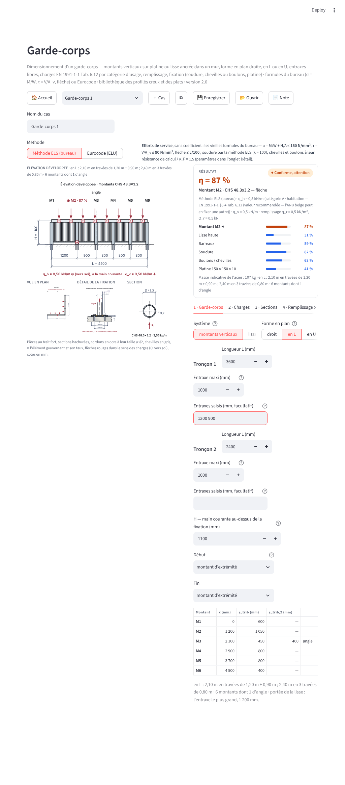
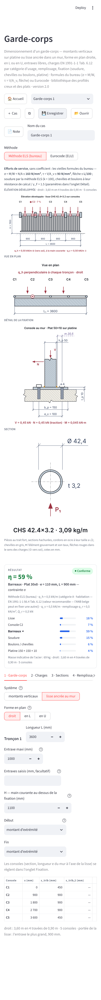

# Garde-corps — document de référence

*Livré le 04/11/2026. Page « Garde-corps » (tuile Autres), moteur `acier/garde_corps/`,
étude de conception `docs/acier/GARDE_CORPS_ETUDE.md`. Remplace l'ancien module (vieilles
formules sans bibliothèque, sans fixation, sans note).*

## 1 · Ce qui est livré

| Pièce | Rôle |
|---|---|
| `acier/garde_corps/charges.py` | les charges : catégories d'usage du Tableau 6.12 de l'EN 1991-1-1 (valeurs recommandées, valeur libre), P direct par montant, q_v, Q, remplissage q_r et Q_r ; leur origine imprimable |
| `acier/garde_corps/geometrie.py` | la forme en plan (droit, L, U), les tronçons à entraxes libres (réguliers ou saisis), les extrémités (montant, mur), les MONTANTS avec leur longueur tributaire par direction (angles compris) |
| `acier/garde_corps/bibliotheque.py` | les sections : 879 creux du catalogue, 56 plats et 8 ronds de stock, sections libres (tube, caisson, plat, rond) par `familles.calculer` ; axe fort = sens de h |
| `acier/garde_corps/membres.py` | la mécanique : console (M = P·H, f = PH³/3EI), poutre (qL²/8 + QL/4, 5qL⁴/384EI), vérification σ = M/W + N/A, τ = V/A_v, flèche ; limites ELS (σ_adm, τ_adm) et Eurocode (γ_Q, f_y/γ_M0) |
| `acier/garde_corps/fixation.py` | la soudure sur la platine comme cas du module Soudures (C6 tube, C3 plat, C8 section libre) ; la platine boulonnée (bras de levier, rangée tendue, boulons EN 1993-1-8 ou chevilles ETA, flexion de la platine, épaisseur requise) |
| `acier/garde_corps/etat.py` | les cas, les défauts, le JSON, la vérification complète (montants un à un, lisse, remplissage, consoles, fixation, éléments, gouvernant, masse), les candidats et le plus léger qui tient |
| `acier/garde_corps/formules.py` | les formules écrites comme à la main (substitutions testées contre le moteur) : montant, console, lisse, remplissage, platine ; la soudure reprend celles du module Soudures |
| `acier/garde_corps/methode.py` | les textes de méthode (onglet Détail et page 2 de la note), les références |
| `acier/garde_corps/schemas.py` | les quatre vues sur le kit des assemblages : élévation développée, plan, détail de la fixation, section |
| `acier/garde_corps/note.py` | la note PDF en deux pages |
| `modules/garde_corps.py` | l'écran (réécrit) ; `modules/liaison.py` : la liaison état → widgets partagée |
| `tests/test_garde_corps_moteur.py`, `_formules.py`, `_schemas.py`, `_ecran.py`, `_note.py` | les tests (68 + 29 + 34 + 39 + 39) ; `tools/captures_garde_corps.js` : captures et mesures aux trois formats |

## 2 · Le modèle

**Montants.** Le garde-corps est une ligne en plan (droit, L, U) découpée en travées ; les
entraxes sont réguliers (longueur et entraxe maximal) ou saisis un à un. Chaque montant est une
console de hauteur H chargée en tête par P = q_h × s_trib (s_trib = demi-somme des entraxes
voisins) et N = q_v × s_trib ; un montant d'angle reçoit une demi-travée de chaque tronçon,
dans deux directions perpendiculaires, et une section rectangulaire y est vérifiée dans les
deux orientations. Une extrémité ancrée dans un mur n'a pas de montant : le mur reprend la
demi-travée, et la note dit l'effort à justifier avec la cheville.

**Lisse ancrée dans un mur.** La lisse est l'élément principal (poutre sur les consoles, portée
l'entraxe le plus grand) ; les consoles, aux mêmes entraxes, sont des consoles de longueur e
sous R_v = q_v·s_trib (flexion), R_h = q_h·s_trib (axial, tire la console hors du mur) ; leur
platine est tirée (enveloppe des deux modèles : appui au nu, couple de boulons).

**Lisse haute, remplissage.** La lisse haute est une poutre entre montants fléchie dans deux
plans (q_h + Q horizontal → axe faible, q_v vertical → axe fort). Un barreau est une poutre
entre la lisse basse et la lisse haute, une lisse intermédiaire une poutre entre montants ;
chacun sous q_r × entraxe OU Q_r à mi-portée, le pire des deux cas. Un panneau n'est pas
vérifié (message : à justifier par le fournisseur).

**Fixation.** La soudure du montant (ou de la console) sur la platine est un cas du module
Soudures : tube sur platine (C6) pour un tube du catalogue, console fléchie (C3) pour un plat,
cordons libres sur le contour (C8) pour une section libre — avec la jonction choisie (angle,
pénétration partielle, pleine) et la méthode du garde-corps. La platine est rigide, deux
rangées de n boulons à ±e_x/2 : z = e_x/2 + h_p/2, Z = (M − N·h_p/2)/z, F_t = Z/n,
F_v = V/(2n) ; boulon (Tab. 3.4) ou cheville (N_Rd, V_Rd de l'ETA, interaction (β)^1,5) ;
bande de platine en console du nu du montant à la rangée tendue (m, b_eff, σ_p, t_req).

## 3 · Les deux méthodes et le switch

| | Méthode ELS (bureau) — défaut | Eurocode (ELU) |
|---|---|---|
| Charges | de service, sans coefficient | × γ_Q = 1,5 (flèche : service) |
| σ | M/W_el + N/A ≤ σ_adm (160 N/mm²) | ≤ f_y/γ_M0 (élastique, W_el) |
| τ | V/A_v ≤ τ_adm (90 N/mm²) | ≤ f_y/(√3·γ_M0) |
| Flèche | ≤ L/100 (ou mm) | ≤ L/100 (ou mm) |
| Soudure | méthode ELS du bureau, k = 100 kg/(mm·cm) | directionnelle EN 1993-1-8, γ_M2 = 1,25 |
| Boulons, chevilles | résistances de calcul / γ_F = 1,5 | résistances de calcul |

Le cas par défaut (CHS 48,3 × 3,2, H = 1,10 m, 0,45 kN en tête) donne 75 % (flèche 8,2 mm
pour 11 admissibles) en ELS ; en Eurocode la flèche reste la même et σ = 1,5 × 104/235 = 66 %.

## 4 · Les charges

| Catégorie (EN 1991-1-1 Tab. 6.12) | q_h recommandé | plage |
|---|---|---|
| A habitation ; B bureaux ; C1 réunion avec tables | 0,5 kN/m | 0,2 à 1,0 |
| C2 à C4 ; D commerces | 1,0 kN/m | 0,8 à 1,0 |
| C5 foules | 3,0 kN/m | 3,0 à 5,0 |
| E stockage | 2,0 kN/m | 0,8 à 2,0 |
| valeur libre | saisie | — |

Ce sont les valeurs RECOMMANDÉES de l'EN : l'annexe belge peut en fixer d'autres (non lue
depuis la session, point P-1 de l'étude) ; la note imprime la valeur retenue et son origine.
Défauts du bureau : q_v = 0,5 kN/m, q_r = 0,5 kN/m² ; Q_r = 0,5 kN (NBN B 03-004, Q_kh,2).
Le mode « P direct » donne la charge ponctuelle par montant ; la lisse reçoit alors P/s.

## 5 · Les schémas

Élévation développée (montants, lisse, barreaux, platines, chaîne des entraxes sur une rangée,
H, L, « ◉ M2 · 75 % », murs d'extrémité, angles), vue en plan (droit / L / U, charges
perpendiculaires, L₁ L₂ L₃), détail de la fixation (montant coupé, platine, cordons à a·√2,
chevilles dans le béton ou boulons dans l'acier, b_p, e_x, t_p, h_p, m, a, V N M), section
(contour du catalogue, hachures de la paroi, Ø ou h × b, t, P₁).

## 6 · L'écran

Barre d'outils du cas, switch de méthode, dessins à gauche, carte RÉSULTAT (statut, η,
élément gouvernant, une barre par élément, masse indicative) et six onglets à droite :
Garde-corps, Charges, Sections (avec la bibliothèque : familles, masse maxi, « seulement ceux
qui tiennent », « Prendre le plus léger qui tient »), Remplissage, Fixation (avec les dessins
de la soudure), Détail (tableaux, formules, paramètres, identification, méthode).

 

## 7 · La note

Page 1 : bandeau (statut, η, gouvernant, méthode, géométrie, charges et origines, méthode),
dessins et hypothèses, tableaux des charges / montants / éléments, vérification du montant
comme à la main, fixation, conclusion. Page 2 : méthode (la méthode choisie seulement), détail
de la lisse et du remplissage, bibliothèque, soudure (vue et formules du module Soudures),
section, références, cartouche.

## 8 · Les preuves

- `tests/test_garde_corps_moteur.py` (68) : géométrie (entraxes saisis 1200 + 900 → 600 /
  1050 / 450, angle d'un L et d'un U, extrémité au mur), charges, mécanique (M = P·H, qL²/8 +
  QL/4, flèches, limites ELS / Eurocode), bibliothèque (nombres du catalogue, plat b·h²/6,
  section libre = catalogue), vérification complète, fixation (C6 / C3 / C8 et leurs efforts,
  Z, F_t, boulon M12 8.8, cheville, flexion de la platine, refus, mur, scellé), candidats, JSON ;
- `tests/test_garde_corps_formules.py` (29) : 300 substitutions ré-évaluées sur dix cas ;
- `tests/test_garde_corps_schemas.py` (34) : les quatre vues, leur contenu, le peintre, la pureté ;
- `tests/test_garde_corps_ecran.py` (39) : navigation, écran, source unique, switch, bibliothèque
  (le sélecteur AFFICHE la section retenue), cas multiples, note, étanchéité ;
- `tests/test_garde_corps_note.py` (39) : deux pages sans débordement sur huit cas, contenu,
  dessins peints, page 2, variantes ;
- `tools/captures_garde_corps.js` : cinq états × trois largeurs, mesures de ce que l'œil voit.

## 9 · Couverture : ce que l'outil calcule, ce qu'il ne calcule pas

**Calculé** : tout garde-corps droit, en L ou en U, à entraxes libres, sur montants verticaux
(tubes, plats, ronds, sections libres) encastrés sur platine (soudée, boulonnée par chevilles
ou boulons, ou scellée sans vérification) ou sur un plat existant ; toute lisse horizontale
ancrée dans un mur par des consoles ; lisse haute, barreaux, lisses intermédiaires ; les charges
du Tableau 6.12 ou libres, la charge verticale, la charge ponctuelle, le remplissage.

**Non calculé (V1)** : béton sous la platine et modes de ruine du béton d'ancrage (module
Pied de poteau), lisse basse, panneaux (verre, tôle), chocs et fatigue, flambement du montant,
aluminium et inoxydable, garde-corps de véhicules (EN 1991-1-1 annexe B), lisse continue
(prise appuyée, côté sûr), fixation latérale en nez de dalle (prendre H jusqu'à la fixation).
