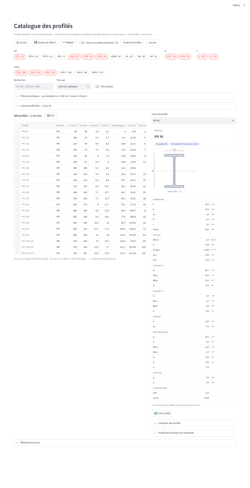
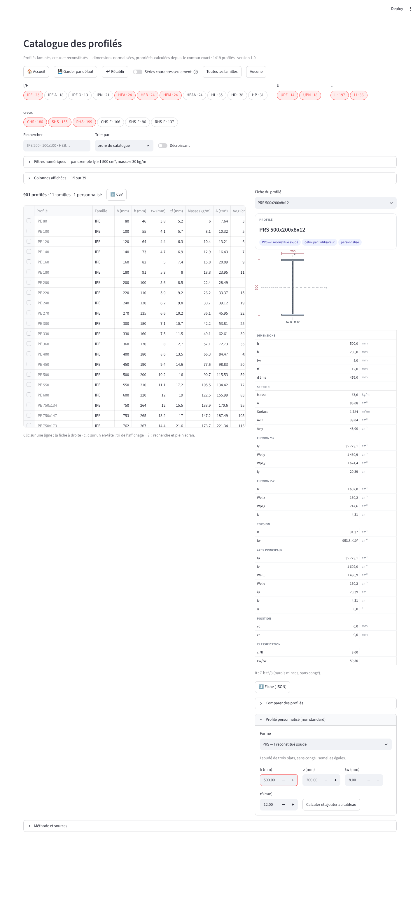

# Catalogue des profilés métalliques — document de référence

*Livré le 04/11/2026. Page « Catalogue profilés » (tuile Acier), source unique
`acier/donnees/profiles.json`, moteur `acier/profiles/`.*

## 1 · Ce qui est livré

| Pièce | Rôle |
|---|---|
| `acier/donnees/profiles.json` | **la source unique** : 1 419 profilés en 21 familles, dimensions nominales et toutes les propriétés calculées, méta (date, sources, méthodes) |
| `acier/profiles/geometrie.py` | le moteur de sections : contours exacts, intégration de Green, modules plastiques, aires de cisaillement EC3, torsion de Saint-Venant, gauchissement de Vlasov |
| `acier/profiles/familles.py` | le registre des familles (dimensions, norme, forme, série courante ou non) et `calculer(famille, dims)` |
| `acier/profiles/catalogue.py` | chargeur, colonnes nommées, filtres, tri, préférences enregistrées, forme ancienne pour les consommateurs d'avant |
| `acier/profiles/dessin.py` | le dessin SVG d'une section (contour du calcul, axes, cotes) |
| `modules/tableau_profiles.py` | la page |
| `tools/transcrire_profiles.py` | la transcription (hors production) : lit les dimensions, calcule, contrôle, écrit le fichier et la mesure datée |
| `docs/validation/profiles_transcription_2026-11-04.md` | la MESURE : contrôle croisé contre trois sources publiées, lecture de chaque dépassement |

Familles : IPE, IPE A, IPE O, IPN, HE A, HE B, HE M, HE AA, HL, HD, HP, UPE, UPN,
cornières égales (L) et inégales (LI), tubes ronds / carrés / rectangulaires finis à
chaud (EN 10210) et formés à froid (EN 10219). Profilés **non standard** saisis à
l'écran : PRS (I soudé), caisson, tube rond, plat, rond plein — calculés par le même
moteur, ajoutés au tableau, comparables.

## 2 · D'où viennent les nombres (R2, « aucun nombre de mémoire »)

**Les dimensions** sont des faits normatifs (EN 10365:2017, EN 10056-1:2017, DIN 1025-1,
DIN 1026-1, EN 10210-2, EN 10219-2) relevés dans des paquets publiés, lus comme des
DONNÉES par la transcription (aucun code étranger exécuté) :

- structuralcodes 0.7.3 (fib International, Apache-2.0) : IPE, HE A/B/M, IPN, UPN, UPE, HD, HP, L, LI ;
- steelsnakes 0.0.1a11 (GPL-2.0 — seules les dimensions nominales sont reprises, aucune
  propriété de ce paquet n'est livrée) : HE AA, HL, IPE A, IPE O, IPE 750, cornières
  complémentaires hors liste EN 10056-1 (gamme étendue du lamineur, hors « séries courantes ») ;
  gammes Blue Book EN 10210 / EN 10219 des creux ;
- eurocodepy 2027.0.12 (LGPL-3 — listes de tailles seulement) : CHS, SHS, RHS EN 10210.

**Toutes les propriétés sont calculées** depuis ces dimensions, par le moteur :

- A, centre de gravité, I_y, I_z, I_yz, axes principaux (α, I_u, I_v) : formule de Green sur
  le contour fermé, congés et arrondis discrétisés (36 segments par arc) ; U et IPN avec leurs
  semelles coniques (8 % / 14 %), cornières avec congé au talon et arrondis aux bouts ;
- W_el : minimal des deux fibres ; W_pl : axe d'aires égales par bissection ;
- A_v,z, A_v,y : EN 1993-1-1 §6.2.6(3), sans le plancher η·h_w·t_w ;
- I_t : **Saint-Venant** sur le contour exact (fonction de Prandtl, différences finies au
  schéma de Shortley-Weller, pas = épaisseur minimale / 20, erreur ≈ +0,1 %, mesurée
  contre la série exacte du rectangle et le cercle) pour les laminés ; EN 10210-2 annexe B
  (Bredt) pour les creux ; Σ b·t³/3 pour les reconstitués ;
- I_w : I_z·(h − t_f)²/4 pour les I/H (forme des catalogues), Vlasov sur la ligne moyenne —
  à épaisseur variable pour les UPN — pour les U ; non défini pour les cornières ;
- masse : A × 7 850 kg/m³ ; surface : périmètre extérieur ; c/t de classification.

**Conventions retrouvées sur les aires publiées** (la mesure le prouve) : IPN, t_f à b/4 de
l'axe ; UPN 50–300, t_f à b/2 du bout d'aile ; UPN 320–400, t_f au milieu de la partie inclinée.

## 3 · Le contrôle croisé (la mesure datée)

306 comparaisons famille × propriété × source contre les valeurs publiées de steelsnakes
(ArcelorMittal, Blue Book), eurocodepy et steel-sections. Dix-sept dépassements de
tolérance, chacun lu et écrit dans le rapport ; aucun ne corrige une valeur à la main (RV2) :

- **arrondis de la source** (W_el,z publié à l'unité : « 4 » pour 3,69 ; i_y à une décimale) ;
- **erreurs de la source** (L 200 × 200 × 16 : I_y publié 2 430, calcul à la main 2 342 —
  chiffres inversés ; L 110 × 110 × 14 : masse publiée incohérente avec l'aire publiée ;
  HL 1100 : rayon 30 incompatible avec la masse publiée, **corrigé à 20 et dit dans la fiche**) ;
- **méthodes différentes, la nôtre retenue** : I_t des HE AA et HD légers (la formule
  empirique des catalogues surestime le terme de congé de 8 à 10 % pour r/t_f ≈ 2,5 ;
  la solution exacte est sécuritaire pour le déversement) ; W_pl,z des grands UPE (axe
  d'aires égales dans l'âme, calcul à la main 220 cm³ pour UPE 400 contre 191 publié) ;
  A_v,z des creux (eurocodepy n'emploie pas A·h/(b + h) de la norme).

Deux contrôles indépendants dans les tests : les 90 profilés du corrigé de référence des
assemblages (`acier/donnees/bibliotheques.json`, transcrit d'un moteur JS indépendant)
ont les **mêmes dimensions** que le catalogue sur tous les profilés communs (≥ 80) ; les
48 profilés que l'application portait avant (`tests/ref_profiles_legacy.json`) sont
retrouvés à 1 % près.

## 4 · La page

Une vue, trois formats (R1) : barre d'outils (🏠 Accueil, 💾 Garder par défaut, ↩ Rétablir,
« Séries courantes seulement », Toutes les familles / Aucune) ; pastilles de familles par
groupe (I/H, U, L, creux) avec le nombre de profilés ; recherche (« ipe200 », « 100x100 »)
; tri par n'importe quelle propriété ; trois filtres numériques (propriété, min, max —
« I_y ≥ 1 500 cm⁴, masse ≤ 30 kg/m ») ; colonnes au choix par groupe (39 propriétés :
dimensions, section, flexion y, flexion z, torsion, axes principaux, position,
classification), les colonnes vides pour les familles affichées se masquent ; le
tableau (clic sur une ligne → fiche, clic sur un en-tête → tri, recherche et plein écran
du tableau, export CSV) ; la fiche (dessin SVG à l'échelle avec axes et cotes, toutes les
propriétés avec unités et définitions au survol, méthode de I_t, export JSON) ;
comparaison de deux à cinq profilés ; profilé personnalisé ; « Méthode et sources ».

*Tablette : `images/catalogue_tablette.png` ; téléphone : `images/catalogue_telephone.png`
(captures du 04/11/2026, `tools/captures_profiles.js`).*

**Préférences.** « Garder par défaut » écrit `acier/donnees/preferences_profiles.json`
(familles, colonnes, tri, courants seulement) : c'est le réglage d'ouverture pour tout le
monde (fichier versionné = défaut du bureau). Sur Streamlit Community Cloud, le fichier
écrit vit jusqu'au redéploiement : pour un défaut durable, on le commit.

**Nombres.** Le tableau affiche les nombres au format du navigateur (fr-BE : espace des
milliers, virgule) et aux décimales de la colonne ; la fiche et les comparaisons en
français fixe.

## 5 · Consommateurs branchés sur la source unique (R2)

`modules/choix_profile.py` (choix de profilé EC3), `plancher/charges/bibliotheque.py`
(filières du plancher), `tests/test_charges_plancher_repartiteurs.py` et
`tests/test_assemblages_bibliotheques.py` lisent `catalogue.legacy()` — la forme de
l'ancien `profiles_test.json`, retiré du dépôt (son contenu vit dans
`tests/ref_profiles_legacy.json` comme référence de non-régression). La bibliothèque des
assemblages garde ses 90 dimensions (copie TENUE par le test de croisement).

## 6 · Tests

- `test_profiles_geometrie.py` (33) : rectangle, cercle, tube (formes fermées) ; congés ;
  Saint-Venant contre la série exacte du rectangle (aligné ou non sur la grille) et le
  cercle ; I/H, U (centre de cisaillement e = 3·b'²·t_f/(6·b'·t_f + h'·t_w) dérivé dans le
  test, I_w classique), L ; HEA 100, IPN 200, UPN 200/400, SHS 100 × 5 (EN 10210 et
  10219), CHS, PRS, PLAT, ROND ; pureté (numpy seul).
- `test_profiles_catalogue.py` (27) : contenu, cohérence fichier = moteur (24 tirés au
  sort), 48 profilés d'avant, 90 dimensions du corrigé, chargeur (recherche, filtres, tri,
  forme ancienne, préférences sur fichier temporaire, formatage).
- `test_tableau_profiles_ecran.py` (AppTest) : ouverture, recherche, filtre, tri,
  familles, colonnes, fiche, comparaison, personnalisé (et dimensions impossibles),
  préférences (fichier temporaire), exports, Accueil, clés.
- `test_navigation_accueil.py` (AppTest) : chaque page ouverte par `?page=` puis
  🏠 Accueil → accueil, paramètre d'URL effacé.
- `tools/captures_profiles.js` : états defaut, recherche, filtre, fiche, perso aux
  largeurs 1440 / 1280 / 1024 / 390 — aucun débordement, tableau et dessin visibles,
  compteur réduit, fiche attendue.

## 7 · Limites, dites

- I_t des sections ouvertes : solution exacte de Saint-Venant, pas la formule empirique
  des catalogues — jusqu'à 10 % d'écart sur HE AA / HD légers, du côté sûr.
- I_w des cornières non défini ; A_v des cornières et des pleins non définis (EC3 ne les
  donne pas).
- Les gammes de creux sont des listes de tailles (EN 10210 continentale ∪ Blue Book,
  EN 10219 Blue Book) : la disponibilité réelle est celle du fournisseur.
- Pas de classification de section ici (elle dépend de f_y) : les élancements c/t sont
  donnés, le classement reste au module qui vérifie.
- Pas de HE heavy (HE 1000 × 393…), ni UAP, ni T, ni Z/Sigma formés à froid.
