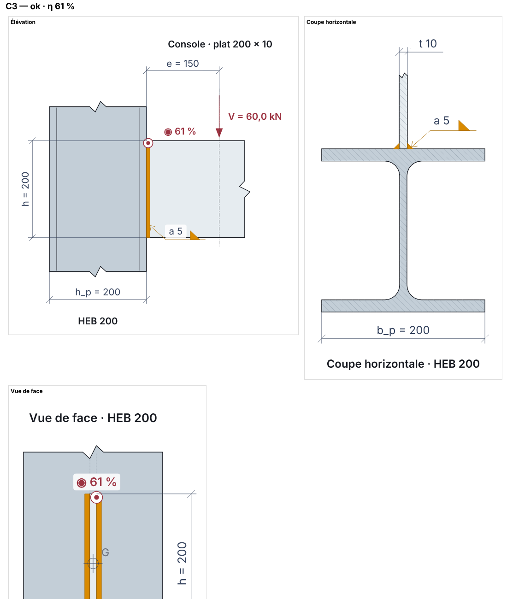
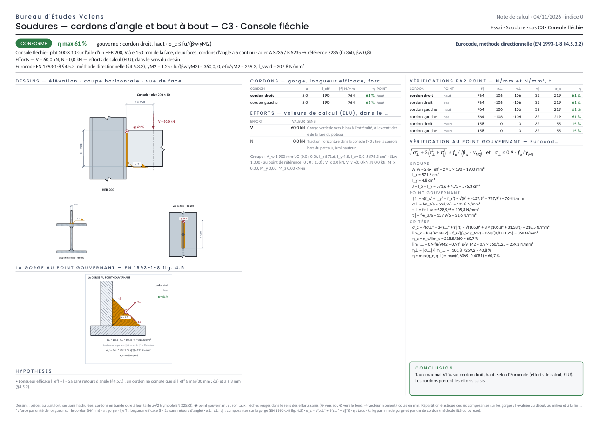
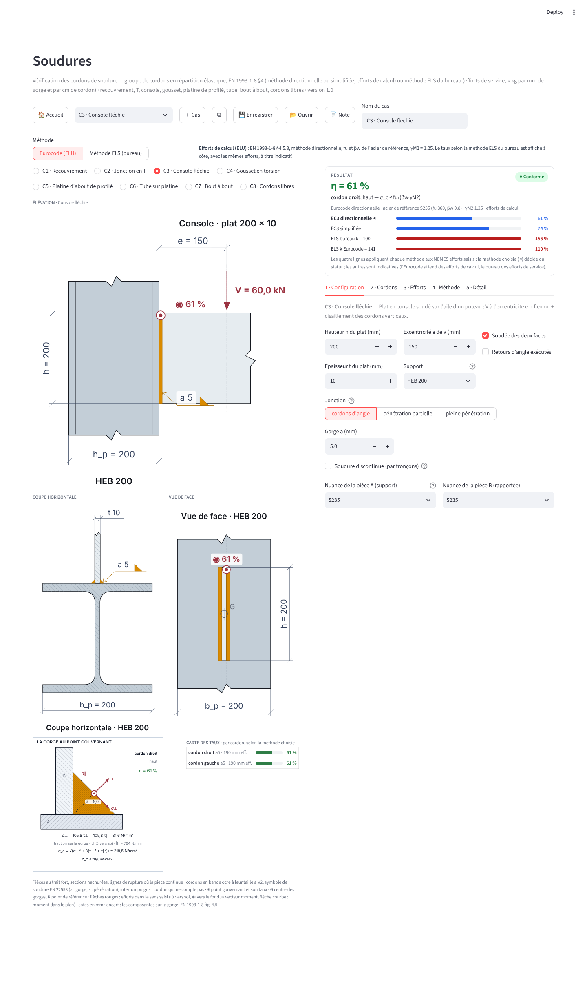
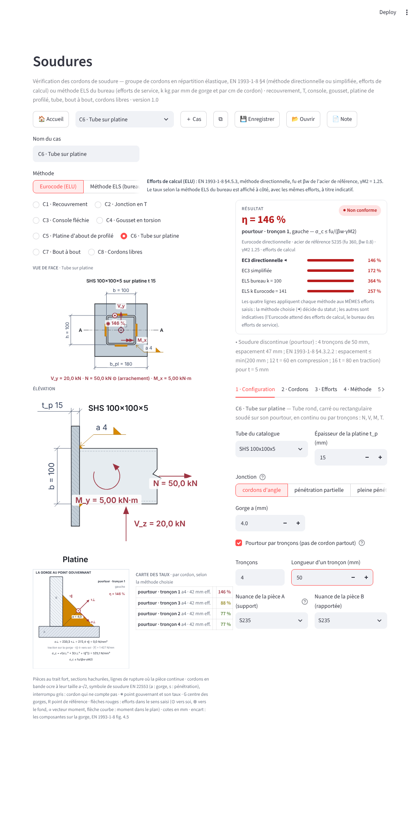

# Soudures — document de référence

*Livré le 04/11/2026, complété le 05/11/2026 (types de jonction, schémas sur le kit des
assemblages, formules dans la note). Page « Soudures » (tuile Acier), moteur
`acier/soudures/`, étude de conception `docs/acier/SOUDURES_ETUDE.md`.*

## 1 · Ce qui est livré

| Pièce | Rôle |
|---|---|
| `acier/soudures/cordon.py` | le cordon : segment de gorge a dans un dièdre, et la décomposition EXACTE d'une force par unité de longueur sur sa gorge (σ⊥, τ⊥, τ∥, EN 1993-1-8 fig. 4.5, σ⊥ > 0 en traction) ; cordon d'angle, bout à bout à pénétration partielle (coplanaire ou en T), **lignes de pleine pénétration** (trois lignes de gorge à poids de Simpson qui rendent exactement la section t·l de la pièce), longueur efficace, βLw |
| `acier/soudures/trace.py` | le tracé : chemins, arcs, chaînes (polyligne → segments de calcul), **tronçons** (soudures discontinues), espacement §4.3.2.2 |
| `acier/soudures/groupe.py` | le groupe de cordons : A_w, G, I_x, I_y, I_xy, J des gorges ; répartition élastique des six composantes d'effort |
| `acier/soudures/criteres.py` | les critères : Eurocode directionnelle (§4.5.3.2) et simplifiée (§4.5.3.3), méthode ELS du bureau, **métal de base** (pleine pénétration : √(σ² + 3τ²) ≤ fy/γM0, fy/γ_F en service), gorge de pleine résistance (a ≥ 0,46·t), k équivalent Eurocode |
| `acier/soudures/configurations.py` | huit configurations C1 … C8 : dimensions → groupe de cordons, efforts au bon point et dans le bon sens, pièces du dessin ; **type de jonction** d'une pièce en T (angle / pénétration partielle ± renfort / pleine) ; support = aile d'un poteau du catalogue ou plat |
| `acier/soudures/etat.py` | les cas, les défauts, le JSON, la vérification complète (points, cordons, chaînes, comparaison des méthodes, messages) |
| `acier/soudures/schemas.py` | les **schémas techniques** sur le kit de dessin des assemblages : deux ou trois vues par configuration, profilés réels, hachures, ruptures, bandes de cordon a·√2, symboles EN 22553, cotes, efforts, point gouvernant ; peints en vectoriel dans la note |
| `acier/soudures/dessin.py` | l'encart « la gorge » (section du cordon gouvernant, σ⊥ / τ⊥ / τ∥) et la carte des taux |
| `acier/soudures/formules.py` | les **formules de la méthode choisie**, écrites comme à la main (substitutions numériques testées contre le moteur) : groupe, point gouvernant, critère |
| `acier/soudures/methode.py` | les textes de méthode (onglet Méthode et page 2 de la note) |
| `acier/soudures/note.py` | la note de calcul PDF en deux pages, la méthode choisie seulement |
| `ndc_pdf/svg.py` | le peintre SVG → reportlab partagé par toutes les notes (hachures, arcs, dégradés) — sert encore à l'encart de la gorge |
| `modules/soudures.py` | l'écran ; `modules/liaison.py` : la liaison état → widgets partagée avec « Charges sur plancher » |
| `tests/test_soudures_moteur.py`, `test_soudures_schemas.py`, `test_soudures_formules.py`, `test_soudures_ecran.py`, `test_soudures_note.py` | les tests (103 + 32 + 27 + 52 + 44) ; `tools/captures_soudures.js` : captures et mesures aux trois formats |

## 2 · Le modèle (une seule règle pour tous les cas)

**Le cordon** est un segment de gorge a posé dans le dièdre de deux faces
perpendiculaires. Il porte l'axe e_a et les directions u_A, u_B de ses deux ailes (de la
racine vers chaque face). Le plan de gorge passe par la racine et coupe l'angle droit en
deux : sa normale est n_t = (u_B − u_A)/√2, orientée vers la pièce rapportée qui
s'arrache (σ⊥ > 0 : traction sur la gorge, σ⊥ < 0 : la pièce comprime le cordon — les
critères n'utilisent que σ⊥², le signe sert à l'encart), la direction en travers dans la
gorge est t_⊥ = (u_A + u_B)/√2. Une force f (N/mm) sur le cordon donne **σ⊥ = f·n_t/a,
τ⊥ = f·t_⊥/a, τ∥ = f·e_a/a** — c'est la figure 4.5 appliquée sans règle de pouce : un
effort en travers dans le plan de joint et un arrachement donnent tous deux
|σ⊥| = |τ⊥| = f/(a√2), mais ne se combinent pas de la même façon.

**Le groupe** traite les cordons comme des lignes d'aire a·dl : A_w, centre G,
I_x, I_y, I_xy, J. Les six composantes données au point de référence sont transportées en
G ; f = a·[F/A_w + σ_flexion·e_z + (M_z/J)·e_z × GP], σ_flexion linéaire (axes
quelconques, I_xy compris). f est évaluée au début, au milieu et à la fin de la longueur
efficace de chaque cordon ; le point le plus chargé gouverne.

**Longueurs.** l_eff = l − 2a sans retours d'angle (§4.5.1) ; un cordon ne compte que si
l_eff ≥ max(30 mm ; 6a) et a ≥ 3 mm (§4.5.2). Un arc ou un pourtour est une CHAÎNE :
découpée en segments de calcul (cordes de 15°), raccourcie de a à chaque bout si elle est
ouverte, entière si elle est fermée. Recouvrement long : βLw,1 (§4.11).

**Soudure discontinue (par tronçons).** Toute configuration accepte « n tronçons de l mm » :
aux deux bouts et régulièrement entre sur un cordon droit, régulièrement à partir du haut
sur un pourtour ou un cercle. Chaque tronçon est une chaîne ouverte (l − 2a) ; l'espacement
est rappelé avec la limite de l'EN 1993-1-8 §4.3.2.2 (≤ min(200 mm ; 12 t en compression ;
16 t en traction)) et marqué « DÉPASSÉ » le cas échéant. On n'est donc pas obligé de
souder partout — un CHS sur platine par quatre tronçons se calcule comme le reste.

**Types de jonction (C2, C3, C5, C6 ; C7 pour le bout à bout coplanaire).** Une pièce
posée en T sur une face se soude de trois façons, choisies à l'écran :

- **cordons d'angle** : gorge a sur une ou deux faces (ci-dessus) ;
- **pénétration partielle** (§4.7.2) : pénétration p par face ; sans renfort, la gorge p
  est parallèle à la face d'appui (σ⊥ = effort normal à la face / (p·l)) ; avec un cordon de
  renfort a_r, cordon d'angle à pénétration profonde de gorge p + a_r (§4.5.2(3)) ; deux
  faces avec p₁ + p₂ ≥ t et c = t − 2p ≤ min(t/5 ; 3 mm) → traitée comme pleine (§4.7.3) ;
- **pleine pénétration** (§4.7.1) : la soudure vaut la pièce la plus faible. Le groupe
  reçoit trois lignes de gorge (bords ±t/2 à t/6, milieu à 2t/3 — poids de Simpson) qui
  rendent EXACTEMENT l'aire t·l et l'inertie l·t³/12 de la section de la pièce ; chaque
  point est vérifié au MÉTAL DE BASE, √(σ² + 3τ²) ≤ fy/γM0 (efforts de calcul) ou
  ≤ fy/γ_F (méthode ELS, efforts de service). Un groupe peut mélanger les deux : semelles
  à pleine pénétration et âme en cordons d'angle, chaque point selon son critère.
  L'écran dit aussi la gorge de cordon d'angle qui égalerait la pièce en traction
  (a ≥ 0,46·t en directionnelle, 0,57·t en simplifiée pour le S235).

Bout à bout coplanaire (C7) : pleine pénétration → une soudure de gorge t vérifiée au métal
de base (σ = N/(b·t) + 6M/(t·b²), τ = V/(b·t)) ; pénétration partielle → une soudure de
gorge p par face, gorge perpendiculaire à l'effort normal ; p₁ + p₂ ≥ t → pénétration
complète, la pièce gouverne.

## 3 · Les deux méthodes et le switch

| | Eurocode (ELU) | Méthode ELS du bureau |
|---|---|---|
| efforts | de calcul (γG·G + γQ·Q) | de service, sans coefficient |
| critère | directionnelle : √(σ⊥² + 3(τ⊥² + τ∥²)) ≤ fu/(βw·γM2) et σ⊥ ≤ 0,9·fu/γM2 ; simplifiée en option : \|f\| ≤ f_vw,d·a | résultante \|f\| ≤ k·a avec k = 100 kg par mm de gorge et par cm de cordon (98,1 N/mm² à 9,81 N/kg) |
| acier | fu et βw de la pièce la plus faible (Tab. 4.1), γM2 = 1,25 (ANB) | — |
| équivalent affiché | le taux selon le bureau avec les mêmes efforts | f_vw,d/γ_F avec γ_F = 1,5 : 138,6 N/mm² = 141 kg/(mm·cm) pour le S235, et un bouton pour prendre cette valeur |

La carte RÉSULTAT de l'ÉCRAN donne toujours les quatre taux (directionnelle, simplifiée,
bureau, bureau avec k Eurocode) pour les mêmes efforts, la méthode choisie marquée ◀ : la
même console est « à 61 % » selon l'Eurocode et « à 156 % » selon la règle du bureau avec
des efforts ELU — c'est exactement ce que le switch rend visible. La NOTE, elle, n'imprime
que la méthode choisie (bandeau, vérification au point gouvernant avec ses formules, textes
de méthode de la page 2) : on choisit sa méthode, le rapport ne porte que celle-là. Les
points à trancher par le bureau (k, g, γ_F, γM2, longueur efficace, critère par défaut)
sont dans l'étude, §8.

## 4 · Les configurations

| Code | Cas | Jonction | Vues | Tronçons |
|---|---|---|---|---|
| C1 | Recouvrement : latéraux ± frontaux | angle | vue en plan (bout de A caché) · coupe A-A | latéraux |
| C2 | Jonction en T : une ou deux faces | angle / partielle ± renfort / pleine | coupe A-A (la jonction, N, V⊥, M) · vue en plan (l, V∥) | oui |
| C3 | Console fléchie : V à e, N ; support = aile d'un poteau du catalogue ou plat | angle / partielle / pleine | élévation (poteau vu de côté, V à e) · coupe horizontale (section réelle du poteau, la jonction) · vue de face | oui |
| C4 | Gousset en torsion : 1 à 4 côtés, point d'application ; support poteau ou plat | angle | vue en plan (V, H, N ⊙) · coupe A-A | oui |
| C5 | Platine d'about de profilé I/H du catalogue : semelles (une ou deux faces), âme, épaisseur de platine | semelles et âme chacune : angle / partielle / pleine | vue de face (section coupée, les six efforts) · élévation (platine, semelles, M_y, V_z, N) | semelles, âme |
| C6 | Tube CHS / SHS / RHS du catalogue sur platine | angle / partielle / pleine (pourtour) | vue de face (couronne hachurée) · élévation | pourtour |
| C7 | Bout à bout coplanaire : pleine ou partielle (p par face) | — | vue en plan · coupe A-A (chanfrein en X, ou les deux pénétrations et le talon) | — |
| C8 | Cordons libres : segments et arcs, continus ou par tronçons, six composantes au point R | angle | vue du plan de joint (chaînes nommées avec leur gorge, R, G) | par élément |

## 5 · Les schémas (le kit de dessin des assemblages)

Depuis le 05/11/2026 les schémas sont des SCÈNES du kit de dessin des assemblages
(`acier/soudures/schemas.py` sur `acier.assemblages.poutre_poutre.doubles_cornieres.schemas`,
le même générateur que les attaches poutre–poutre et poutre–poteau) — le premier jeu
« carrés et rectangles » du 04/11 ne tenait pas la comparaison avec les dessins
d'assemblage. Le trait est donc le même : pièces au trait fort, sections hachurées, lignes
de rupture là où une pièce continue, arêtes cachées en interrompu, profilés RÉELS du
catalogue (section en I avec ses congés, couronne d'un tube, aile d'un HEB), feuille de
cotation à rangées, noms des pièces, bandes de cordon en ocre à leur taille a·√2, symbole
de soudure EN 22553 (triangle « a 5 » pour un cordon d'angle, demi-V « s 6 + a 3 » pour une
pénétration partielle avec renfort, V « pleine pénétration »). Deux ou trois vues par
configuration (§4) : la vue du plan de joint montre les cordons TELS QUE CALCULÉS
(chaînes, tronçons, exclus en interrompu), une coupe ou une élévation montre la jonction
(triangles des cordons d'angle, chanfreins remplis, chanfrein K).

Les efforts sont en rouge dans le sens saisi : dans une vue du plan de joint, flèches V_x
et V_y, ⊙ / ⊗ pour N, vecteurs ⇒ pour M_x et M_y, arc pour M_z, et les valeurs dans un
bloc sous le dessin ; dans une coupe ou une élévation, chaque effort porte sa valeur.
◉ marque le point gouvernant avec son taux, G le centre des gorges, R le point de
référence. La boîte de vue englobe tout le corps : rien n'est coupé (une flèche, un
symbole, un nom de cordon) — `tests/test_soudures_schemas.py` le garde. L'écran les affiche
en SVG (vue principale sur la largeur, les autres côte à côte) ; la note peint les mêmes
scènes en vectoriel avec le peintre du kit (`rapport.peindre`).

L'encart « LA GORGE » (`dessin.py`) montre la section du cordon gouvernant — cordon
d'angle, pénétration partielle, ou pleine pénétration (la gorge est la section de la
pièce) — le plan de gorge en interrompu, σ⊥ sortante (traction) ou entrante
(compression), τ⊥, τ∥ et les valeurs.

## 6 · L'écran

Barre d'outils (Accueil, cas, ＋, ⧉, 🗑️, Enregistrer, Ouvrir, 📄 Note, nom du cas) ; le
SWITCH « Eurocode (ELU) | Méthode ELS (bureau) » avec une ligne qui dit ce que chaque
position change ; à gauche le choix de configuration, le dessin, l'encart de la gorge et la
carte des taux ; à droite la carte RÉSULTAT puis cinq onglets à libellé fixe :
1 · Configuration (dimensions, profilé du catalogue, support — aile d'un poteau du
catalogue ou plat —, **jonction** « cordons d'angle | pénétration partielle | pleine
pénétration » avec les champs qui vont avec (gorge a ; pénétration p et renfort a_r ; rien
pour la pleine, qui dit l'équivalent en cordons d'angle), tronçons, nuances ; en C8 un
tableau éditable d'éléments), 2 · Cordons (chaînes, l_eff, propriétés du groupe),
3 · Efforts (sens du dessin, nature selon la méthode), 4 · Méthode (critère, γM2, k, g,
γ_F, bouton « prendre la valeur Eurocode », identification, textes de méthode),
5 · Détail (par point : f, σ⊥, τ⊥, τ∥, σ_c, η selon chaque méthode ; et les formules de la
méthode choisie au point gouvernant, écrites comme à la main). Trois formats (R1), clés
`sdr_`, JSON.

**Liaison état → widgets (`modules/liaison.py`).** Un widget à clé garde son identité d'un
rendu à l'autre et le navigateur garde sa dernière valeur tant qu'on ne la lui réassigne
pas : supprimer la clé ne suffit pas (défaut trouvé par les captures du 04/11/2026 : après
C3 → C6 la gorge affichait 5 alors que le calcul prenait 4 ; sur « Charges sur plancher »,
après « ＋ Cas », la portée affichait celle du cas précédent). Chaque widget est enregistré
avec son chemin dans le cas ; à tout changement d'état hors widget, les clés sont RÉÉCRITES
depuis l'état (dans un callback directement, depuis le corps du script au rendu suivant).
Le harnais AppTest ne voit pas ce défaut (pas de navigateur) : c'est le contrôle Playwright
de `tools/captures_soudures.js` (état « tube ») qui le garde.

## 7 · La note

Deux pages A4 paysage (`acier/soudures/note.py`, kit `ndc_pdf`), **la méthode choisie
seulement**. Page 1 CALCUL : bandeau (statut, η max, cordon et point gouvernants, critère,
la méthode), configuration, efforts, méthode ; les schémas peints en vectoriel (vue
principale, puis les autres côte à côte) et l'encart de la gorge, hypothèses (messages du
moteur) ; tableaux des cordons, des efforts (avec le sens), des propriétés du groupe, des
vérifications par point (le pire point de chaque cordon quand ils ne tiennent pas tous) ;
la VÉRIFICATION AU POINT GOUVERNANT écrite comme à la main — le critère de la méthode en
typographie mathématique, puis les substitutions numériques de `formules.py` (A_w = Σ a·l_eff
= 2 × 5 × 190 = 1 900 mm², |f| = √(f_x² + f_y² + f_z²) = … = 764 N/mm, σ⊥ = f·n_t/a, …,
σ_c = √(105,8² + 3 × (105,8² + 31,6²)) = 218,5 N/mm², lim_c = 360/(0,8 × 1,25) = 360,
η = max(η_c, η⊥) = 60,7 %), chacune ré-évaluée par `tests/test_soudures_formules.py` avec
ses nombres tels qu'imprimés ; la conclusion. Page 2 MÉTHODE ET DÉTAIL : les textes de
`methode.py` de la méthode choisie (Eurocode OU règle du bureau), la carte des taux, le
détail complet, le cartouche (cas, configuration, méthode, acier, date · indice, échelle
du dessin). La comparaison des quatre lectures n'est plus imprimée : elle reste à l'écran.

## 8 · Les preuves

- `tests/test_soudures_moteur.py` (103) : décomposition contre la figure 4.5 (et le SIGNE :
  l'arrachement tend la gorge), console de l'étude (σ⊥ = τ⊥ = 95,5, τ∥ = 30, η 0,550 /
  0,665 / 0,94), torsion d'un cordon seul, recouvrement, T, platine (M/(h·b)), tube
  (N/périmètre, Bredt), bout à bout, βLw, conversions k ; chemins, chaînes, tronçons
  (positions, exclusion, refus), arcs ; CHS et SHS par tronçons, console par tronçons
  contre l'inertie à la main, espacement dépassé, cercle et demi-cercle libres, ancien
  fichier converti ; **types de jonction** : pleine pénétration N/(l·t) et 6M/(l·t²)
  exacts par les trois lignes de Simpson, fy/γ_F en ELS, pénétration partielle avec et sans
  renfort, règle du T §4.7.3, semelles pleines d'un IPE 200 (I exact), âme pleine, tube
  plein, gorge de pleine résistance 0,46·t / 0,57·t, poteau du catalogue en support.
- `tests/test_soudures_schemas.py` (32) : les vues de chaque configuration (nombre, SVG
  valides, RIEN de coupé), ce qui doit s'y lire (profilé, cotes, symboles selon la
  jonction, point gouvernant, efforts, tronçons, exclus), le peintre PDF, la pureté.
- `tests/test_soudures_formules.py` (27) : chaque substitution imprimée redonne le résultat
  du moteur (≥ 150 substitutions sur quatorze cas × méthodes), les textes attendus, les
  critères en typographie mathématique.
- `tests/test_soudures_ecran.py` (52) : navigation, switch, source unique, huit
  configurations avec leurs champs de jonction, semelles pleines, cordons libres, cas
  multiples, JSON, Note, étanchéité des clés.
- `tests/test_soudures_note.py` (44) : treize notes sans débordement, contenus, scènes
  peintes, vérification au point gouvernant, page 2 de la méthode choisie, méthode ELS.
- `tools/captures_soudures.js` : cinq états × quatre largeurs, aucune exception ni
  débordement, dessin et encart visibles, pastilles attendues, gorge qui suit l'état.

*Téléphone : `images/soudures_telephone_els.png` ; note page 2 : `images/soudures_note_p2.png` ;
bout à bout à pleine pénétration : `images/soudures_note_c7.png`.*

## 9 · Couverture : ce que l'outil calcule, ce qu'il ne calcule pas

**Une seule règle couvre tous les cas** : un groupe de cordons dans UN plan de joint, six
composantes d'effort, répartition élastique, critère au point le plus chargé. Les huit
configurations ne sont que des constructeurs de groupe ; C8 (cordons libres : segments,
arcs, tronçons, côté de la pièce, gorge par élément) construit n'importe quel groupe plan.
Il n'y a donc pas de « cas spécifique à introduire à chaque fois » tant que la soudure
tient dans un plan.

| Couvert | Comment |
|---|---|
| cordons d'angle, continus ou par tronçons, retours d'angle, recouvrements longs (βLw) | toutes les configurations |
| pénétration partielle, avec ou sans cordon de renfort, règle du T (§4.7.3) | jonction « partielle » (C2, C3, C5, C6), C7 |
| **pleine pénétration** : la soudure vaut la pièce, métal de base (§4.7.1) | jonction « pleine » (C2, C3, C5, C6), C7 |
| mélange dans un même groupe (semelles pleines + âme d'angle) | C5, chaque point selon son critère |
| profilés et tubes du catalogue, support = aile d'un poteau | C3, C4, C5, C6 |
| Eurocode directionnelle / simplifiée (efforts de calcul) et règle du bureau k·a (efforts de service) | le switch, γM2, k, g, γ_F modifiables |

**L'exemple du bureau — la cornière reconstituée de deux plats de 30 mm soudés à pleine
pénétration.** C'est la jonction en T (C2) avec t_B = 30, t_A = 30, jonction « pleine » :
le groupe reçoit la section 30 × l de l'aile rapportée, chaque point est vérifié au métal
de base √(σ² + 3τ²) ≤ fy/γM0 — sous N = 400 kN sur 200 mm, σ = N/(l·t) = 66,7 N/mm²,
η = 28 % ; sous un moment, σ = 6M/(l·t²) exactement. L'écran dit aussi ce que coûterait la
même résistance en cordons d'angle : a ≥ 0,46·t = 13,8 mm de chaque côté (directionnelle),
0,57·t = 17 mm (simplifiée) — ce qui est précisément pourquoi on soude à pleine pénétration
à 30 mm. Le cas se saisit, il ne s'introduit pas ; la console (C3) et la platine (C5) ont
le même choix de jonction.

| Pas couvert (V1) | Ce qu'on fait en attendant |
|---|---|
| groupes de cordons dans PLUSIEURS plans (une soudure sur les quatre faces d'un tube ET sur une platine perpendiculaire) | un cas par plan, les efforts partagés à la main |
| soudures en bouchon et en entaille (§4.3.3), cordons sur bords arrondis de profilés creux dans les nœuds de treillis (EN 1993-1-8 §7) | hors outil |
| fatigue (EN 1993-1-9), aciers au-delà du S460, acier inoxydable (EN 1993-1-4), tôles minces | hors outil, dits dans « ce que l'outil ne fait pas » |
| vérification des PIÈCES assemblées hors de la pleine pénétration (section nette du gousset, voilement d'une platine, pression diamétrale) | les modules d'assemblage ou le calcul à la main |
| répartition plastique entre cordons | non : élastique, du côté sûr |
