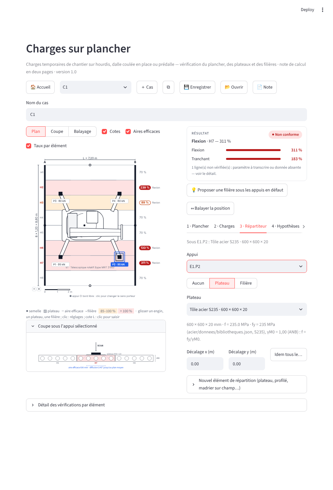

# Charges sur plancher — document de référence (moteur, lot 1 · écran, lot 2 · note, lot 3)

*Lot 1 livré le 02/11/2026 : le moteur, sans écran. Lot 2 livré le 02/11/2026 :
l'écran (section 8). Lot 3 livré le 02/11/2026 : la note PDF et l'onglet
Méthode (section 9). Étude de conception : `CHARGES_PLANCHER_ETUDE.md`
(décisions P-1 à P-17, section 12 pour la revue des remarques extérieures).
Ce document dit ce que le moteur calcule, avec quels paramètres, ce qu'il
refuse, ce qui reste à transcrire, comment il est tenu par ses tests, et
comment l'écran et la note s'en servent.*

## 1 · Ce que le paquet contient

```
plancher/charges/
  modele.py         Hourdis · DalleBA · Predalle (éléments, raideur k = 3·E·I·L/(a²(L−a)²), g_total)
                    Empreinte · ChargeLineaire · ChargeSurfacique · AppuiGabarit · Gabarit · Engin
                    Plateau · Filiere · Chape (P-17)
  diffusion.py      Heft 240 : t_y, b_v, b_m · lignes d'influence · règle du levier · parts annexe C fournies · créneaux
  repartiteurs.py   bande efficace c (EN 1993-1-8 §6.2.5) · section en I (repli) · poutre sur ressorts (numpy) · flexion de la filière
  resistances.py    formules BA de l'application inversées · natures de catalogue · chape · EN 1992-1-1 §6.7 et §6.4
  verification.py   verifier() · balayer() · dimensionner_filiere()
  bibliotheque.py   gabarits, types de hourdis, plateaux (plancher/donnees/*.json) · profilés (profiles_test.json) · aciers
  parametres.py     Parametres : décisions du bureau et valeurs « à transcrire », défauts conservatifs
plancher/donnees/   engins.json · hourdis.json · plateaux.json (génériques, sources, charges à saisir)
tests/              test_charges_plancher_diffusion.py · _repartiteurs.py · _moteur.py · ref_chp.json (cas gelés)
```

Le paquet est **pur** : ni Streamlit, ni dessin, ni note (test 10 du moteur).
Dépendance : numpy, déjà présent dans l'application.

## 2 · Appel

```python
from plancher.charges import modele as M, verification as V, bibliotheque as BIB
from plancher.charges.parametres import Parametres

h = M.Hourdis(nom="SP 200", L=7.2, n_elements=8, I=1.05e-3, M_Rd=90, V_Rd=95, nature=M.RD,
              p_loc_adm=0.70, q_presentes=1.0, etat=M.CLAVETES, parts_annexe_C=None)
gab = BIB.gabarits()["Télescopique rotatif (type MRT 2150) · levage sur stabilisateurs"]
for a in gab.appuis: a.P = 60.0                      # tableau de stabilité, par opération
engin = M.Engin("E1", gab, x=3.0, y=4.8, angle=0)
plateau = BIB.plateaux()["Tôle acier S235 · 600 × 600 × 20"]
res = V.verifier(h, [engin], {e.ref: plateau for e in engin.empreintes()}, Parametres())
res["statut"], res["taux_max"], res["gouverne"], res["elements"], res["verifications"]
```

`verifier` ne lève jamais : un refus est un résultat `{"statut": "refus", "message": …}`.
`balayer(plancher, charges, repartiteurs, ref_engin)` déplace l'engin le long de la portée.
`dimensionner_filiere(plancher, charges, repartiteurs, groupes, candidats, fabrique)` parcourt
les profilés par masse croissante, une filière en travers par groupe de pieds, et retient le
premier candidat dont **tout le système** est ≤ 1 (P-14), avec la liste des taux qui ont monté.

## 3 · Ce que le moteur calcule

**Charges.** Empreintes de service `P` avec coefficient dynamique `φ` par appui (P-6) ; charges
linéaires et surfaciques discrétisées (pas 0,25 / 0,30 m) ; gabarits d'engin tournés de 0 à 270°.
Un gabarit sans charge par appui est un refus (P-13).

**Répartiteurs.** Plateau : aire efficace (a + 2c)(b + 2c), c = t·√(f/(3·p_Ed)) itéré avec la pression
ELU p_Ed = γQ·P / aire (vérification plastique de l'acier), c plafonné par le bord du plateau ; plaque
déclarée rigide : plaque entière, pression de service comparée à la valeur publiée. Filière en travers :
poutre d'Euler libre sur un ressort par élément croisé, k = 3·E·I·L/(a²(L − a)²) à l'abscisse de la
filière ; réactions = charges des éléments ; flexion de la filière à l'ELU, γQ·M ≤ W·fy/γM0 ; un
ressort qui tire est signalé. Filière dans le sens porteur : charge linéaire uniforme (hypothèse
rigide), aucune répartition entre éléments.

**Hourdis.** Par élément : règle du levier (part proportionnelle au recouvrement de l'empreinte),
parts de l'annexe C si elles sont fournies et si les joints sont clavetés ou le plancher chapé
(flexion seulement), tranchant à `part_tranchant_element` sur l'élément chargé (P-3, défaut 100 %) ;
M cherché aux abscisses des charges, à mi-portée et sur une grille au pas L/60 (son maximum tombe
entre la charge et la mi-portée, § 10), V aux appuis ; les efforts sollicitants comptent les
**poids propres** (`g + chape`, part G) et les charges de chantier (`q_presentes` et charges
concentrées × φ, part Q). **Résistances de calcul** (nature Rd) : M_Ed = γG·M_G + γQ·M_Q ≤ M_Rd avec
γG = 1,35 et γQ = 1,5 (P-2, tranché le 02/11/2026 — plus de « ÷ 1,5 uniforme », qui pondérait le poids
propre à 1,5) ; **valeurs admissibles de service** : M_G + M_Q ≤ M_adm, coefficients 1 ; valeurs
« avec chape » seulement si collaborante et classe exigée atteinte (P-17). La ligne de fissuration
(M_cr) compare le moment de service. Membrure : pression P/(aire efficace
+ diffusion à 45° dans la chape) ≤ `p_loc_adm` ; sans donnée : non vérifié si un répartiteur efficace
est présent, défaut « répartiteur exigé » sinon (P-5). Joints : effort transmis par les parts de
l'annexe C, vérifié si `joint_adm_kN_m` et `joint_longueur_m` sont renseignés (P-15). Fissuration :
information si M_cr est renseigné (P-11).

**Dalle et prédalle.** Par mètre : t_y = b + 2·h1 + h ≤ 0,8·l ; b_v = t_y + 0,5·a ; b_m = t_y tant que
`k_flexion_heft240` est `None` (P-4, **très conservatif** sous charge concentrée, voir § 5) ;
superposition en créneaux, maximum sur la largeur ; résistances = formules de `poutre.py` inversées
(§ 2.1 de l'étude) sur la classe saisie ou la classe arrondie vers le bas de fck(t). Effets locaux
EN 1992-1-1 §6.7 et §6.4 à l'ELU avec γQ sur la charge concentrée (P-9) ; la flexion et le tranchant
par mètre restent en service (coefficients 1), méthode de l'application. Prédalle : largeur plafonnée à la prédalle si
joints non armés ou charge à cheval sur un joint (P-16) ; étais en place = portée réduite +
avertissement (P-8) ; chape non durcie = refus de toute charge d'engin ou d'étai (P-7).

**Statuts.** `ok`, `attention` (≥ 0,85), `nok` (> 1), `info`, `non_verifie` (paramètre à transcrire
absent), `refus`. Le statut global est `nok` dès qu'une ligne l'est ; `non_verifie` ne masque rien :
la liste `non_verifies` est rendue à part.

## 4 · Paramètres (`parametres.Parametres`)

| Champ | Défaut | Décision |
|---|---|---|
| `gamma_G`, `gamma_Q` | 1,35 · 1,5 | P-2 (02/11/2026) : ELU quand la résistance est une valeur de calcul — γG sur les poids propres, γQ sur les charges de chantier (hourdis Rd, effets locaux, filière, bande plastique du plateau) ; 1 et 1 avec une valeur admissible de service |
| `part_tranchant_element` | 1,0 | P-3 : part de la réaction d'appui d'une charge concentrée reprise en tranchant par l'élément chargé ; 1 = aucun partage par les joints (prudent : l'annexe C répartit la flexion, pas le tranchant près de l'appui) |
| `k_flexion_heft240` | `None` → b_m = t_y | P-4, **à transcrire** du Heft 240 |
| `joint_adm_kN_m`, `joint_longueur_m` | `None` → non vérifié | P-15, **à transcrire** de l'EN 1168 |
| `gamma_c`, `alpha_cc`, `beta_poinconnement` | 1,5 · 1,0 · 1,0 | P-9 ; αcc de l'ANB belge à confirmer |
| `coef_vrd_max` | 0,4 (ν·fcd) | §6.4.5(3), coefficient à confirmer sur l'ANB ; `None` = contrôle u0 non fait |
| `seuil_attention`, `seuil_defaut` | 0,85 · 1,0 | affichage |
| `pas_lineaire`, `pas_surfacique`, `pas_balayage` | 0,25 · 0,30 · 0,10 m | discrétisation |

Les parts de l'annexe C ne sont pas un paramètre global mais une donnée du hourdis
(`parts_annexe_C = {0: part de l'élément chargé, 1: chaque premier voisin, …}`), fournies par le
bureau après transcription de la figure C.1 ; `None` = l'élément chargé porte tout.

## 5 · Ce qui reste à transcrire avant un usage en production

1. **k du Heft 240** (largeur efficace en flexion) : sans lui, une charge concentrée sur une dalle
   est jugée sur t_y seul, ce qui multiplie le moment par mètre par un facteur de l'ordre de 3 à 5 par
   rapport à la largeur efficace réelle. Le moteur le dit dans une ligne d'hypothèse.
2. **Parts de la figure C.1 de l'EN 1168** : sans elles, aucun partage entre hourdis clavetés
   (conservatif pour l'élément chargé).
3. **Résistance du joint longitudinal** (EN 1168) : sans elle, l'effort transmis est calculé et la
   ligne est « non vérifié ».
4. **αcc et v_Rd,max** de l'ANB belge pour les effets locaux.
5. **Valeurs de catalogue** des hourdis (M_Rd, V_Rd, nature, I, p_loc_adm, M_cr, valeurs avec chape et
   classe exigée) : la fiche livrée est un gabarit vide.

## 6 · Tests

- `test_charges_plancher_diffusion.py` (39) : Heft 240, lignes d'influence, levier, parts annexe C,
  créneaux (plateau déterministe, fenêtre d'évaluation d'une bande sans re-concentration).
- `test_charges_plancher_repartiteurs.py` (23) : bande c itérée à la main, section en I à 2 % du
  catalogue sur tous les profilés, poutre sur ressorts (statique, rigide, souple, Σ R = Σ P, symétrie,
  erreurs), flexion de la filière.
- `test_charges_plancher_moteur.py` (84) : **copie tenue** des formules BA (les expressions de
  `poutre.py` retrouvées mot pour mot, inversions exactes, exemple de l'étude), classes et Ecm,
  natures et chape (P-17), §6.7 et §6.4 à la main, pipeline hourdis (P·L/4, levier, plateau avec
  bande plastique sous la pression ELU, chape, P-5, filière rigide et souple, annexe C, P-3, P-15,
  P-11, φ), **P-2** (poids propres dans les efforts : M_G et M_Q nommés, M_Ed = 1,35·M_G + 1,5·M_Q,
  V de même, nature service → coefficients 1, γG = γQ = 1 retrouve le service, l'ancien ÷ 1,5 refusé,
  fissuration en service), pipeline dalle et prédalle (P-4, P-16, P-8, P-7, effets locaux à γQ),
  refus (dont le hourdis sans M_Rd / V_Rd), taux par bande d'une dalle bornés par le taux global,
  balayage, dimensionnement (P-14), bibliothèque, JSON, **sections de moment** (le maximum de M_Ed
  cherché ENTRE la charge et la mi-portée, § 10), cas gelés `ref_chp.json` (régénérés le
  02/11/2026 sur la règle P-2, puis sur la correction des bandes, puis sur les sections au pas
  L/60), pureté.
- `test_charges_plancher_validation.py` (6, lot 4) : le script de validation croisée rend VALIDÉ en
  mode rapide (6 filières, 60 jeux de créneaux), ses figures sont produites puis retirées, le cas A
  tient le défaut des sections (maximum ni à la charge ni à mi-portée), le rapport daté et ses trois
  figures existent, le moteur n'importe ni scipy, ni matplotlib, ni streamlit.
- `test_charges_plancher_note.py` (52, lot 3) : deux pages A4 paysage sans débordement sur quatre
  cas (hourdis complet, dalle + étançon + stock, prédalle + file + grue araignée + filière en sens 2,
  refus), contenu de la page 1 (statut, η max, gouverne, familles, données, éléments, charges,
  vérifications groupées, conclusion, légende), plan et coupe peints depuis le SVG de l'écran (textes
  retrouvés, rien de l'interface), page 2 (sections de `methode.py` mot pour mot, bibliothèque et
  sources, balayage, à transcrire, cartouche), peintre (composition des transformations, texte
  vertical, motif, balise inconnue), groupement des lignes.
- `test_charges_plancher_ecran.py` (74, lots 2 et 3, AppTest sur l'application réelle) : navigation et
  tuile, composant du plan, « Données manquantes », onglets, source unique widgets → état → moteur
  et plan (M_Rd, L, hourdis / dalle / prédalle), engin de la bibliothèque et charges par appui
  (refus P-13 puis calcul, bandes teintées, semelles cliquables), plan → état (glisser, cote,
  sens, ±, fenêtres d'engin et de semelle, plateau, idem, filière, dupliquer / supprimer),
  répartiteur par l'onglet 3, proposition de filière, vues Coupe et Balayage, cas multiples,
  JSON aller-retour, fiches ajoutées (engin, plateau azobé, madrier sur champ, fiche de hourdis
  gardée depuis l'onglet Plancher et réappliquée), onglet Méthode (sections, bibliothèque,
  identification), bouton « 📄 Note » (PDF de deux pages produit, bouton de téléchargement,
  identification portée), étanchéité des clés.
- `tools/captures_plancher.js` : captures et mesures aux quatre largeurs (états vide, engin,
  plateau, clic, glisser, coupe, balayage, methode, note) — aucun débordement, plan visible, calcul
  abouti, plateau hachuré, fenêtre ouverte au clic sur une semelle, position changée au glisser,
  onglet Méthode lisible, bouton de téléchargement de la note apparu.


*Trois contrôles calculés par le moteur : a · partage d'une filière sur trois hourdis selon sa raideur
relative, de « tout sur un » à « trois tiers » ; b · balayage d'un rotatif le long de la portée ;
c · part efficace d'un plateau selon son épaisseur. Valeurs d'illustration.*

## 7 · Limites de la V1 (reprises de l'étude)

Deux appuis seulement ; filières à 0° ou 90° ; éléments supposés indépendants sous une filière
(conservatif pour le plus chargé) ; pas de chaîne d'étaiement entre étages (P-8) ; pas de
continuité ni de porte-à-faux ; prédalle avant chape refusée ; poinçonnement au sens EN 1992-1-1
réservé aux dalles et prédalles (pour un hourdis, la membrure se juge sur la donnée fabricant).

## 8 · L'écran (lot 2)

```
modules/charges_plancher.py   la vue Streamlit : barre d'outils du cas, plan, coupe, balayage, carte résultat,
                              quatre onglets (Plancher · Charges · Répartiteur · Hypothèses), détail, bibliothèque
plancher/charges/etat.py      l'ÉTAT (dict JSON, source unique) : cas multiples, fiches ajoutées ; construire() →
                              objets du moteur ; contexte_dessin() → plan ; appliquer_changements() ← plan
plancher/charges/dessin.py    le plan cliquable et glissable, la coupe sous un appui, le bandeau de balayage (SVG en mm)
plancher/charges/symboles.py  symboles d'engins en vue de dessus, au trait, À L'ÉCHELLE de leur fiche
tools/captures_plancher.js    captures et mesures PC 1440 / 1280, tablette 1024, téléphone 390 (états vide, engin,
                              plateau, clic, glisser, coupe, balayage)
tests/test_charges_plancher_ecran.py   harnais AppTest + état (source unique, plan → état, JSON, fiches)
```

`plancher/charges` reste **pur** (le test 10 du moteur le garde) : l'état, le dessin et les symboles
n'importent pas Streamlit ; seule la vue `modules/charges_plancher.py` le fait.

**Organisation** (étude § 7, maquette « digeste ») : à gauche le **plan** — appuis A et B en trait
épais, bords libres fins avec une poignée ○ qui change le sens porteur, cote L cliquable, poignées
± du nombre de hourdis, bandes teintées seulement à partir de 85 % (orange) et au-delà de 100 %
(rouge), taux et famille gouvernante **hors du dessin**, engins dessinés à l'échelle de leur fiche,
semelles et étiquettes « P2 · 95 kN », plateaux hachurés avec leur aire efficace en pointillé bleu,
filières, échelle graphique ; sous le plan, la **coupe** sous l'appui sélectionné (éléments voisins,
couche de compression, plateau, semelle, charge, diffusion à 45°). À droite la **carte résultat**
(pastille, une phrase « Flexion · H7 — 343 % », barres par famille, lignes non vérifiées,
« Proposer une filière », « Balayer la position »), puis les quatre onglets. En bas, le détail des
vérifications par élément et par famille.

**Ce qui se règle sur le plan** (composant partagé `acier/composants/svg_cliquable`, retours en mm) :
glisser un engin, une charge, un plateau, une filière ; clic sur un engin (angle, charges par appui,
dupliquer, supprimer), sur une semelle (répartiteur : aucun, plateau, filière, « idem tous les
appuis »), sur un plateau (même fenêtre, et le plateau se décale), sur une filière (élément,
longueur, orientation), sur la cote L, sur les poignées ± et ○. Grammaire des clés :
`<objet>:<réf>.<champ>` avec objet ∈ engin · charge · rep · fil (`dessin.py`, en-tête). Tout retour
passe par `etat.appliquer_changements`, qui écrit dans le cas ; les widgets des onglets (clés
`chp_w_…`) sont des **vues** du même état, relues dès qu'il change par ailleurs.

**Bibliothèque extensible** (exigence du 02/11/2026) : la fenêtre « Ajouter depuis la bibliothèque »
pose un engin de `plancher/donnees/engins.json` ou une **fiche ajoutée** (nom, type d'appuis,
silhouette, appuis avec positions, empreintes, charges, φ, source) ; l'onglet Répartiteur accepte un
**nouvel élément** (plateau ou filière : matériau, f, E, masse, dimensions, profilé du catalogue ou
rectangle b × h posé sur champ — plateau azobé, madrier C24, profilé, plaque de grue) ; l'onglet
Plancher garde les valeurs saisies d'un hourdis comme **fiche du catalogue** (« ＋ Fiche de
hourdis », P-1 : un catalogue transcrit sert de défaut, le bureau indique les siennes). Les fiches
ajoutées voyagent avec le fichier JSON du cas (`💾 Enregistrer` / `📂 Ouvrir`, `etat.charger`
contrôle le module et la version).

**Deux décisions d'écran prises le 02/11/2026, chacune tenue par un test :**

- les quatre étapes sont des **onglets à libellé fixe**, pas des expanders au titre résumé : un
  expander dont le titre change se referme à chaque saisie qui le change (Streamlit le remonte), ce
  qui coupait la saisie des charges par appui ; le résumé vit en tête de chaque onglet ;
- `diffusion.max_creneaux` nomme le **premier** plateau maximal à 1e-9 relatif près : la valeur
  d'un plateau n'est jamais plate au bruit numérique, et le cas gelé `dalle_etai` donnait
  « y = 3,65 m » sous numpy 2.4 et « y = 3,90 m » sous numpy 2.5 pour la même valeur. Le cas gelé
  a été réécrit sur la valeur déterministe (révision du 02/11/2026).

Textes du plan : constants à l'écran quelle que soit la taille du plancher (facteur k sur les tailles
de police et d'étiquette au-delà d'un plan de référence de 11,4 m de large) ; sur téléphone, le
plan garde une largeur minimale lisible et le conteneur du composant défile horizontalement.

L'onglet **5 · Méthode** porte les sections de `plancher/charges/methode.py` (mêmes textes que la
page 2 de la note), les références, ce qui reste à transcrire, la bibliothèque livrée avec ses
sources et l'identification de la note (projet, partie, indice). Le bouton **📄 Note** de la barre
d'outils produit la note du cas actif puis offre son téléchargement.


*PC 1440 : télescopique rotatif posé depuis la bibliothèque, charges d'essai par appui, plateau
600 × 600 × 20 sous P2. Les valeurs de résistance (M_Rd 60 kN·m, V_Rd 80 kN) sont des valeurs
d'ESSAI du harnais, pas un catalogue.*



*Tablette 1024 : le plan tient dans sa colonne (largeur minimale 440 px), textes à 9 px.*


*Téléphone 390 : mêmes fonctions, colonnes empilées, plan défilant dans son cadre.*

## 9 · La note PDF (lot 3)

```
plancher/charges/note.py      la note : page 1 CALCUL, page 2 MÉTHODE ET DÉTAIL (kit ndc_pdf, palette Encre,
                              mêmes marges et polices que les notes d'assemblage) ; generer_note(etat, cas, infos)
plancher/charges/peintre.py   le sous-ensemble SVG de dessin.py et symboles.py peint sur le canevas reportlab
plancher/charges/methode.py   les sections de méthode, les références, la liste « à transcrire »
tests/test_charges_plancher_note.py
```

**Page 1 · CALCUL.** Bandeau : bureau, titre avec le type de plancher, projet · partie · cas, date ·
indice ; pastille (CONFORME, CONFORME · ATTENTION, NON CONFORME, DONNÉES MANQUANTES), η max, famille
et objet gouvernants, taux par famille, lignes non vérifiées ; deux lignes de données (plancher ;
charges et répartiteurs). Trois colonnes : le **PLAN** et la **COUPE** tels qu'à l'écran, peints depuis
le MÊME SVG (source unique, R2) sans poignées ni invites de clic (`ctx["impression"]`), puis les
**HYPOTHÈSES** du moteur (y compris ses notes P-4, P-8, P-16, chape) ; le tableau des **ÉLÉMENTS**
(M_Ed, M_Rd, η_M, V_Ed, V_Rd, η_V — les douze pires si plus de treize) et celui des **CHARGES**
(engin et ses appuis, étançons, files, stocks, répartiteur de chaque appui) ; le tableau des
**VÉRIFICATIONS** (plateaux, filières, effets locaux, joints, fissuration) et la **CONCLUSION**.
Les empreintes d'une charge discrétisée (« S1.3.7 ») et les éléments sous une filière (« F1 →
H3 ») donnent UNE ligne, la pire, comptée (« local ×32 ») — un stock de 32 empreintes écrivait 96
lignes d'effets locaux. Pied de page : légende P-2 / P-3 et notations.

**Page 2 · MÉTHODE ET DÉTAIL.** Les sections de `methode.py` (charges et combinaisons,
répartiteurs, hourdis, dalle et prédalle, ce que l'outil ne fait pas), la **bibliothèque utilisée**
avec la source de chaque fiche (gabarit d'engin et ses appuis, plateau, filière, hourdis), le
**balayage** de position s'il y a un engin, ce qui reste **à transcrire**, et le cartouche (cas,
plancher, charges, répartiteurs, date · indice, échelle du plan).

**Peintre SVG → reportlab.** Pas de svglib ni de cairosvg dans l'environnement : `peintre.py` rend
le sous-ensemble émis par les dessins (rect, circle, line, polygon, polyline, text, g avec
translate · rotate · matrix · scale composés, fill / stroke / dasharray / opacity, text-anchor,
font-weight) ; les motifs de hachures deviennent des aplats clairs, les textes sont posés à
l'endroit avec l'angle de la matrice courante (un `rotate(-90)` donne un texte qui monte), les
traits sont pris en points, bornés. Le test retrouve dans le PDF les textes du plan (« L = 7,20 m »,
« P2 · 95 kN ») et rien de l'interface.

**Deux défauts trouvés par la note le 02/11/2026, corrigés et tenus par un test :**

- `diffusion.max_creneaux` recevait la bande d'affichage comme plancher : une empreinte hors de la
  bande, « tronquée » à une largeur nulle, y était concentrée sur 1e-9 m — des taux de 10⁹ % sur les
  bandes non chargées d'une dalle (visibles aussi à l'écran dès qu'une dalle portait une charge).
  La fonction prend désormais une `fenetre` d'évaluation distincte du plancher ; cas gelés régénérés ;
- le groupement des lignes de la note fusionnait deux vérifications distinctes d'une même filière
  (flexion, ressort qui tire) : seules les lignes « sous <charge> » se groupent.

Les textes de méthode sont écrits une fois (`methode.py`) et lus par l'onglet Méthode et par la
page 2 : le test de la note retrouve un fragment de chaque section mot pour mot, celui de l'écran
aussi.

## 10 · Validation croisée (lot 4)

```
tools/validation_charges_plancher.py              le script : cinq contrôles, rapport daté, trois figures
docs/validation/charges_plancher_validation_2026-11-02.md   la MESURE (ne se réécrit pas)
docs/validation/figures/plancher_validation_{A_roue,C_dalle,D_filiere}.png
tests/test_charges_plancher_validation.py         le script en mode rapide, VALIDÉ exigé
```

Cinq contrôles, chacun par une méthode qui **ne passe pas par le moteur** (numpy et matplotlib, hors
chemin de production — le moteur reste pur, le test le vérifie) :

| Cas | Ce qui est vérifié | Méthode indépendante | Écart mesuré |
|---|---|---|---|
| A · une roue sur un hourdis | M_Ed, son abscisse, V_Ed, η_M, η_V de H3, M_Ed d'un élément non chargé | M_Ed = 1,35·M_G + 1,5·M_Q sur 7 201 sections ; statique | ≤ 3·10⁻⁵ % (abscisse : 3 mm) |
| B · un stabilisateur sur tôle à cheval sur deux hourdis | bande plastique c, aire efficace, pression de service, part de H3, M_Ed de H3 = M_Ed de H4, V_Ed | point fixe c = t·√(f/(3·p_Ed)) sous la pression ELU, règle du levier, moments | 0 |
| C · un Manitou sur une dalle de 20 cm | M et V par mètre en service, abscisse, §6.7 F_Rdu et γQ·P, §6.4 v_Ed et v_Rd,c | Heft 240 réécrit (t_y, b_v), quatre roues superposées sur une grille transversale de 5 mm, formules depuis la norme | ≤ 2·10⁻¹³ % |
| D · filière sur ressorts | réactions, moment maximal, flèches aux nœuds de 24 configurations tirées au sort | éléments finis d'Euler-Bernoulli, Hermite cubique, 400 éléments | ≤ 0,003 % |
| E · créneaux | maximum sur la largeur et dans une fenêtre de bande, 300 jeux tirés au sort | évaluation exhaustive aux arêtes | 0 |

Les cas A à C emploient des résistances d'ESSAI (M_Rd 60 kN·m et V_Rd 80 kN par hourdis ; dalle de
20 cm à 524 mm²/m), pas un catalogue : ils valident les efforts, les largeurs efficaces, les
répartiteurs et les effets locaux, pas une valeur de fabricant.

**Un défaut NON CONSERVATIF trouvé par le cas A, corrigé le 02/11/2026 et tenu par deux tests.**
Le moteur n'évaluait le moment d'un hourdis qu'aux abscisses des charges et à mi-portée. Or, sous
une charge concentrée hors du milieu, le maximum de M_Ed = 1,35·M_G + 1,5·M_Q tombe ENTRE la
charge et la mi-portée dès que la pente du réparti à la charge, w_Ed·(L/2 − a), dépasse celle du
terme concentré, γQ·φ·P·a/L : sur le cas A (roue de 12 kN, φ 1,4, à 2,00 m d'une portée de 7,20 m
sous 2,90 + 1,00 kN/m²), 71,08 kN·m en x = 2,52 m contre 70,19 à la charge — **−1,3 %**. Le moteur
regarde désormais aussi une grille au pas L/60 (`verification._sections`, hourdis et dalles) ; sur
les cas gelés, M_Ed monte jusqu'à +3,2 % et deux statuts passent d'« ok » à « attention ». Le verrou
du moteur emploie un cas dont l'optimum analytique x* = L/2 − γQ·φ·P·a/(L·w_Ed) est intérieur ; le
test de validation exige que le cas A ne culmine ni à la charge ni à mi-portée.

Ce que la validation **ne couvre pas** : les formules béton armé de l'application (reproduites, pas
jugées), le coefficient k du Heft 240 en flexion, les parts de l'annexe C et la résistance du joint
(non transcrits, § 5), les valeurs de catalogue, et les deux décisions du bureau (P-3, éléments
indépendants sous une filière) qui sont des choix, pas des mesures.

**Registre.** Le module est inscrit dans l'application : page « Charges sur plancher » dans
`streamlit_app.py`, tuile de la rangée Béton dans `modules/accueil.py` (le harnais d'écran les
contrôle tous deux) ; ses documents sont ce fichier, l'étude `CHARGES_PLANCHER_ETUDE.md` et la
mesure datée de `docs/validation/`.
