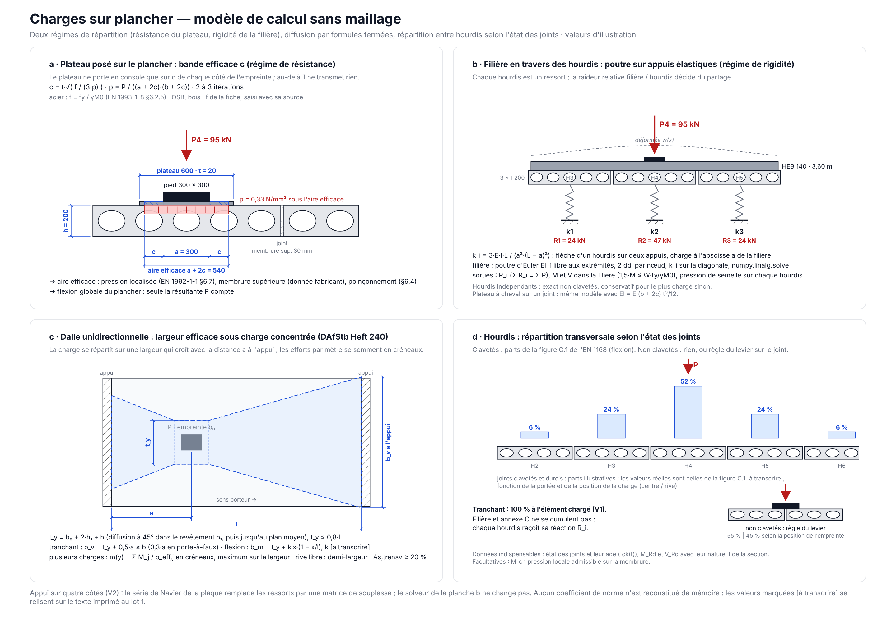
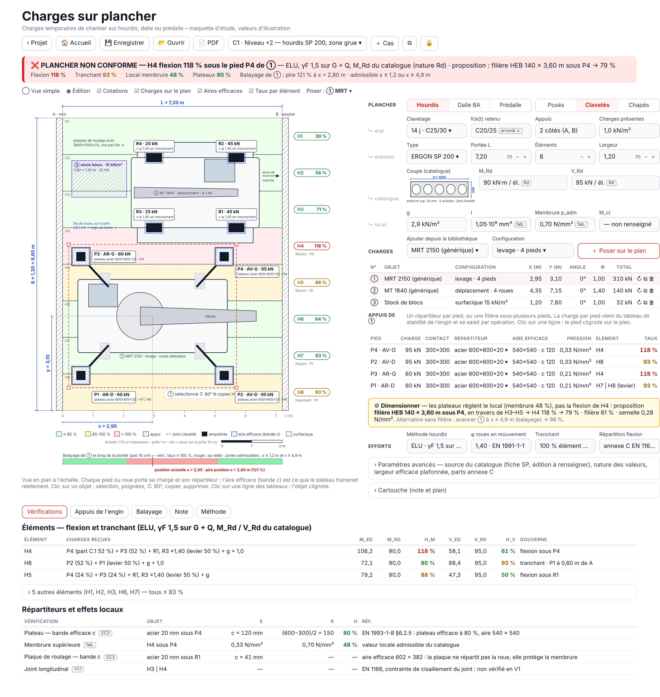
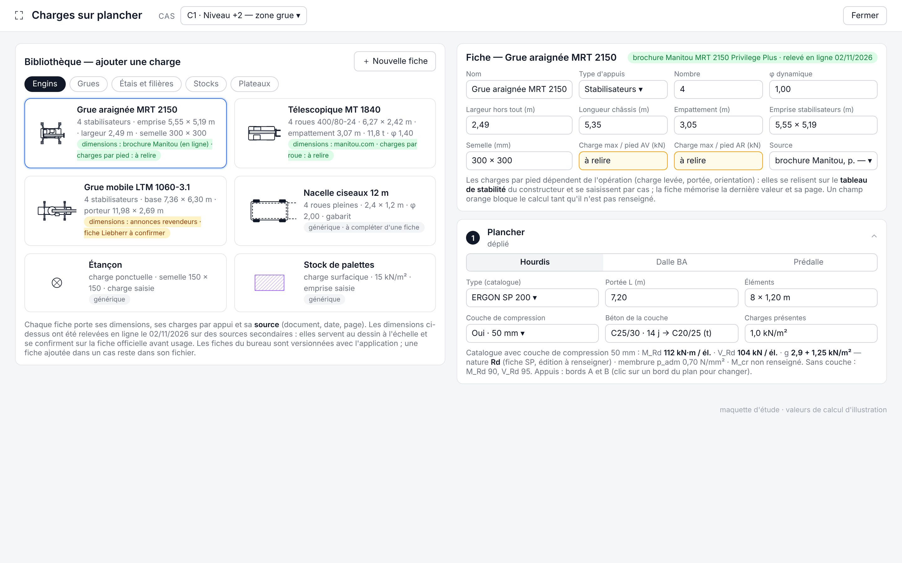

# Charges sur plancher en phase chantier — étude de conception

*Étude du 02/11/2026, avant toute ligne de code. Elle répond aux questions
posées pour un module unique « Charges sur plancher » : organisation de
l'écran, modèle de calcul sans maillage, données indispensables,
vérifications réellement possibles par type de plancher, fonctions utiles
sans « usine à gaz », critique du « ÷ 1,5 » sur les catalogues de hourdis.
Elle se termine par la solution recommandée, les lots de réalisation et les
points à trancher par le bureau (P-1 à P-12).*

**Convention de citation.** Les articles cités sont ceux dont je suis sûr.
Là où je ne le suis pas, je cite le texte par son titre et la relecture sur
le document imprimé fait partie du lot 1. Aucun coefficient de norme n'est
reconstitué de mémoire : les valeurs à transcrire (figure C.1 de l'EN 1168,
largeurs efficaces du Heft 240) sont marquées **[à transcrire]**. Les
nombres d'exemple sont calculés avec les formules **de l'application**
(`modules/poutre.py`, `beton_classes.json`), ils illustrent et ne valident
rien.

---

## 0 · La décision en une page

**Faisable, sans maillage, avec une note justifiable — à condition de
nommer honnêtement ce qu'on vérifie.**

1. **Une seule entrée de menu, un plancher, des charges posées sur un plan,
   des répartiteurs sous les charges.** L'écran a trois objets, dans
   l'ordre où le chantier les pense : le PLANCHER (type, portée, état
   d'avancement), les CHARGES (bibliothèque d'engins, position, coefficient
   dynamique), les RÉPARTITEURS (plateaux, filières, dimensionnés
   automatiquement). Le plan est au centre, les trois lignes de cases de la
   charte des assemblages à côté, les résultats colorient le plan.
2. **Deux régimes de répartition, un seul moteur.** Un plateau posé
   **directement** sur un plancher rigide ne répartit pas « par rigidité »
   mais par **résistance** : c'est la bande efficace *c* d'EN 1993-1-8
   §6.2.5 que l'application utilise déjà pour les pieds de poteaux. Un
   répartiteur qui **porte d'un élément à l'autre** (filière sur plusieurs
   hourdis, plateau à cheval sur un joint) répartit **par rigidité
   relative** : poutre sur appuis élastiques, chaque hourdis ou bande de
   dalle étant un ressort de raideur connue. Un système linéaire de
   quelques dizaines d'inconnues, pas un maillage.
3. **Le plancher calcule ses efforts par des formules fermées.** Appui sur
   deux côtés : lignes d'influence d'une poutre et largeur efficace (Heft
   240 pour les dalles, annexe C de l'EN 1168 pour les hourdis clavetés,
   rien pour les hourdis non clavetés). Appui sur quatre côtés, plus tard :
   série de Navier de la plaque simplement appuyée, qui remplace les
   ressorts par une matrice de souplesse **sans rien changer** au reste.
4. **Le « ÷ 1,5 » n'est pas une méthode ELS, c'est une vérification ELU
   écrite en charges de service.** Elle est acceptable, et même pratique,
   **si** la valeur de catalogue est une résistance de calcul *R*d ; elle
   est fausse si c'est une charge utile admissible (déjà en service), et
   elle ne dit rien de la fissuration d'un élément précontraint. La
   bibliothèque porte donc la **nature** de chaque valeur, et la note
   affiche le taux avec son nom exact.
5. **Les anciennes formules BA gardent leur place** pour les dalles coulées
   et les prédalles après durcissement de la chape : *M*adm = min(αb·μ·b·d² ;
   As·fyd·0,9·d) et *V*adm = τadm,I·0,75·b·h, c'est-à-dire les formules de
   `dalle.py` **inversées**. Ce que l'ancienne méthode n'a pas — le
   poinçonnement, la pression localisée, la membrure supérieure d'un
   hourdis — est pris dans l'EN 1992-1-1 ou chez le fabricant, et la note
   le dit.
6. **Périmètre V1 net** : trois planchers (hourdis précontraints, dalle BA
   unidirectionnelle, prédalle après chape) sur deux appuis ; charges
   ponctuelles avec surface de contact, linéaires, surfaciques, groupes
   (roues, stabilisateurs, chenilles) ; plateaux et filières à 0° ou 90° ;
   bibliothèque JSON du bureau + ajouts dans le fichier ; balayage de la
   position le long de la portée ; note PDF deux pages au format des
   assemblages. Quatre côtés, continuité, porte-à-faux, étais reportés sur
   l'étage inférieur : V2, architecture prête.

---

## 1 · Ce que l'application a déjà, et ce que le module réutilise

| Existant | Réemploi dans « Charges sur plancher » |
|---|---|
| `modules/dalle.py`, `modules/predalle.py` : hᵤ,min = √(M/(αb·b·μ)), As = M/(fyd·0,9·d), τ = V/(0,75·b·h) ≤ τadm,I, seuils de `beton_classes.json` | Les mêmes formules, **inversées** pour donner la résistance d'une bande dont l'armature est connue (§ 2.1). Une seule source : les fonctions de calcul sont importées, pas recopiées. |
| `modules/treillis.py` : nomenclature des treillis, As en mm²/m | Saisie de l'armature en place d'une dalle ou d'une prédalle. |
| `modules/age_beton.py` : fck(t) par maturité (EN 1992-1-1 §3.1.2, annexe B) | Résistance d'une chape ou d'un clavetage jeune : la classe retenue est celle dont fck est **inférieure ou égale** à fck(t) (arrondi vers le bas, § 3.2). |
| `acier/assemblages/pied_poteau/…` : bande efficace *c* = t·√(fy/(3·fjd·γM0)) d'EN 1993-1-8 §6.2.5 | Diffusion sous un plateau posé directement sur le plancher (§ 5.1). Même fonction, importée. |
| `modules/tableau_profiles.py`, `acier/resistances.py` : catalogue IPE/HEA/HEB/UPN, W, I | Filières de profilés : inertie pour le modèle, module de flexion pour la vérification du profilé. |
| `acier/assemblages/carte.py`, `ui_commun.py`, `note_kit.py` : charte des cartes, kit CSS, note deux pages, hypothèses ≤ 3 lignes | Toute la présentation : « même présentation » que les assemblages, y compris la note. |
| `acier/composants/svg_cliquable` : dessin SVG dont on sait quel élément a été cliqué | Sélection d'un objet sur le plan et **placement par clic** sur une grille invisible (§ 7.3). |
| `modules/dalle.py` : liste de cas (ajout, copie, suppression, verrou), fichier JSON propre au module | Même mécanique : plusieurs **cas** (un plancher + ses charges) dans une session, fichier JSON du module. |

Rien de ce qui précède n'est à réécrire. Le module est un **assemblage de
briques existantes** plus trois choses neuves : le modèle de répartition
(§ 5), la diffusion dans le plancher (§ 4) et le plan (§ 7).

---

## 2 · Le point dur : « ELS », résistances de catalogue et le « ÷ 1,5 »

### 2.1 Ce que l'application appelle ELS

La méthode de `poutre.py` et `dalle.py` est l'ancienne méthode belge aux
**charges de service** et **contraintes admissibles** : pas de coefficient
sur les charges, des seuils déjà minorés côté matériau (αb et μ par classe
de béton, fyd = fyk/γs avec le « coefficient acier ELS » = 1,15, τadm,I =
0,016·fck,cube/1,05). Elle **dimensionne** une section : on lui donne M et
V, elle rend hᵤ,min, As,req et un verdict sur τ.

Pour une **vérification** d'un plancher existant sous une charge de
chantier, on a besoin de l'inverse : la **résistance** d'une bande dont
l'armature est connue. Les mêmes formules la donnent sans rien inventer :

- *M*adm,béton = αb·μ·b·d² (c'est hᵤ,min résolue en M) ;
- *M*adm,acier = As·fyd·0,9·d (c'est As,req résolue en M) ;
- *M*adm = min des deux ; *V*adm = τadm,I·0,75·b·h.

Exemple, formules de l'application : bande de 1 m, h = 20 cm, d = 17 cm,
C30/37 (αb = 12,96 ; μ = 0,1709), As = 524 mm²/m (Ø10/150), fyd = 500/1,15.

| Grandeur | Formule | Valeur |
|---|---|---|
| *M*adm,béton | 12,96·0,1709·1000·170² | 64,0 kN·m/m |
| *M*adm,acier | 524·434,8·0,9·170 | 34,9 kN·m/m |
| τadm,I | 0,016·37/1,05 | 0,564 N/mm² |
| *V*adm | 0,564·0,75·1000·200 | 84,6 kN/m |

C'est la méthode que le bureau connaît, elle reste la règle pour les dalles
coulées et les prédalles après chape (**P-10** : le bureau confirme que
« garder la méthode ELS » signifie bien cette inversion).

### 2.2 Ce qu'un catalogue de hourdis publie

Un hourdis précontraint n'a pas d'armature « à inverser » : sa résistance
vient du fabricant. Les catalogues belges publient, selon le document :

- des **résistances de calcul** *M*Rd et *V*Rd (par mètre de largeur ou par
  élément), qui contiennent déjà γc, γs et le coefficient sur la
  précontrainte ;
- des **tableaux de portées maximales par charge utile** (kN/m² selon la
  hauteur, avec ou sans dalle de compression) — ce sont des charges **de
  service**, calculées par le fabricant avec ses propres combinaisons, et
  souvent bornées par une **flèche** (le PTV 201 Probeton-Benor limite f/L,
  d'après le résumé d'un catalogue PRECO consulté le 02/11/2026 ; le
  document lui-même n'a pas pu être ouvert depuis cette session) ;
- parfois un **moment de fissuration** ou de décompression, une charge
  ponctuelle admissible sur la membrure supérieure, les propriétés de
  section (aire, inertie).

Le catalogue ERGON n'était pas accessible depuis cette session : **la
nature de chaque valeur se relit dans le document du fabricant au moment
de remplir la bibliothèque, pas de mémoire** (**P-1**).

### 2.3 Critique du « ÷ 1,5 »

Diviser *M*Rd par 1,5 et comparer à *M*G + *M*Q revient exactement à
vérifier 1,5·(*M*G + *M*Q) ≤ *M*Rd, soit l'ELU avec γF = 1,5 **uniforme**
au lieu de 1,35 sur le poids propre. C'est **conservatif** sur la part
permanente (rapport 1,5/1,35 = 1,11 sur cette part seule), et c'est
**parfaitement défendable** en phase chantier, où la part variable domine
et où l'EN 1990 autorise les mêmes coefficients pour les situations
transitoires. Mais il faut le **nommer** : ce n'est pas un ELS, c'est un
ELU écrit en charges de service. La note dira « taux ELU = 1,5·(M_G +
M_Q)/M_Rd », pas « ELS ».

Quatre cas où le « ÷ 1,5 » est **faux ou insuffisant** :

1. **La valeur est déjà une charge de service.** Diviser une charge utile
   admissible par 1,5 cumule deux sécurités : on refuse des opérations
   légitimes, et l'ingénieur méthodes finit par contourner l'outil. La
   bibliothèque porte un champ *nature* ∈ {Rd, service admissible,
   caractéristique} et la conversion ne s'applique qu'à *Rd*.
2. **La fissuration d'un élément précontraint.** *M*Rd/1,5 n'est pas un
   moment de fissuration : la fissuration se juge sur la contrainte de
   traction en fibre inférieure, c'est-à-dire sur *M*cr (ou le moment de
   décompression) du fabricant. Si le plafond reste apparent ou si le
   hourdis n'est pas encore chapé, une fissure sous un stabilisateur est
   un défaut ; le module affiche une ligne « fissuration » **seulement si
   M_cr est renseigné** (**P-11**), et ne prétend pas la couvrir sinon.
3. **L'effort tranchant.** *V*Rd d'un hourdis est une résistance de section
   (traction d'âme, EN 1168 §4.3.3.2.2 par renvoi à l'EN 1992-1-1), fragile,
   sans armature. Un stabilisateur de grue est souvent **près d'un appui**,
   là où le tranchant gouverne et où la répartition transversale est la
   plus faible. Le « ÷ 1,5 » y est correct comme coefficient, mais la
   répartition entre hourdis ne l'est pas (§ 4.2) : la V1 affecte **100 %
   du tranchant à l'élément chargé** (**P-3**).
4. **Les effets locaux.** Ni *M*Rd ni *V*Rd ne disent ce qu'une roue à
   0,8 N/mm² fait à une membrure supérieure de quelques centimètres. Ce
   contrôle n'a **pas** de formule publique fiable : soit le fabricant
   donne une charge locale admissible, soit le répartiteur est
   **obligatoire** et le module l'exige (**P-5**).

### 2.4 Ce que la note affichera

Un seul vocabulaire pour les trois planchers : un **taux en %** par
vérification, et dans la ligne d'hypothèses le nom exact de la méthode :

- dalle BA et prédalle : « méthode aux contraintes admissibles de
  l'application (αb, μ, τadm) sur charges de service » ;
- hourdis : « résistances de calcul du fabricant, γF = 1,5 sur G + Q » ;
- effets locaux : « EN 1992-1-1 §6.4 / §6.7, γF = 1,5 sur la charge » —
  l'ancienne méthode n'a pas de poinçonnement, le module en introduit un
  et le dit (**P-9**).

---

## 3 · Les planchers : données indispensables, vérifications possibles

### 3.1 Hourdis précontraints (alvéolés)

**État du plancher, la donnée qui change tout.** Un plancher de hourdis
passe par trois états et la répartition transversale n'existe que dans le
dernier :

| État | Répartition entre éléments | Portée |
|---|---|---|
| posés, joints **non** clavetés | aucune : chaque élément porte seul ; une roue à cheval sur un joint se partage par la règle du levier | L entre appuis |
| joints clavetés et durcis (fck(t) du mortier de clavetage ≥ seuil fabricant) | annexe C de l'EN 1168 (figure C.1, **[à transcrire]**), pour la **flexion** ; tranchant : 100 % à l'élément chargé (**P-3**) | L |
| dalle de compression collaborante durcie | annexe C au minimum ; la chape peut mieux faire, mais sans règle publique : on reste à l'annexe C en V1 | L |

**Données indispensables** (par type, dans la bibliothèque) : hauteur,
largeur d'élément (1,20 m usuel, éléments découpés en rive), poids propre
g, inertie I de la section (donnée fabricant ; à défaut estimation sur la
géométrie, signalée), *M*Rd et *V*Rd **avec leur nature** (**P-1**), classe
de béton. Facultatives : *M*cr, charge locale admissible sur la membrure,
épaisseur de membrure et entraxe d'alvéoles (pour dessiner où poser un
plateau). Par cas : portée, nombre d'éléments, appuis, état, âge du
clavetage ou de la chape, charges réparties déjà présentes (stocks,
personnel), épaisseur de chape si coulée.

**Vérifications possibles** : flexion de l'élément chargé (part annexe C ou
100 %) ; tranchant à l'appui de l'élément chargé ; charge locale sur la
membrure (si donnée fabricant) sinon exigence de répartiteur ;
fissuration (si *M*cr). **Impossible sans donnée fabricant** : le joint
longitudinal (l'EN 1168 fixe une contrainte de cisaillement admissible
dans le joint, **[à transcrire]**, V1.1), la torsion d'un élément de rive
chargé excentré, les éléments découpés ou à réservations.

### 3.2 Dalle en béton armé coulée en place, unidirectionnelle

**Données** : h, enrobage d'axe, classe de béton **ou** âge (fck(t) de
`age_beton`, classe arrondie vers le bas), As inférieur dans le sens
porteur (treillis + renforts, `treillis.py`), armature transversale
≥ 20 % de la principale (case cochée par défaut ; EN 1992-1-1 §9.3.1.1(2)) —
sans elle, pas de largeur efficace au-delà de t_y (§ 4.1) ; portée et
appuis. As supérieur sur appuis : V2 (continuité).

**Vérifications** : *M*adm et *V*adm par bande (§ 2.1) sur la largeur
efficace ; pression localisée sous un plateau (EN 1992-1-1 §6.7) ;
poinçonnement sous une roue ou un plateau (EN 1992-1-1 §6.4, γF = 1,5).

### 3.3 Prédalles

**Avant la chape** : la prédalle et ses raidisseurs ne portent que le béton
frais et les charges de bétonnage de l'EN 1991-1-6 ; un engin n'y a rien à
faire. Le module **refuse** l'état « chape non coulée » pour toute charge
autre que surfacique de bétonnage, avec le message qui renvoie aux tables
d'étaiement du fabricant (**P-7**). Pas de calcul.

**Après durcissement de la chape** : dalle unidirectionnelle monolithique
(§ 3.2) avec deux particularités : la largeur efficace est **plafonnée à
la largeur de la prédalle** sauf si le treillis de chape et les barres de
couture traversent les joints (case « joints armés », cochée par défaut
quand la chape est coulée) ; les **étais encore en place** réduisent la
portée à leur entraxe, mais reportent la charge sur l'étage inférieur, ce
que le module ne modélise pas et **signale** (**P-8**).

### 3.4 Appui sur quatre côtés (V2)

Dalle BA bidirectionnelle simplement appuyée : série de Navier de la
plaque rectangulaire (formules fermées, charges en rectangle), qui donne
flèche, Mx et My en tout point sans maillage. Elle fournit à la fois la
**souplesse** sous un répartiteur (§ 5.2) et les **efforts** à comparer à
*M*adm par direction (As,x et As,y). L'interface `Plancher` de § 8 est
écrite pour qu'un quatrième type s'ajoute sans toucher aux répartiteurs ni
aux vérifications.

---

## 4 · La diffusion dans le plancher, sans maillage

### 4.1 Dalles unidirectionnelles : largeur efficace (DAfStb Heft 240)

Une charge concentrée sur une dalle portant dans un sens se répartit sur
une largeur qui croît avec la distance à l'appui. Le Heft 240 donne :

- la largeur de **contact diffusée** t_y = b₀ + 2·h₁ + h (largeur de la
  charge, diffusion à 45° dans le revêtement h₁ et jusqu'au plan moyen de
  la dalle), bornée par t_y ≤ 0,8·l ;
- pour le **tranchant**, b_v = t_y + 0,5·a ≤ b (a = distance de la charge à
  l'appui ; 0,3·a en porte-à-faux) ;
- pour la **flexion**, une largeur de la forme t_y + k·x·(1 − x/l) selon les
  conditions d'appui, **[à transcrire]** du texte avant implémentation ;
  la forme est connue, le coefficient ne se recopie pas de mémoire.

Charges multiples : l'effort par mètre en un point est la **somme des
créneaux** M_j/b_eff,j centrés sur chaque charge ; le maximum sur la
largeur donne la bande gouvernante. Près d'une rive libre : demi-largeur.
C'est de l'arithmétique sur des intervalles, pas un maillage.

### 4.2 Hourdis : annexe C de l'EN 1168 et règle du levier

Joints clavetés : la figure C.1 donne la **part de la charge** reprise par
l'élément chargé et ses voisins, pour une charge ponctuelle ou linéaire,
au centre ou en rive, en fonction de la portée **[à transcrire]**. Elle
s'applique à la flexion ; pour le tranchant près de l'appui, V1 garde
100 % sur l'élément chargé (**P-3**) — c'est conservatif et c'est là que
se posent les stabilisateurs.

Joints non clavetés : aucune répartition. Une empreinte à cheval sur un
joint se partage entre les deux éléments par la **règle du levier** (au
prorata de la position), ce qui est exact pour deux appuis indépendants.

Annexe C et filière ne se cumulent pas : si une filière distribue la
charge sur plusieurs éléments (§ 5.2), chaque élément reçoit sa réaction
**sans** nouvelle répartition — conservatif pour l'élément le plus chargé.

### 4.3 Efforts dans un élément ou une bande

Poutre sur deux appuis, formules fermées : pour une charge P à l'abscisse
a, M(x) et V(x) par lignes d'influence, plus les charges réparties
présentes (poids propre, chape, stocks). Le maximum est cherché aux
abscisses des charges et aux appuis, ce qui suffit pour des charges
concentrées et réparties uniformes. Le **balayage** (§ 7.5) déplace le
groupe de charges le long de la portée et garde l'enveloppe.

---

## 5 · Les répartiteurs : deux régimes, un moteur



*Quatre planches au trait (sources dans `maquette/modele.py`) : a · plateau
posé sur le plancher et bande efficace c ; b · filière en travers des
hourdis, poutre sur appuis élastiques ; c · largeur efficace d'une dalle
unidirectionnelle ; d · répartition entre hourdis selon l'état des
joints. Valeurs d'illustration.*

### 5.1 Plateau posé directement sur le plancher : régime de résistance

Un plateau d'OSB ou d'acier posé sur une dalle est des centaines de fois
plus souple qu'elle en flexion. Il ne « répartit » donc pas par rigidité :
la pression ne s'étale que jusqu'où le plateau **résiste** en console
autour de l'empreinte. C'est exactement le modèle d'EN 1993-1-8 §6.2.5
pour une platine sur béton : bande efficace *c* = t·√(f/(3·p)), où p est la
pression sous l'aire efficace et f la contrainte de flexion admise du
plateau (fy/γM0 pour l'acier, valeur de fiche pour l'OSB ou le bois,
**saisie dans la bibliothèque avec sa source**). L'aire efficace vaut
(a + 2c)·(b + 2c) ; comme p en dépend, deux ou trois itérations suffisent.

Ce modèle **dit la vérité qui fâche** : pour un plateau de 18 mm, avec par
exemple f = 10 N/mm² et p = 1 N/mm², c = 18·√(10/3) = 33 mm. Un OSB sous
une roue protège la surface et ne répartit presque rien. Une tôle de
20 mm en S235 sous un stabilisateur gagne une bande de plusieurs
centimètres, pas la tôle entière. Le module affiche l'aire efficace sur
le plan, et c'est l'argument que l'ingénieur méthodes attend.

Le dimensionnement est direct : l'aire efficace nécessaire vient de la
pression localisée admise par le plancher (EN 1992-1-1 §6.7, ou donnée
fabricant pour un hourdis) et du poinçonnement ; l'épaisseur nécessaire
vient de c ≥ (B − b)/2 pour que le plateau choisi soit **entièrement**
efficace. Un plateau de fournisseur déclaré rigide (plaques de grue
composites) se saisit avec la nature « rigide déclaré » et sa pression
admissible, sans calcul de c.

Pour la flexion globale du plancher, l'aire efficace ne change presque
rien (seule la résultante compte) ; pour le poinçonnement, la membrure
d'un hourdis et le joint, elle change tout. Le modèle est donc là où il
sert.

### 5.2 Filière ou plateau à cheval : régime de rigidité

Une filière de profilés (ou une tôle épaisse) posée **en travers** de
plusieurs hourdis, ou sur plusieurs bandes d'une dalle, porte d'un
élément à l'autre. Là, la rigidité relative décide : une HEB rigide
partage presque également, une UPN souple concentre sous la charge.

Modèle : **poutre sur appuis élastiques**.

- Les appuis sont les éléments croisés par la filière : hourdis de largeur
  b_u, ou bandes de 1,00 m d'une dalle. Chacun est un ressort de raideur
  k_i = 3·E·I·L/(a²·(L − a)²) — la flèche d'une poutre sur deux appuis sous
  une charge à l'abscisse a — avec E·I de l'élément (inertie fabricant ou
  b·h³/12 de la bande) ; k dépend donc de l'endroit de la portée où la
  filière est posée.
- La filière est une poutre d'inertie EI_f, chargée par les charges P_j aux
  abscisses de la machine, **libre à ses extrémités** et tenue seulement
  par les ressorts. Méthode des déplacements : deux degrés de liberté par
  nœud (flèche, rotation), matrices élémentaires 4×4 d'une poutre
  d'Euler, raideurs des ressorts sur la diagonale, résolution par
  `numpy.linalg.solve` (numpy est déjà une dépendance de l'application).
  Vingt appuis font un système de quarante équations : instantané.
- Sorties : réactions R_i (ce que chaque élément reçoit, **somme exacte**),
  moment et tranchant dans la filière (vérification du profilé avec W du
  catalogue : 1,5·M ≤ W·fy/γM0, même vocabulaire de taux), pression de
  la semelle sur l'élément (R_i / (largeur de semelle · largeur de
  contact)), qui alimente le contrôle local.

Un plateau à cheval sur un joint se traite par le **même** moteur : la
bande de plateau qui travaille en poutre d'un élément à l'autre a la
largeur de contact + 2c (§ 5.1), et EI = E·b_strip·t³/12.

Validité et limites, écrites dans l'onglet Méthode : les éléments sont
supposés **indépendants** (exact pour des hourdis non clavetés,
conservatif pour l'élément le plus chargé sinon) ; filière à 0° ou 90°
seulement, une diagonale est refusée avec un message ; deux filières
sous les deux chenilles ou les deux files de roues sont deux problèmes
indépendants.

Dimensionnement automatique : pour une longueur donnée (n éléments
couverts), le module parcourt la bibliothèque de filières par masse
croissante et retient la première dont tous les taux sont ≤ 100 % ; il
essaie ensuite n + 1 éléments. Le tableau des trois premières candidates
reste visible, comme le « prédimensionnement » des assemblages.

### 5.3 Pourquoi pas un maillage

Un plancher de chantier est une poutre ou une plaque simplement appuyée
sous quelques charges : tout ce qu'un maillage apporterait (répartition
2D fine, continuité, singularités sous charge ponctuelle) est soit
couvert par des formules fermées reconnues, soit **non souhaité** dans une
note qu'un ingénieur doit relire en dix minutes. Le jour où la plaque sur
quatre côtés arrive, la série de Navier (fermée, convergente pour des
charges en rectangle) fournit la matrice de souplesse F_ij = w(x_i | P
en x_j) qui remplace les ressorts diagonaux par une matrice pleine de
même taille. Le solveur de § 5.2 ne change pas d'une ligne.

---

## 6 · Les charges : bibliothèque, coefficients, combinaison

### 6.1 Natures de charge

| Nature | Saisie | Exemple |
|---|---|---|
| ponctuelle | P, empreinte a × b, position, angle | roue, stabilisateur, pied d'étai |
| linéaire | p (kN/m), longueur, largeur de contact | file d'étais de l'étage supérieur, chenille |
| surfacique | q (kN/m²), rectangle | stock de palettes, benne, personnel |
| **groupe** | gabarit de la bibliothèque : liste d'empreintes avec (dx, dy, a × b, part ou charge) | télescopique (4 roues, charge par essieu), grue mobile (4 stabilisateurs), nacelle |

Un gabarit d'engin porte sa **géométrie** et ses charges **par appui** ;
la charge par stabilisateur vient du tableau de levage de la grue et se
saisit **par opération** (le gabarit mémorise la dernière valeur, pas une
valeur « constructeur » que personne ne pourra justifier). Les gabarits
livrés avec l'application sont **génériques et nommés comme tels** ; le
bureau y ajoute ses machines, fiche technique à l'appui (champ *source*
obligatoire : nom du document et date).

Un engin a des **configurations** : un télescopique « en déplacement »
porte sur ses quatre roues avec φ = 1,40, « en levage » sur ses pieds
stabilisateurs avec les roues délestées ; une grue mobile sur ses
stabilisateurs. La configuration est une case du gabarit, et chaque
**appui** de l'engin (roue, pied, chenille) est une ligne de la table
« Appuis de l'engin » : sa charge, son empreinte, **son répartiteur**
(plateau par pied, plaque de roulage par file de roues, ou filière sous
plusieurs appuis), l'aire efficace qui en résulte, la pression, l'élément
du plancher qui le reçoit et le taux. La charge de chaque roue ou pied est
**écrite sur le plan**, à côté de son empreinte, avec son plateau.

### 6.2 Coefficient dynamique

Une machine qui roule frappe plus fort qu'une machine arrêtée. Règle
codifiée la plus proche : EN 1991-1-1 §6.3.2.3, chariots élévateurs,
Q_k,dyn = φ·Q_k avec φ = 1,40 (pneumatiques) et 2,00 (bandages pleins).
Défauts de la bibliothèque : φ = 1,40 pour des roues « en mouvement »,
1,00 pour un stabilisateur ou une charge à l'arrêt ; valeur modifiable et
affichée dans la ligne d'hypothèses (**P-6**).

### 6.3 Combinaison

Charges de service en entrée : poids propre du plancher (bibliothèque ou
calculé), chape si coulée, charges réparties déjà présentes (stocks,
personnel ; l'EN 1991-1-6 §4.11 nomme les charges de chantier Q_ca à
Q_cf, le module ne les impose pas, il les laisse saisir), puis l'engin
avec son φ. Le taux se calcule :

- dalle BA et prédalle : (M_G + M_Q)/M_adm, (V_G + V_Q)/V_adm — la méthode
  de l'application porte sa sécurité côté matériau ;
- hourdis : 1,5·(M_G + M_Q)/M_Rd, 1,5·(V_G + V_Q)/V_Rd (**P-2** : γF = 1,5
  uniforme, conservatif sur G, accepté pour la phase chantier) ;
- effets locaux : 1,5·P/F_Rd (EN 1992-1-1 §6.7), 1,5·V_Ed/(u₁·d) ≤ v_Rd,c
  (§6.4).

Le même mot « taux » partout, et la ligne d'hypothèses dit lequel.

### 6.4 Étais, files d'étais et filières (question du bureau du 02/11/2026)

Un étai est une charge ponctuelle à petite semelle (150 × 150 mm usuels),
rarement seul : une **file** (n étais à l'entraxe e) ou une **trame**
(nx × ny). Sa charge ne vient pas d'une fiche constructeur mais du
plancher qu'il porte : le gabarit « Étais » la calcule depuis la surface
tributaire et le plancher au-dessus (épaisseur × 25 kN/m³ + coffrage +
charge de chantier), ou la prend saisie. La classe de l'étai (EN 1065)
est une information de la fiche, pas une vérification du module.

| Plancher porteur | Étai posé directement | Étai sur filière |
|---|---|---|
| dalle coulée en place | oui : bande avec largeur efficace (Heft 240), poinçonnement (petite semelle : souvent gouvernant sur une dalle mince), pression localisée ; dalle jeune → fck(t) | oui : filière **en travers** du sens porteur = poutre sur bandes-ressorts, répartit sur plusieurs bandes ; filière **dans** le sens porteur = charge linéaire sur la même bande, utile seulement pour le local |
| prédalle, chape durcie | oui, comme une dalle ; semelle à cheval sur un joint de prédalle → avertissement et largeur plafonnée (**P-16**) ; avant la chape : refus (**P-7**) | oui, mêmes règles ; la filière en travers des joints est la bonne réponse à **P-16** |
| hourdis, nus ou chapés | oui : élément chargé ou règle du levier sur un joint, part annexe C si clavetés, tranchant à 100 % ; la **membrure** sous une semelle de 150 × 150 est presque toujours le point dur → charge locale admissible du fabricant, sinon filière exigée (**P-5**) | oui, c'est le cas d'usage de la filière : en travers des hourdis, elle porte sur plusieurs éléments par leur raideur (§ 5.2) et supprime le problème de membrure |

Ce que la V1 ne fait pas : la **chaîne d'étaiement** sur plusieurs
étages (un étage porté par des étais est lui-même étayé sur l'étage
inférieur). La V1 vérifie un plancher sous des charges d'étais données et
avertit que l'étage inférieur reçoit ces charges (**P-8**) ; la chaîne
est une V2, avec les mêmes briques.

---

## 7 · L'interface : une entrée, un plan, trois objets

### 7.1 Une entrée de menu

`streamlit_app.py` reçoit une page « Charges sur plancher » qui appelle
`modules/charges_plancher.show()`, façade mince devant le paquet
`plancher/charges/` (§ 8), comme `modules/assemblages.py` devant
`acier/`. Pas de sous-menu : le **type de plancher** est une case de la
première ligne, pas une page.

### 7.2 Organisation de l'écran : digeste d'abord

**Décision du 02/11/2026 (retour du bureau).** Une première maquette, qui
montrait tout en même temps (quatre lignes de cases par objet, bulles
détaillées sur chaque roue, grille, cotes, bandeau de statut à six
chiffres), a été jugée **indigeste** et rejetée. La règle retenue : on ne
simplifie **aucun calcul ni aucune vérification**, on simplifie **ce qui
se voit**. Un écran = un plan épuré, un résultat en une phrase, et des
étapes repliées qu'on ouvre quand on en a besoin.



*Maquette HTML/SVG rendue par Chromium (sources dans `maquette/`,
régénérables : `python3 maquette.py <dossier>` puis `node capture.js`).
Toutes les valeurs sont d'illustration.*

**En haut** : le titre, le sélecteur de cas, et trois boutons (ouvrir,
enregistrer, note PDF). Rien d'autre.

**À gauche, le plan**, blanc, à l'échelle, avec le strict nécessaire :

- les **appuis sont un trait noir épais** (A et B), les bords libres un
  trait fin ; une poignée au milieu de chaque bord permet de **basculer
  appui / libre** d'un clic (par défaut : poutre sur deux appuis, A et B) ;
- les hourdis numérotés, leurs joints en tireté ; seules les bandes dont
  le taux est **≥ 85 %** sont teintées (orange) ou **> 100 %** (rouge), les
  autres restent blanches ; le taux de chaque bande est écrit à droite,
  hors du dessin, en pastille rouge ou orange seulement quand il compte ;
- l'engin en **vraie vue de dessus, à l'échelle de sa fiche** : châssis et
  roues, tourelle, cabine, flèche, stabilisateurs ; chaque symbole est
  dessiné au trait à partir des dimensions de la fiche (§ 7.3) et posé sur
  le plan avec la même échelle que le plancher. Chaque pied porte une
  étiquette courte « P2 · 95 kN », la semelle en noir, le **plateau**
  hachuré autour, l'aire efficace en tireté bleu. Un engin sans fiche
  dimensionnelle est dessiné par son gabarit générique, et nommé tel ;
- **le plateau se pose automatiquement sous le pied** quand on le choisit
  (centré par défaut), il se déplace en le glissant, et **un clic sur le
  plateau ouvre un petit panneau**, à côté du plan et relié au plateau,
  pour changer son type, son matériau, ses dimensions, ou le retirer ;
- la **filière proposée** par le dimensionnement est dessinée en tireté
  bleu à l'endroit où elle irait, avant qu'on l'applique ;
- deux cotes (portée, largeur), une échelle graphique, une légende d'une
  ligne. Les options d'affichage (cotes, aires efficaces, taux) sont des
  cases à cocher ; « Plan · Coupe · Balayage » sont trois vues du même cas.

**Sous le plan, la coupe transversale** sous le pied sélectionné : les
hourdis voisins, la **couche de compression** si elle existe (épaisseur,
béton, âge), le plateau, la semelle, la charge, l'aire efficace et la
diffusion à 45° jusqu'au plan moyen. C'est la figure que le bureau
voulait voir.

**La couche de compression** est une donnée du plancher, pas un état : le
hourdis peut être nu ou chapé, et la chape change le poids propre, la
hauteur de diffusion et les résistances de catalogue (le fabricant publie
*M*Rd et *V*Rd avec et sans dalle de compression). L'étape 1 porte donc
« Couche de compression : oui / non · épaisseur · béton · âge », et la
ligne de catalogue dit laquelle des deux valeurs est retenue.

**À droite, le résultat puis quatre étapes** :

1. **RÉSULTAT** en tête : une pastille (conforme / non conforme), **une
   phrase** (« Flexion de H3 sous le pied P2 »), quatre barres (flexion,
   tranchant, pression locale, plateaux) et les **propositions** du
   dimensionnement avec un bouton « Appliquer » (filière sous P2) ou
   « Voir » (reculer la grue de 0,40 m).
2. **Plancher**, replié sur une ligne de résumé (type, portée, éléments,
   appuis, état) ; déplié, il montre le type en contrôle segmenté, six
   champs, et les valeurs de catalogue avec leur **nature**.
3. **Charges** : la liste des objets posés (nom, configuration, position,
   charge totale), le bouton « Ajouter » qui ouvre la **bibliothèque**, et
   la table « Pieds de la grue » (pied, charge, répartiteur, élément, taux).
4. **Répartiteur sous le pied sélectionné** : « Aucun · Plateau · Filière ·
   Plateau + filière », matériau, dimensions, épaisseur, et une ligne de
   résultat (aire efficace, pression, éléments touchés). La case « idem
   4 pieds » applique le même choix à tous les pieds de l'engin.
5. **Hypothèses de calcul**, repliées sur une ligne (ELU, γF, φ, nature
   des résistances, annexe C), puis le lien « Voir le détail des
   vérifications par élément », qui ouvre les tableaux complets.

Téléphone : même page, une seule colonne, plan puis coupe puis étapes
(`images/maquette_ecran_390.png`).

### 7.3 La bibliothèque



« Ajouter » ouvre la bibliothèque : des **fiches** d'engins, grues, étais
et filières, stocks, plateaux, chacune avec **le même symbole en vue de
dessus que sur le plan**, ses valeurs clés et un badge de **source** qui
dit d'où viennent les dimensions et si les charges par appui sont
renseignées. Une fiche se crée ou se complète depuis une vraie
documentation constructeur : nom, type d'appuis, nombre, largeur et
longueur hors tout, empattement, emprise des stabilisateurs, semelle,
masse, charge maximale par pied (avant / arrière), configurations,
coefficient dynamique, source et page. Un champ obligatoire vide
(charge par pied) est orange et **bloque le calcul**. Les charges par pied
se relisent sur le tableau de stabilité du constructeur pour
l'opération prévue ; la fiche mémorise la dernière valeur saisie et sa
source. Les fiches du bureau sont versionnées avec l'application
(**P-12**), une fiche ajoutée dans un cas reste dans son fichier.

**Dimensions utilisées dans la maquette** (relevées en ligne le
02/11/2026 sur des sources secondaires, pour dessiner à l'échelle ; à
confirmer sur les fiches officielles avant tout usage) : Manitou
MRT 2150 Privilege Plus, largeur 2,49 m, châssis 5,35 m, empattement
3,05 m, emprise sur stabilisateurs 5,55 × 5,19 m (brochure Manitou
diffusée par un distributeur, fiche Equipworld) ; Manitou MT 1840,
longueur au tablier 6,27 m, largeur 2,36 à 2,42 m selon la variante,
empattement 3,07 m, pneus 400/80-24, 11,6 à 11,9 t (pages manitou.com,
Equipworld) ; Liebherr LTM 1060-3.1, base d'appui 7,36 × 6,30 m,
porteur 11,98 × 2,69 m (annonces de revendeurs, fiche Liebherr à
confirmer). **Aucune charge par pied n'a été relevée** : elles viennent
des tableaux de stabilité, que la maquette laisse en orange.

### 7.4 Le plan : mécanique du clic

Dessin SVG à l'échelle, rendu par `svg_cliquable`. Placement **par clic**
sans composant nouveau : le plan est recouvert d'une grille de cellules
invisibles (pas de 10 cm) identifiées `c_x_y` ; le module y pose l'objet
choisi. Un clic sur un pied, un plateau, un bord ou une bande renvoie son
identifiant : sélection, fenêtre du répartiteur, bascule appui / libre,
détail de la bande. Le déplacement d'un plateau se fait par clic sur sa
nouvelle cellule (ou par les cases x, y de l'étape 4) ; le glisser-déposer
continu reste **écarté** tant qu'il exigerait un composant JavaScript
nouveau : le clic-pose donne le même résultat au pas de 10 cm.

### 7.5 Résultats

Le résultat tient en une phrase et quatre barres (§ 7.2) ; le détail
(tableau des éléments, répartiteurs, effets locaux, formules) est
derrière le lien « Voir le détail des vérifications par élément ». Les
messages de refus (prédalle sans chape, filière en diagonale, hourdis
sans donnée locale et sans répartiteur) prennent la place de la phrase
de résultat, en rouge, avec ce qu'il faut faire.

### 7.6 Balayage de position

Case « balayer le long de la portée » : le groupe de charges est déplacé
de l'appui gauche à l'appui droit par pas de 10 cm, le taux maximal est
tracé en bandeau sous le plan (vert / rouge selon x) et la position la
plus défavorable est retenue pour la note. Coût nul avec des formules
fermées ; valeur énorme pour un ingénieur méthodes à qui l'on demande
« où peut rouler le Manitou ».

### 7.7 Note PDF, deux pages, même présentation

Page 1 : en-tête du projet, trois lignes d'hypothèses (plancher et état ·
charges et φ, γF · diffusion et répartiteurs), plan à l'échelle avec
empreintes et taux, tableau des éléments, statut. Page 2 : répartiteurs
(réactions, moment, pression), effets locaux, balayage s'il est activé,
sources et notations. Kit `note_kit`, signets, intégration future au
rapport de projet.

---

## 8 · Architecture logicielle

```
plancher/
  charges/
    modele.py         dataclasses : Plancher (3 variantes), Charge, Groupe,
                      Repartiteur, Position ; interface Plancher :
                      elements(), raideur(i, a), efforts(charges) → M, V
                      par élément, resistance() → M_adm, V_adm, locaux
    diffusion.py      Heft 240 (t_y, b_v, b_m), annexe C EN 1168 (table
                      transcrite + interpolation), règle du levier,
                      superposition en créneaux
    repartiteurs.py   bande efficace c (import pied_poteau), poutre sur
                      ressorts (numpy), dimensionnement par parcours
    resistances.py    inversion des formules de dalle.py (import, pas
                      copie), conversion des natures de catalogue,
                      EN 1992-1-1 §6.4 / §6.7
    verification.py   pipeline : charges → répartiteurs → charges par
                      élément → efforts → taux ; balayage ; statut
    bibliotheque.py   JSON livrés (plancher/donnees/*.json) + ajouts du
                      fichier de cas ; champ source obligatoire
    dessin.py         plan SVG, grille de clic, coloration
    ecran.py          Streamlit, charte carte.py / ui_commun.py
    note.py, textes.py, methode.py
  donnees/
    hourdis.json      types génériques (à compléter par le bureau)
    engins.json       gabarits génériques
    repartiteurs.json plateaux, filières (profilés du catalogue, bois)
modules/charges_plancher.py   façade show()
tests/test_charges_plancher_{diffusion,repartiteurs,moteur,ecran}.py
docs/plancher/CHARGES_PLANCHER.md   (document de référence, lot 4)
```

Clés de session préfixées `chp_`, disjointes des autres modules. Fichier
JSON du module (comme `dalle.py`) ; la bibliothèque personnelle vit **dans
le dépôt** pour les machines du bureau (Streamlit Cloud n'a pas de disque
persistant : un fichier écrit à chaud disparaît au redémarrage) et **dans
le fichier de cas** pour les ajouts d'une étude, exportables.

**Tests qui verrouillent** (chaque formule a le sien, et rougit si on la
retire) : charge au milieu d'un élément seul → M = P·L/4, V = P/2 ; règle
du levier → somme des parts = 1 ; filière infiniment rigide sur n
ressorts égaux → réactions égales ; filière infiniment souple → tout sur
le ressort sous la charge ; somme des réactions = somme des charges, à
10⁻⁹ près ; inversion des formules de dalle → hᵤ,min(M_adm,béton) = d et
As,req(M_adm,acier) = As ; parts de l'annexe C → somme = 100 % ; cas de
référence gelés (`tests/ref_chp.json`) ; harnais AppTest de l'écran ;
captures PC / tablette / téléphone par `tools/captures_assemblages.js`
étendu.

---

## 9 · Fonctions retenues, fonctions écartées

**Retenues en V1** : trois planchers sur deux appuis ; états
d'avancement avec fck(t) ; charges ponctuelles, linéaires, surfaciques,
groupes ; bibliothèque JSON avec sources ; φ dynamique ; plateaux (règle
c) et filières (poutre sur ressorts) à 0° / 90° ; dimensionnement
automatique ; diffusion Heft 240 / annexe C / levier ; contrôles locaux
EN 1992-1-1 ; balayage de position ; plan cliquable ; plusieurs cas par
fichier ; note PDF deux pages ; onglet Méthode avec limites.

**Écartées, et pourquoi** : glisser-déposer (composant nouveau pour rien) ;
maillage 2D (§ 5.3) ; continuité et porte-à-faux (V2, exigent As
supérieur et les largeurs efficaces correspondantes) ; quatre côtés (V2,
Navier) ; chaîne d'étais vers l'étage inférieur (avertissement seulement,
**P-8**) ; prédalle avant chape (refus, **P-7**) ; joint longitudinal des
hourdis (V1.1 avec la valeur de l'EN 1168, **[à transcrire]**) ; flèche et
vibrations (sans objet pour une charge temporaire) ; répartiteurs en
diagonale ; grues sur chenilles au-delà d'une charge linéaire (la
chenille **est** une charge linéaire, elle est donc couverte).

---

## 10 · Solution recommandée et lots

**Recommandation.** Construire le module tel que décrit, en quatre lots
de taille comparable à ceux des assemblages, et ne pas lancer le lot 2
avant que le bureau ait tranché P-1 à P-3 (ce sont les trois décisions
qui changent les nombres).

| Lot | Contenu | Preuve |
|---|---|---|
| 1 · moteur | `modele`, `diffusion` (Heft 240 et annexe C **transcrits** du texte), `repartiteurs`, `resistances`, `verification`, bibliothèques génériques | tests analytiques et cas gelés ; relecture des valeurs transcrites sur le document imprimé, référencée dans `methode.py` |
| 2 · écran | `dessin` (plan, grille de clic), `ecran` (charte), cas multiples, fichier JSON, balayage | harnais AppTest, captures trois formats relues |
| 3 · note | note deux pages, onglet Méthode, textes, intégration menu — **livré le 02/11/2026** (`note.py`, `peintre.py`, `methode.py`, `CHARGES_PLANCHER.md` § 9) | tests PDF (ancres de page 1 et 2), images envoyées |
| 4 · V&V et doc | cas de contrôle à la main (une roue sur un hourdis, un stabilisateur sur tôle à cheval sur deux hourdis, un Manitou sur dalle 20 cm), `docs/plancher/CHARGES_PLANCHER.md`, registre — **livré le 02/11/2026** (`tools/validation_charges_plancher.py`, cinq contrôles dont une filière contre éléments finis et des créneaux exhaustifs ; un défaut non conservatif trouvé et corrigé : le maximum de M_Ed entre la charge et la mi-portée, `CHARGES_PLANCHER.md` § 10) | rapport daté `docs/validation/charges_plancher_validation_2026-11-02.md`, suites au vert, fusion dans `main` sur demande |

---

## 11 · Points à trancher par le bureau

- **P-1 · Nature des valeurs de catalogue — tranché le 02/11/2026.** Les
  valeurs du catalogue (ERGON) servent de défaut dès qu'elles sont
  transcrites dans `plancher/donnees/hourdis.json`, et le bureau peut
  toujours saisir les siennes dans l'étape Plancher (M_Rd, V_Rd, nature,
  I, p_loc_adm, M_cr, valeurs avec chape et classe exigée). Chaque valeur
  porte sa nature : résistance de CALCUL (Rd, comparée à des efforts ELU)
  ou charge ADMISSIBLE de service (coefficients 1). La fiche ERGON reste à
  transcrire du document du fabricant — aucun chiffre n'est pris de
  mémoire ; la recherche en ligne du 02/11/2026 n'a trouvé aucun tableau
  ERGON publié (seul un document PRECO, qui ne vaut pas pour ERGON).
- **P-2 · Coefficients partiels — tranché le 02/11/2026 : pas de ÷ 1,5
  uniforme.** Les efforts sollicitants comptent les poids propres. Quand
  la résistance est une valeur de CALCUL (M_Rd d'un catalogue, EN 1992-1-1
  pour les effets locaux, EN 1993 pour une filière ou un plateau) :
  M_Ed = 1,35·M_G + 1,5·M_Q ≤ M_Rd, avec G = poids propres (hourdis, chape,
  dalle) et Q = charges de chantier (charges présentes, engins × φ, étais,
  stocks). Quand la résistance est une valeur ADMISSIBLE de service
  (catalogue en service, méthode aux contraintes admissibles de
  l'application pour les dalles) : coefficients 1 sur G et Q. L'ancienne
  règle « M_Rd / 1,5 contre un moment de service » pondérait le poids
  propre à 1,5 au lieu de 1,35.
- **P-3 · Tranchant des hourdis — hypothèse explicitée le 02/11/2026.**
  Pour l'effort tranchant, la réaction d'appui de chaque charge
  concentrée reste à 100 % sur l'élément qui la porte : aucun partage avec
  les voisins par les joints longitudinaux. La figure C.1 de l'EN 1168
  répartit la FLEXION à mi-portée, où les joints ont toute la portée pour
  transmettre ; près de l'appui, le joint n'a que quelques dizaines de
  centimètres et l'annexe C ne dit rien de l'effort tranchant : garder
  tout sur l'élément chargé est prudent. Le paramètre
  `part_tranchant_element` (défaut 1,0) permet une autre part, à
  justifier ; l'hypothèse est écrite dans la ligne de méthode de chaque
  vérification de tranchant et dans les hypothèses du résultat.
- **P-4 · Largeur efficace en flexion** (Heft 240) : coefficients à
  transcrire du texte ; la V1 n'utilise que t_y et b_v tant que la
  relecture n'est pas faite.
- **P-5 · Charge locale sur hourdis** : donnée fabricant ou répartiteur
  obligatoire. Pas de troisième voie.
- **P-6 · φ = 1,40** pour des roues en mouvement (EN 1991-1-1 §6.3.2.3),
  1,00 à l'arrêt. Confirmer la transposition d'une règle « chariot
  élévateur » aux télescopiques de chantier.
- **P-7 · Prédalle sans chape** : refus de toute charge d'engin.
- **P-8 · Étais en place** : portée réduite acceptée, report sur l'étage
  inférieur non modélisé, avertissement.
- **P-9 · Poinçonnement et pression localisée** : EN 1992-1-1 §6.4 / §6.7
  avec γF = 1,5, introduits à côté de l'ancienne méthode qui ne les a pas.
- **P-10 · « Garder la méthode ELS »** = inverser les formules de
  `dalle.py` (M_adm = min(αb·μ·b·d² ; As·fyd·0,9·d), V_adm = τadm,I·0,75·b·h).
- **P-11 · Fissuration des hourdis** : ligne affichée seulement si *M*cr
  est renseigné.
- **P-12 · Bibliothèque du bureau dans le dépôt** (fichier versionné) plutôt
  qu'écrite à chaud sur Streamlit Cloud, où elle disparaîtrait au
  redémarrage ; ajouts d'étude dans le fichier de cas.
- **P-13 · Bibliothèque livrée = engins de plancher** (télescopiques et
  rotatifs, mini-grues araignées sur stabilisateurs, nacelles, chariots,
  étançons et tours d'étaiement, bennes, stocks) ; une grue mobile se crée
  comme fiche utilisateur, jamais livrée. Aucune charge constructeur n'est
  livrée : champ obligatoire, orange tant qu'il est vide (§ 12, remarque 1).
- **P-14 · Une proposition affiche le pire taux du système** après
  recalcul complet, et la liste des taux qui ont monté (§ 12, remarques 3
  et 6).
- **P-15 · Joint longitudinal des hourdis vérifié dès la V1** quand le
  partage de l'annexe C est utilisé : le cisaillement transmis au voisin
  passe par le joint, et sa limite de l'EN 1168 **[à transcrire]**
  s'applique (§ 12, remarque 4).
- **P-16 · Charge concentrée à cheval sur un joint de prédalle** :
  avertissement et largeur efficace plafonnée à la prédalle, le joint
  n'ayant pas d'armature de flexion transversale propre (§ 12, remarque 4).
- **P-17 · Résistances « avec dalle de compression »** du catalogue :
  admises seulement si la chape a atteint la classe que le fabricant exige
  et si elle est collaborante (surface rugueuse, joints remplis) ; sinon
  valeurs « sans chape », et la chape ne compte que comme poids (§ 12,
  remarque 5).
  *Révision du 11/11/2026 (catalogue Ergon 2018, `docs/beton/HOURDIS.md`) :
  une troisième condition, l'**épaisseur** de chape au moins égale à celle
  des valeurs du fabricant (Ergon : 50 mm de C30/37, p. 23) ; et M et V
  sont admis **séparément** — un fabricant qui ne publie que M_Rd avec chape
  (Ergon ne publie pas V_Rd,c avec chape) fait juger M_Rd avec chape et
  V_Rd nu, la plus faible des deux valeurs connues du tranchant. La note
  le dit dans ses hypothèses.*

---

## 12 · Revue du 02/11/2026 : six remarques extérieures, examinées une à une

Le bureau a soumis la maquette à un second avis (un outil, pas un
ingénieur), qui a rendu six remarques. Elles sont examinées ici
**indépendamment**, contre ce que l'étude dit réellement ; verdict et
suite pour chacune. L'interface n'est pas touchée.

**1 · « Pas de grosses grues mobiles sur des hourdis ; engins réellement
utilisés ; vérifier désignations et charges. »** Pertinent sur deux
points, à côté sur un. (a) La maquette appelait « grue araignée » un
MRT 2150, qui est un **télescopique rotatif** : désignation fausse,
corrigée dans la maquette et la bibliothèque ; une vraie grue araignée est
une mini-grue sur chenilles et stabilisateurs (Unic, Maeda, Jekko), ajoutée
comme gabarit générique à compléter d'une fiche. (b) Les charges par appui
ne sont pas livrées, elles viennent des tableaux de stabilité, champ
obligatoire orange — c'était déjà la règle. (c) La grue mobile n'a rien à
faire dans la bibliothèque livrée, mais le module ne l'interdit pas : une
dalle de parking ou un podium conçus pour la recevoir sont des cas réels,
et c'est l'utilisateur qui crée la fiche. → **P-13**.

**2 · « Un plateau de 600 × 600 ne répartit pas sur toute sa surface ;
tenir compte de sa rigidité, de sa déformation, du plancher. »** Le
modèle fait exactement cela, et la maquette l'affiche : aire efficace
540 × 540, « plateau efficace à 80 % ». La remarque n'a pas lu le modèle.
Sur le fond, le choix d'un modèle de **résistance** (console de largeur
*c*, EN 1993-1-8 §6.2.5) plutôt que de rigidité est volontaire : posé sur
un plancher raide, un plateau sur appui élastique concentre la pression
sous le pied **plus** que la règle *c*, pas moins ; la rigidité compte là
où elle décide, entre éléments, et c'est le régime de la filière (§ 5.2).
Deux précisions vont dans l'onglet Méthode : la règle *c* est une
distribution plastique, cohérente avec γF = 1,5 ; sur la membrure d'un
hourdis, c'est la charge locale admissible du fabricant qui tranche, et un
plateau n'y aide que s'il est efficace (*c* ≥ (B − b)/2). → modèle
inchangé, texte précisé.

**3 · « Une filière proposée doit faire recalculer tous les hourdis avec
toutes les charges. »** Exigence juste, mécanisme déjà prévu : une
proposition est le **résultat** d'un recalcul complet (toutes charges,
tous éléments, la filière elle-même, la pression de sa semelle sur les
voisins). Ce qui manquait est l'affichage : la maquette ne montrait que
l'élément qui était en défaut. Retenu : la proposition affiche le pire
taux du système après recalcul et les taux qui ont monté. → **P-14**.

**4 · « Poinçonnement, résistance locale des hourdis, transferts par les
joints. »** À moitié pertinent. Poinçonnement et pression localisée sont
au périmètre pour les dalles et prédalles (§ 7). Pour un hourdis, le
poinçonnement au sens de l'EN 1992-1-1 **n'est pas le bon modèle** : une
membrure de 30 à 50 mm entre alvéoles ne se vérifie pas avec un périmètre
à 2d ; seule la charge locale admissible du fabricant est défendable, et
elle est obligatoire (**P-5**). Le joint longitudinal, en revanche, est
une vraie lacune de la V1 : si l'on prend le partage de l'annexe C, les
joints transmettent du cisaillement, et ne pas le vérifier est
incohérent. Promu en V1. → **P-15**, et **P-16** pour le joint de
prédalle.

**5 · « Clarifier ELS / ELU ; vérifier dalle de compression et âge du
béton. »** La clarification est le § 2 de l'étude, inchangé : taux ELU
écrit en charges de service pour les hourdis, méthode aux contraintes
admissibles de l'application pour le béton armé, et le nom exact dans la
ligne d'hypothèses. L'âge est déjà traité par maturité avec classe
arrondie vers le bas. La remarque fait toutefois apparaître une règle
qui manquait : les résistances « avec dalle de compression » du
catalogue supposent une chape à sa classe de calcul et collaborante ; à
14 jours et une classe en dessous, elles ne sont pas acquises. → **P-17**.

**6 · « Quand une modification améliore un critère, vérifier l'ensemble. »**
Même réponse que la remarque 3 : tout est recalculé, « Appliquer »
relance la vérification et affiche le nouveau statut, et une proposition
qui crée un défaut ailleurs n'est pas proposée. → **P-14**.

**Deux points que la revue n'a pas vus**, ajoutés de mon côté : la charge
par stabilisateur d'une mini-grue ou d'un rotatif varie avec
l'orientation de la flèche, et la valeur retenue par cas est le
**maximum sur le tour** ; le *V*Rd d'un hourdis est réduit dans la
longueur de transmission de la précontrainte près de l'appui, et un
stabilisateur posé à moins de cette longueur de l'appui doit être comparé
à la valeur la plus proche de l'appui que publie le fabricant, si le
catalogue distingue.

---

## 13 · Sources

EN 1992-1-1:2004 (§3.1.2, §6.2, §6.4, §6.7, §9.3.1.1) ; EN 1993-1-8:2005
§6.2.5 (bande efficace *c*) ; EN 1168 (hourdis alvéolés : §4.3.3.2
tranchant, annexe C répartition transversale) ; EN 1991-1-6 (charges de
chantier, §4.11) ; EN 1991-1-1 §6.3.2.3 (coefficient dynamique des
chariots) ; EN 1990 (situations transitoires) ; DAfStb Heft 240 (largeurs
efficaces des dalles sous charges concentrées ; la formule de tranchant
t_y + 0,5·a est citée par des publications de second rang consultées le
02/11/2026, la formule de flexion est à relire dans le texte) ;
`modules/poutre.py`, `modules/dalle.py`, `beton_classes.json` (formules de
l'application) ; `docs/assemblages/ERGONOMIE.md` (charte).
