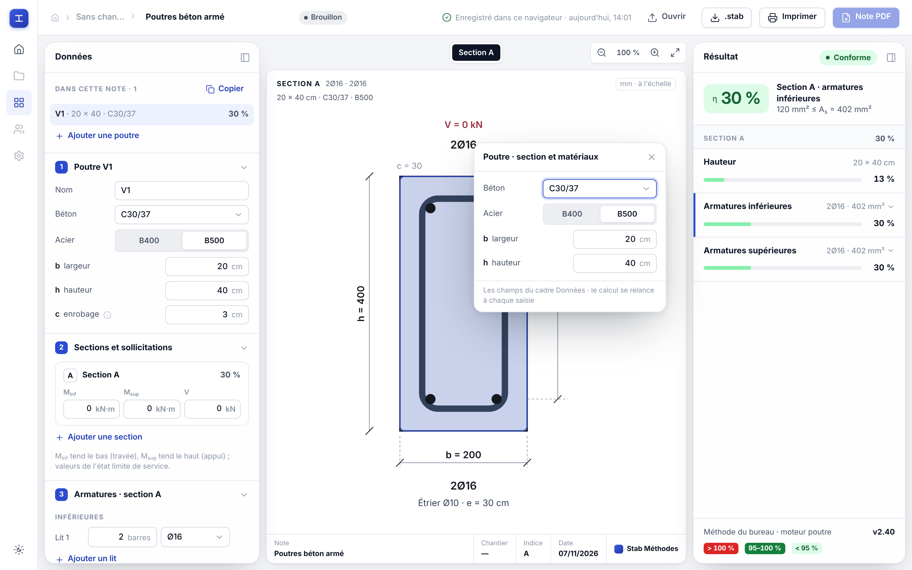
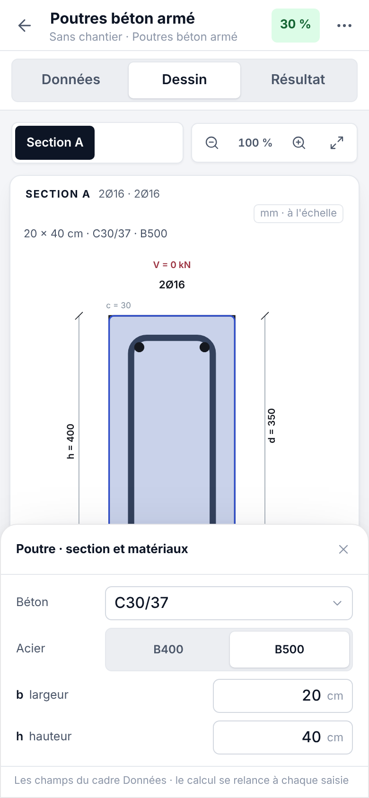

# Modifier les données sur le dessin — étude de faisabilité (PROPOSITION à trancher)

*07/11/2026. Question de l'ingénieur : « On pourrait cliquer sur les éléments dans le dessin et les changer dans le
dessin. Est-ce que ce serait possible, ou la construction du site ne fonctionnerait pas comme ça ? Avant de tout
modifier, tu me dis si c'est possible. »*

*Méthode : cinq enquêtes indépendantes (l'écran du site, les dessins des moteurs, le précédent Streamlit, des mesures
de temps dans Chromium, un prototype jetable sur la poutre et la dalle), une synthèse, puis deux contre-expertises qui
ont corrigé six affirmations. Ce document est la version corrigée. **Rien n'est changé sur le site** : le prototype vit
hors de la branche ; son diff est gardé à côté (`images/dessin_cliquable/prototype.patch`, appliqué sur 31a2379).*

**VÉRIFIÉ** = lu, exécuté ou mesuré. **SUPPOSÉ** = déduit ou estimé.

## 1. Verdict

**Oui, c'est possible sans reconstruire le site**, à condition de traiter quatre points (§3). Quatre raisons, vérifiées :

1. Les dessins sont de vrais objets dans la page : l'établi pose le SVG du moteur dans la toile
   (`site/web/js/etabli.js:177-180`) ; un élément garde ses attributs, reçoit l'appui du doigt et peut prendre le focus.
2. Le site sait déjà changer UNE valeur par son chemin et tout recalculer : une saisie envoie `modifier` avec le chemin
   du champ (`etabli.js:60-68`, `:239-248`), le routeur l'applique (`api_web/routeur.py:97-98`) et recalcule (`:105`).
   Un clic sur le dessin prend le même chemin : aucune règle de calcul nouvelle, aucune règle en JavaScript (R3).
3. Pour les assemblages et les charges sur plancher, le moteur produit DÉJÀ des dessins cliquables (c'était l'écran
   Streamlit) ; le site coupe volontairement ces attributs (`api_web/assemblages_poutre.py:126-128`,
   `assemblages_poteau.py:125`, `assemblages_pied.py:569`, `dessin_plancher.py:33`, appliqué l.53). Les 119 cotes
   des sept configurations, à l'état neuf, correspondent chacune à un champ `v/<clé>` du site (mesuré).
4. Le prototype marche : poutre aux trois formats, dalle au PC et au téléphone (pas essayée en tablette). Suites ciblées
   au vert, sauf `tests/test_site_web.py` (paquet du moteur non reconstruit — attendu) ; `verifier_site.js` filtré sur
   poutre et dalle.

## 2. Ce que verrait l'utilisateur

- **PC** : au survol, l'élément se teinte ; un clic ouvre une bulle à côté du point touché, avec **les mêmes lignes que
  le cadre Données** (mêmes champs, unités, aide). On saisit, le calcul repart, dessin, Données et Résultat suivent.
  Sur un grand élément (la section), la bulle cache une partie du dessin (captures).
- **Tablette et téléphone** : pas de survol au doigt — il faut un **repère permanent** de ce qui est modifiable (comme
  la classe `ed` du kit des assemblages, cote en gras et en couleur). Au téléphone, une feuille en bas d'écran
  (34 à 42 % de la hauteur) ; le clavier virtuel n'a pas été essayé (pas testable dans Playwright).
- **Le cadre Données reste complet** : le dessin est un raccourci vers le bon champ, jamais le seul accès (R1 : le
  téléphone, le clavier). Le Résultat ne change pas.

## 3. Les deux niveaux et leurs conditions

### (a) Cliquer → modifier la valeur — prouvé

- **Clic contre déplacement de la vue** : la toile capture le pointeur à chaque appui (`toile.js:96-102`) ; le clic de
  souris tombe sur le fond, et un glisser de 40 px produit quand même un clic (mesuré). Le prototype lit l'élément à
  l'appui et n'ouvre au relâcher que si le pointeur a bougé de moins de 8 px — `toile.js` intact. Le pincement part
  bien d'un élément sans rien ouvrir (100 → 367 %).
- **Double appui** : au zoom de 195 %, un double appui sur un élément remet le zoom à 100 % (`toile.js:123`) ET ouvre
  la bulle (mesuré) — à corriger : au téléphone, c'est le geste habituel pour agrandir.
- **Fluidité** (Chromium sans affichage, Xeon, médiane de 5 saisies, saisie → fin du calcul) : poutre 27 ms, dalle
  61 ms, cornière 72 ms, assemblage poutre–poutre 91 ms, prédalle 98 ms, plancher 187 ms, garde-corps 233 ms, pied
  de poteau à la main 708 ms. Le moteur fait 54 à 98 % du délai selon le module ; l'écran ajoute 7 à 24 ms par
  réponse (78 ms avec l'affichage freiné ×4). Le calcul n'est PAS freiné dans ces mesures : sur un vrai téléphone,
  SUPPOSÉ ×2 à ×3 (≈ 0,7 s garde-corps, 1,3 à 2 s pied de poteau). 9 modules sur 17 non mesurés.

### (b) Glisser → déplacer — possible, non prouvé

- Prévu par les moteurs : assemblages (jeu gh, décalage vertical, tiges et éléments de la platine à la main ; kit
  `acier/assemblages/.../schemas.py:1319-1331`), plancher (engins, charges, filières, plateaux ;
  `plancher/charges/dessin.py`, conversion en `plancher/charges/etat.py:413`). Pas pertinent pour la poutre, la
  dalle et le bois (répartition des barres conventionnelle ; bois pas à l'échelle, `dessin_bois.py:23`).
- **Chaque réponse réécrit toute la toile** (`etabli.js:177-180`) : elle détruirait l'élément glissé et le cadre qui
  tient le pointeur. Il faut une silhouette posée hors de la toile pendant le geste, et n'envoyer que la DERNIÈRE
  valeur (la file du moteur traite tout, une requête à la fois : `moteur.js:32-40`).
- Recalculs par seconde mesurés (PC / téléphone) : poutre 31/44, dalle 17/20, cornière 14/15, assemblage et prédalle
  10 à 13, plancher et garde-corps 4 à 8, pied de poteau 1,4 → en direct pour les premiers, au relâcher pour les autres.
- Précision mesurée sur le plan du plancher : 18,7 mm/px au PC, 33,9 mm/px au téléphone → pas d'accroche obligatoire,
  saisie numérique gardée. Le bureau a demandé des champs x, y à la place du glisser pour le plancher
  (`docs/plancher/CHARGES_PLANCHER_SITE.md:120-121`) : le glisser viendrait EN PLUS.
- Au doigt, une pièce glissable bloque le défilement de la page (`touch-action: none`).

### Les dessins denses au doigt — la vraie limite (mesuré)

Cibles émises par les moteurs, portées à la taille de la toile :

| Vue | Format | Cibles | sous 36 px | médiane des cotes | se chevauchent à 36 px |
|---|---|---|---|---|---|
| Doubles cornières, élévation | téléphone | 26 | 23 | 13 px | 19 sur 24 |
| Doubles cornières, élévation | PC | 26 | 21 | 24 px | 7 sur 22 |
| Doubles cornières sur poteau, élévation | téléphone | 26 | 23 | 10,5 px | 20 sur 23 |
| Platine d'about, élévation | téléphone | 20 | 16 | 15 px | 10 sur 17 |
| Plan du plancher | téléphone | 17 | 16 | 9,7 px | 14 sur 16 |

Agrandir les zones à toucher ne suffit pas sur ces dessins : il faut zoomer d'abord (×2,5 à 3,5) ou une liste
« éléments du dessin ». La poutre, elle, se touche bien (appuis décalés de 0, ±4, ±8 px : bon élément 9 fois sur 9
pour 7 éléments sur 8).

## 4. Module par module (intérêt = avis, à valider ; efforts SUPPOSÉS)

| Module | Clic | Glisser | Intérêt |
|---|---|---|---|
| Assemblages (7 configurations) | toutes les cotes ; pièces → leur section ; profilés, boulons → le sélecteur du Résultat | gh, décalage, tiges et éléments de la platine à la main | fort au PC (demande du bureau, `docs/assemblages/REFONTE_UX.md:257-262`) ; au téléphone après zoom |
| Charges sur plancher | engins, étançons, stocks, semelles, cote L, sens porteur | engins, charges, filières (en plus des champs) | fort |
| Dalle, prédalle | épaisseur, largeur, chaque nappe, yG, direction, efforts | non | moyen à fort |
| Poutre BA | b, h, enrobage, matériaux, lits (+ jeux entre lits), étriers, efforts | non | moyen |
| Garde-corps | H, tronçons, entraxes, platine, ancrage, profilés (sélecteur) | un montant (difficile) | moyen |
| Cornière | e (cote mm, champ cm), A/B/t en saisie libre, s, V | la charge V | moyen |
| Soudures | cotes de C1…C7, cordons, efforts | extrémités en C8 | moyen |
| Rigidité du sol | B, D, L, couches (coupe à l'échelle) | non | moyen |
| Bois, flambement | portée, charges, appuis, section (sélecteur) | non | faible à moyen |
| Maturité, choix de profilé | âges et seuils sur la courbe ; la section → le sélecteur | non | faible |
| Taux d'armature, enrobage | familles de barres, zones d'étriers | non | faible à moyen (non inventorié) |
| Tableau des armatures, catalogue | — (tableaux) | — | nul |

Les sélecteurs (profilés, armatures, boulons) vivent dans le **Résultat** (`data-pk`), pas dans Données : la brique
commune doit aussi savoir ouvrir un sélecteur (`ouvrirSelecteur`, `etabli.js:324-333`), et ce volet est caché sous la
toile en plein écran (z-index 6 contre 45).

Ordre de grandeur (SUPPOSÉ, sans base de comparaison) : 13 à 21 jours de travail pour le clic sur les modules concernés,
plus 3 à 5 jours pour le glisser commun et le travail module par module.

## 5. Ce qui se construit une fois

- **Moteur (Python)** : une petite brique d'étiquette partagée — `data-chemin` = chemin du champ, nom de l'élément,
  `tabindex`, `role="button"`, zone de prise transparente agrandie. L'attribut se pose en FIN de balise (les
  expressions régulières des tests dalle, prédalle, bois, flambement le lisent ainsi). À documenter dans
  `docs/site/MODULES_SITE.md` §4.
- **Écran** : un seul composant pour les trois formats (`site/web/js/edition.js`, ≈ 220 lignes dans le prototype) :
  appui contre glisser, bulle ou feuille, clavier (Tab, Entrée, Échap), recopie des lignes du cadre Données (aucun
  second formulaire), remémoriser l'élément après chaque calcul, sélecteurs du Résultat, plein écran.
- **Tests à écrire** : contrat commun (chaque chemin nommé par un dessin est un champ du cadre Données — il a déjà
  trouvé un défaut dans le prototype de la dalle — avec un MINIMUM de cibles par module, sinon il passe à vide sur 15
  modules sur 17 ; un piège avec guillemet pour les attributs) ; navigateur trois formats (appui → bulle, saisie →
  dessin/Données/Résultat, glisser au zoom n'ouvre rien, double appui garde le zoom, survol non collant
  `@media (hover: hover)`, bulle visible en plein écran, vignette de l'accueil inerte, cibles de 36 px OU zoom/liste
  sur les dessins denses) ; `edition.js` dans `tests/test_site_web.py:112-118`. Mutation : retirer le seuil de 8 px
  doit faire rougir « un glisser n'ouvre rien ».
- **Tests qui suivront le changement** : les recopies « interactivité coupée » (`test_api_web_assemblages.py:516-520`,
  `_poteau.py:569`, `_pied.py:691`, `test_api_web_plancher.py:300-301`).

## 6. Risques à ne pas oublier

- Pas de fonction « annuler » sur le site (aucune occurrence dans `site/web/js/`) : un glisser involontaire devient
  plus probable — besoin à part.
- Une cote affichée n'est pas toujours le champ saisi (poutre : c de calcul ; cornière : e en mm, champ en cm ;
  garde-corps : noms différents) : la bulle montre LE CHAMP.
- Des chemins contiennent un nom saisi (appuis du plancher) : l'échappement doit couvrir les attributs.
- Parcours au clavier : 26 arrêts de tabulation sur l'élévation des doubles cornières avant le Résultat.
- Doctrine Streamlit « la géométrie se règle sur le dessin, jamais dans la carte » (`docs/assemblages/ERGONOMIE.md:72`,
  P6) : pour le site, l'étude recommande l'inverse — le dessin est un SECOND accès au champ.

## 7. Ordre proposé

1. **Décision du bureau** : le dessin est un raccourci vers les Données, il ne les remplace pas.
2. Brique commune « cliquer → modifier » livrée avec la poutre (prototypée), tests trois formats.
3. Assemblages (clic, PC d'abord ; téléphone après zoom ou liste).
4. Dalle et prédalle, plancher (clic), garde-corps, cornière, soudures, sol, bois, flambement.
5. Glisser commun : plancher (au relâcher), gh et décalage des assemblages (en direct), tiges de la platine à la main
   (au relâcher ; d'abord sortir la conversion des coordonnées de l'écran Streamlit,
   `.../platine_beton/manuel/ecran.py:383-418`).

## 8. Défaut trouvé en chemin (traité)

Pied de poteau, calcul à la main, une tige à 30 mm du bord (1,2·d₀ = 31,2 mm) : la tête écrivait **0 % · Non
conforme** pendant que la ligne « Géométrie » disait 104 %. Corrigé à l'affichage le 07/11/2026 (tête = rapport de la
pire pince non conforme, cause nommée) — voir `docs/site/DEFAUTS_STREAMLIT.md` §2 « Assemblages · pied de poteau ».
