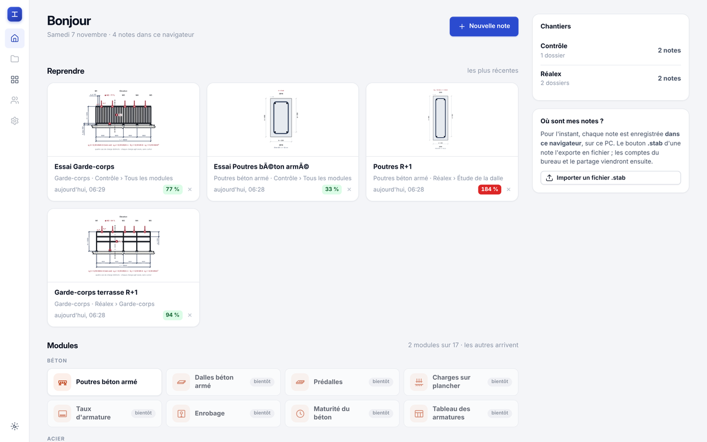
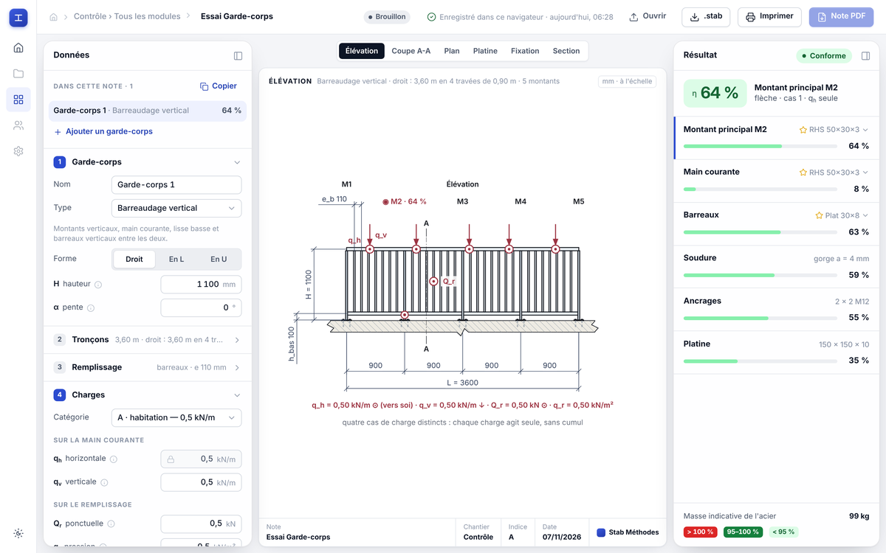
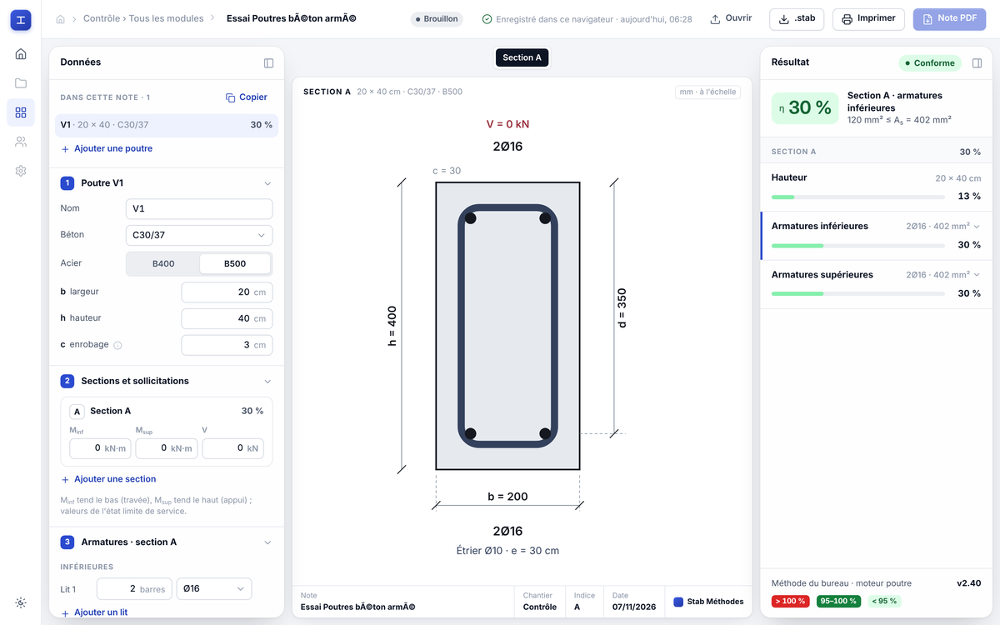

# Contrôle du site en ligne — mesure du 07/11/2026

- **Adresse** : https://dev-etudes-structure.pages.dev (Cloudflare Pages)
- **Commit contrôlé** : `5a9ffe2` (branche `claude/dalle-module-creation-sjmitr`), « Site : une vue de la toile peut
  être un tableau (bloc HTML) — contrat commun et contrôle navigateur »
- **Méthode** : `curl` pour les en-têtes ; `site/web/verifier_site.js` dans Chromium (Playwright), en ligne puis sur une
  copie locale du même commit (`site/web/outils/serveur_local.py 8770`) ; un petit script Playwright pour le temps de
  démarrage du moteur.

**Conclusion : le site en ligne fonctionne.** Il sert exactement les fichiers du commit, avec les en-têtes de
`_headers`, et le parcours complet du navigateur passe (62 OK, 0 KO, comme en local).

## 1. Le site en ligne sert bien le commit 5a9ffe2

Empreinte SHA-256 de chaque fichier téléchargé, comparée au fichier du dépôt : **toutes identiques**.

| Fichier | Empreinte (12 premiers caractères) |
|---|---|
| `index.html` | `fca006eaa8bb` |
| `garde-corps.html` | `a60b375a8014` |
| `poutre.html` | `bfce89f24f31` |
| `js/modules.js` | `905d310d1f25` |
| `js/travailleur.js` | `d817965d046c` |
| `js/etabli.js` | `0b52fd1085d4` |
| `moteur/manifeste.json` | `88ac33999f55` |
| `moteur/moteur.zip` | `b73a5bfc3081` |
| `vendor/pyodide-0.29.5/pyodide.asm.wasm` | `54309a5a2cfd` |

## 2. En-têtes HTTP (curl, HTTP/2)

| Adresse | Statut | Content-Type | Cache-Control | Taille |
|---|---|---|---|---|
| `/` | 200 | `text/html; charset=utf-8` | `public, max-age=0, must-revalidate` | 23 858 o |
| `/garde-corps` | 200 | `text/html; charset=utf-8` | `public, max-age=0, must-revalidate` | 16 968 o |
| `/poutre` | 200 | `text/html; charset=utf-8` | `public, max-age=0, must-revalidate` | 16 981 o |
| `/js/modules.js` | 200 | `application/javascript` | `public, max-age=0, must-revalidate` | 298 o |
| `/moteur/manifeste.json` | 200 | `application/json` | `no-cache` | 1 821 o |
| `/moteur/moteur.zip` | 200 | `application/zip` | `no-cache` | 406 093 o |
| `/vendor/pyodide-0.29.5/pyodide.asm.wasm` | 200 | **`application/wasm`** | `public, max-age=31536000, immutable` | 8 647 684 o |
| `/garde-corps.html` | **308** → `/garde-corps` | — | — | 0 o |
| `/garde-corps.html?note=abc` | **308** → `/garde-corps?note=abc` | — | — | 0 o |
| `/index.html` | **308** → `/` | — | — | 0 o |

- **Politique de sécurité (CSP)** : chaque réponse, redirections comprises, porte exactement celle de
  `site/web/_headers` :
  `default-src 'self'; script-src 'self' 'wasm-unsafe-eval'; style-src 'self' 'unsafe-inline'; img-src 'self' data: blob:; connect-src 'self'; worker-src 'self'; object-src 'none'; base-uri 'none'; form-action 'none'; frame-ancestors 'none'`.
  On reçoit aussi `X-Content-Type-Options: nosniff`, `Referrer-Policy: same-origin` et `X-Frame-Options: DENY`.
- **Cache** : `vendor/*` est bien servi en immuable pour un an, `moteur/*` en `no-cache`, comme le demande `_headers`.
  Les pages HTML et `js/` reçoivent le réglage par défaut de Cloudflare (`max-age=0, must-revalidate`), puisque
  `_headers` ne fixe rien pour eux.
- **Le .wasm** est servi en `application/wasm` : le navigateur peut le compiler pendant le téléchargement.
- **Adresses en « .html »** : Cloudflare répond par une redirection permanente (308) vers l'adresse sans « .html », et
  **garde la requête `?note=`**. Un ancien lien vers `garde-corps.html?note=…` ouvre donc toujours la bonne note.

## 3. Contrôle dans le navigateur (`verifier_site.js`)

| | OK | KO | Durée totale |
|---|---|---|---|
| **En ligne** (`https://dev-etudes-structure.pages.dev`) | **62** | **0** | 1 min 18 s |
| **En local** (`http://127.0.0.1:8770`, même commit) | **62** | **0** | 1 min 06 s |

Les deux listes portent **les mêmes 62 lignes, dans le même ordre, toutes OK** (comparaison ligne par ligne) : rien
n'est propre au site en ligne. Les deux contrôles ont tourné en même temps sur la même machine, d'où des durées un peu
gonflées.

Ce que le parcours en ligne a vérifié, entre autres :

- la politique de sécurité est active (un script écrit dans la page est refusé), et tout le parcours tourne sous elle ;
- garde-corps : le moteur démarre (9 111 ms au premier lancement), résultat η = 64 %, puis 89 % avec H = 1 300 mm ;
  calcul détaillé, sélecteur de profilés, choix de l'optimal (RHS 50x30x3), type « lisses », deuxième élément ;
  après rechargement, la note garde ses deux garde-corps et la hauteur de 1 300 mm ;
- poutre : le moteur démarre (4 269 ms), η = 30 % sans effort, η = 289 % avec M = 122 kN·m et V = 60 kN (cinq
  vérifications), η = 184 % avec h = 60 cm ; coupe visible, calcul de section, choix des armatures ;
- contrat commun pour chaque module du registre (poutre, garde_corps) : démarrage, résultat, vue à sa taille, calcul
  détaillé, sélecteur, saisie qui recalcule, saisie gardée après rechargement ;
- .stab abîmé refusé avec un message ; .stab aux noms piégés : rien ne s'exécute, les noms s'affichent comme du texte ;
- aucun débordement, aucun nom coupé, aucune erreur JavaScript.

Aucun KO, ni en ligne ni en local.

## 4. Temps de démarrage du moteur

Mesuré de l'ouverture de `/garde-corps` à l'affichage du premier résultat (`.verdict` non vide) : trois essais, chacun
dans un navigateur neuf (« froid », cache vide), puis une deuxième ouverture dans le même navigateur (« chaud »,
Pyodide déjà en cache). Le premier résultat est le même à chaque fois : η = 64 %, montant principal M2.

| | Froid (cache vide) | Chaud (Pyodide en cache) | Page HTML seule |
|---|---|---|---|
| **En ligne** | 7,9 s · 7,2 s · 7,4 s (moyenne **7,5 s**) | 6,5 s · 6,7 s · 6,6 s (moyenne **6,6 s**) | 0,4 à 1,1 s |
| **En local** | 6,0 s · 5,9 s · 5,9 s (moyenne **5,9 s**) | 6,1 s · 6,2 s · 5,9 s (moyenne **6,1 s**) | 0,03 à 0,08 s |

Le réseau ajoute environ 1,5 s au premier démarrage (8,6 Mo de WebAssembly plus la bibliothèque Python à télécharger).
Avec le cache, l'écart tombe à environ 0,5 s. L'essentiel des 6 s vient de la mise en route de Python dans le
navigateur (Pyodide, numpy, paquet du moteur), qui a lieu à chaque ouverture de page, même cache plein.

## 5. Ce que montrent les captures en ligne

Captures prises par `verifier_site.js` sur le site en ligne, réduites à 1 200 px de large.

**Accueil** — page complète : « Bonjour », les quatre notes créées par le contrôle avec leur vignette (dessin du
garde-corps, coupe de la poutre) et leur taux, les chantiers « Contrôle » et « Réalex », l'import .stab, les tuiles des
modules (Poutres béton armé ouverte, les autres « bientôt »).

**Garde-corps** — page complète : données à gauche, élévation cotée au centre (M1 à M5, charges, L = 3 600) avec ses
onglets (Élévation, Coupe A-A, Plan, Platine, Fixation, Section), résultat à droite (η = 64 %, « Conforme », six
lignes de vérification, masse 99 kg).

**Poutre** — page complète : données (béton, acier, b, h, c, section A, armatures), coupe cotée 20 × 40 au centre
(2Ø16 en haut et en bas, étrier Ø10), résultat à droite (η = 30 %, « Conforme », trois lignes).

**Une seule anomalie visible, qui vient du script de contrôle, pas du site** : la note de la poutre s'appelle
« Essai Poutres béton armé » (en tête de page et sur sa tuile de l'accueil), et pas « Essai Poutres béton armé ».
On voit la même chose en local. Ce nom est tapé par `verifier_site.js` (ligne 200). Pour le construire, le script
ouvre `/js/modules.js` **comme une page** (ligne 193) et en lit le texte. Or le fichier est servi en
`application/javascript` sans `charset`, donc le navigateur le lit en Latin-1 et « é » devient « é ». Le site, lui,
importe `modules.js` comme module JavaScript, et un module est toujours lu en UTF-8 : sur la même capture de l'accueil,
la tuile du module s'écrit bien « Poutres béton armé ». Rien n'est à corriger côté site pour cela. Le script de
contrôle pourrait lire le registre par `import()` (comme il le fait déjà ailleurs pour l'accueil), ou bien `_headers`
pourrait ajouter `charset=utf-8` aux `.js`.

## 6. Conclusion

**Le site en ligne fonctionne** : il sert exactement le commit 5a9ffe2, avec la politique de sécurité et les règles de
cache de `_headers` et le WebAssembly en `application/wasm`. Les anciennes adresses en « .html » sont redirigées en
gardant `?note=`. Le parcours complet du navigateur passe (62 OK, 0 KO, comme en local). Le premier résultat du
garde-corps s'affiche en 7,5 s à froid, 6,6 s avec le cache.
