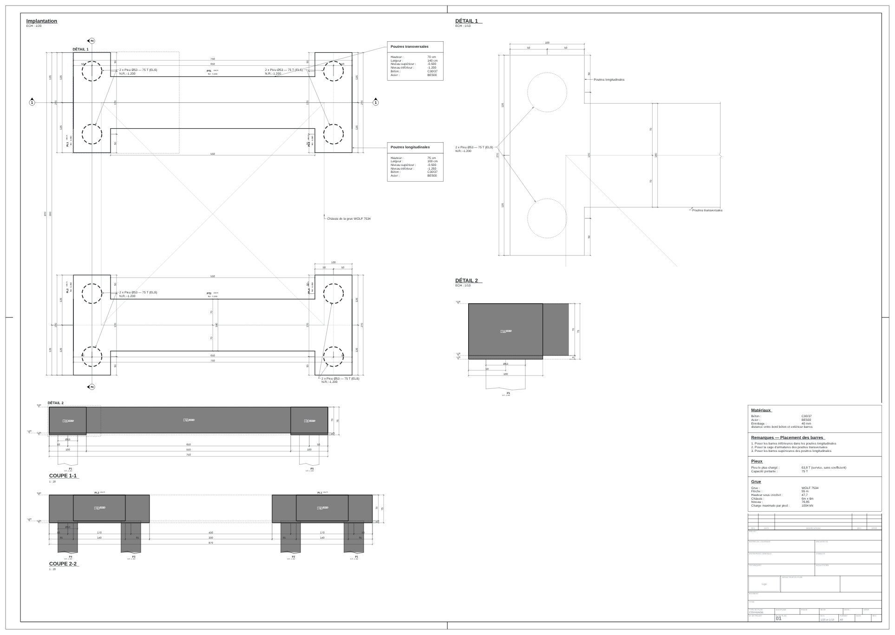
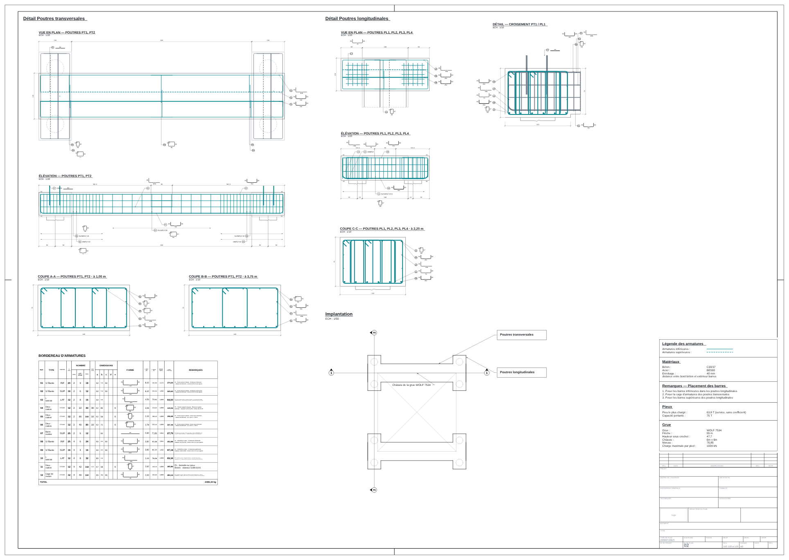

# Le fichier « rbar.ouvrage » du site, lu et dessiné par RBAR — mesure du 12/11/2026

Mesure datée (elle ne se réécrit pas ; une nouvelle mesure fait un nouveau fichier).

## Conditions

- **Le fichier** : celui que le site télécharge par « Exporter › DWG pour AutoCAD » (`beton/fondation_grue/ouvrage.py`),
  pour la note Greenwood aux armatures du plan de référence (9Ø20 / 6Ø16 dans la poutre support, 6Ø25 / 4Ø16 dans la
  semelle), options de conception par défaut ; identification : « Fondation grue tour GT1 », chantier « Greenwood »,
  indice A, 12/11/2026. 11 065 octets. Puis la même note, retours « arrêtés sous la face opposée » (10 cm).
- **RBAR** : son noyau `Rbar.Core` (net8.0), copié tel quel hors de son dépôt — que le site ne touche pas — au commit
  `5252130` (0.4.35), compilé par le SDK .NET 8.0.134 ; un petit programme fait les appels de son test d'aperçu :
  `OuvrageReader.Read`, `OuvrageReader.StandardNotes`, `OuvrageSheets.Choose` (ses échelles) puis `OuvragePlan.Build`
  et `OuvrageSheets.Build` aux échelles de `feuilles.echelles` (celles que le site impose, que RBAR ne lit pas encore),
  et `OuvrageSheetSvg.Render` ; les feuilles SVG mises en PNG par Chromium.
- Le programme et le noyau copié sont dans le brouillon de la séance, pas dans le dépôt (ils ne sont à personne ici).

## Résultats

| | Greenwood | Retours arrêtés à 10 cm |
|---|---|---|
| Refus | aucun | aucun |
| Notes du lecteur | 3 : « cartouche », « revisions », « feuilles.echelles » non lues par cette version | les mêmes 3 |
| Notes du standard du poste | aucune | aucune |
| Feuilles | 2 (coffrage, armatures), A0 | 2 |
| Échelles choisies par RBAR = celles de la table du site (6,00 m) | oui, à l'octet près | oui |
| Retours au bordereau (repères 01, 02 ; 08, 09) | 50 et 60 cm | 55 et 60 cm (54,8 et 59,8 cm dans le fichier) |

Les trois notes sont attendues : ce sont les ajouts que la conversation RBAR a demandés le 12/11 et qu'elle fait de son
côté. Tant qu'elle ne les a pas faits, le cartouche des feuilles reste vide.

## Ce que cette mesure ne dit pas

- Elle ne passe pas par AutoCAD : la commande `RBAROUVRAGE` construit les objets de RBAR dans un dessin ; ce rendu
  est celui de son noyau (le même que son aperçu), pas le DWG.
- Le visuel des plans est celui de RBAR à cette date.
