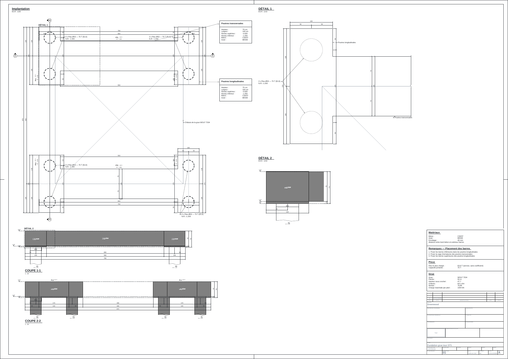
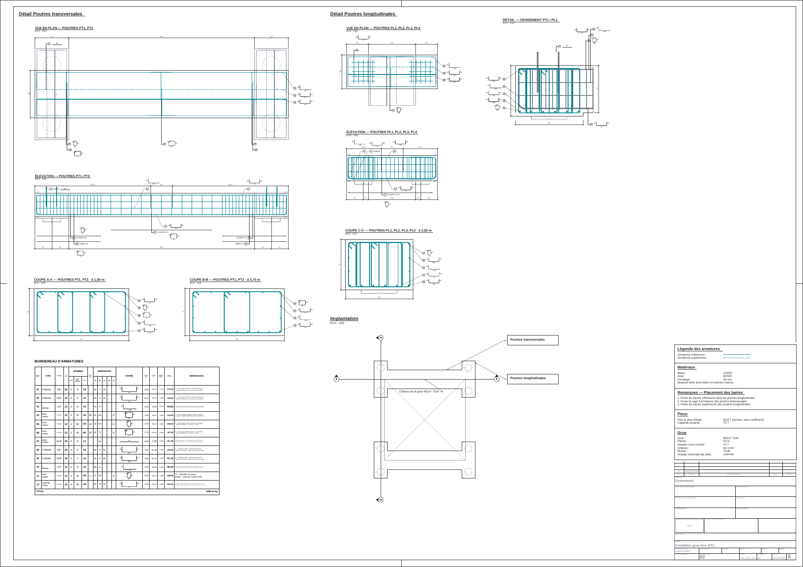

# Les plans PDF de Greenwood, faits par le moteur de RBAR depuis le fichier du site — mesure du 12/11/2026 (soir)

Mesure datée (elle ne se réécrit pas ; une nouvelle mesure fait un nouveau fichier). Suite de
`2026-11-12_fichier_rbar_lu_par_rbar.md` : RBAR a livré son moteur de plans le même soir.

## Conditions

- **Le fichier** : le même que la mesure précédente — la note Greenwood aux armatures du plan de référence, options de
  conception par défaut, identification « Fondation grue tour GT1 », chantier « Greenwood », indice A, 12/11/2026 ;
  11 155 octets (empreinte SHA-256 `207ce798598a…`).
- **Le moteur** : `rbar-plans` de RBAR 0.4.37 (commit `11eeacc` de son dépôt, le moteur de la commande `RBAROUVRAGE`),
  copié hors de son dépôt — que le site ne touche pas — et compilé par le SDK .NET 8.0.134 ; lancé sous Linux :
  `dotnet rbar-plans.dll greenwood.json --sortie <dossier>`, standard du bureau livré (sans `--config`).
- Les PDF mis en image par `pdftoppm` (40 points par pouce) pour les relire.

## Résultats

| | |
|---|---|
| Code de sortie | 0 (tout est fait) |
| Compte rendu | `ok` vrai, aucun refus, **aucune note** |
| Feuilles | 01 — plan de coffrage, A0, 6 vues, 1/20 et 1/10, 53 842 octets ; 02 — plan d'armatures, A0, 9 vues, 1/50, 1/20 et 1/10, 73 781 octets |
| Échelles | celles que le fichier impose (table « mise en page par châssis », ligne 6,00 m) : lues, sans recherche |
| Cartouche | rempli depuis le fichier : projet « Greenwood », titre « Fondation grue tour GT1 », indice A, date 12/11/2026 |
| PDF | 1 page A0 chacun (3 370 × 2 384 points), polices Liberation Sans incorporées en sous-ensemble |
| Durée | 2,4 s, programme lancé compris (compte rendu : 2 077 ms) |

Les trois notes de la mesure précédente (« cartouche », « revisions », « feuilles.echelles » non lues) ont disparu :
RBAR 0.4.36 lit ces clés.

## Ce que cette mesure ne dit pas

- Le moteur a tourné ici comme un programme .NET ; le site, lui, calcule dans le navigateur, sans serveur : il lui faut
  la version WebAssembly de ce moteur, demandée à RBAR. Le temps et la mémoire au téléphone se mesureront avec elle.
- Le visuel des plans est celui de RBAR à cette date.
