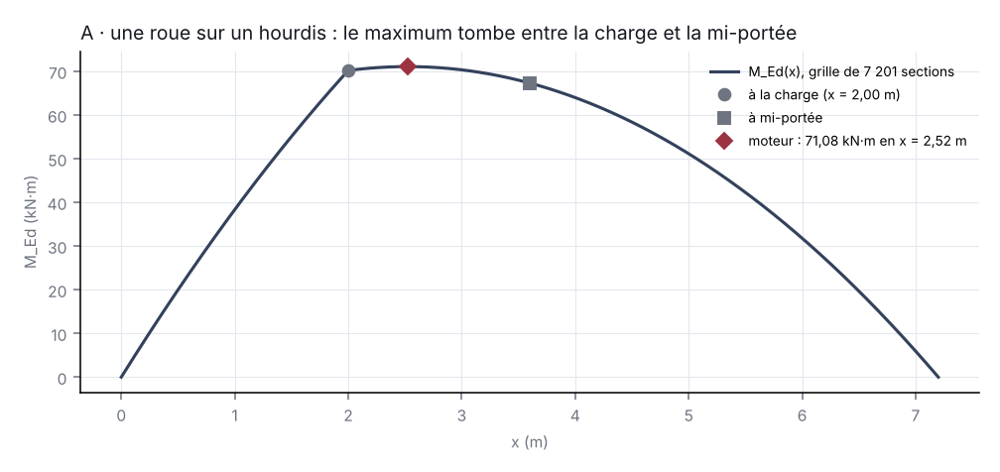
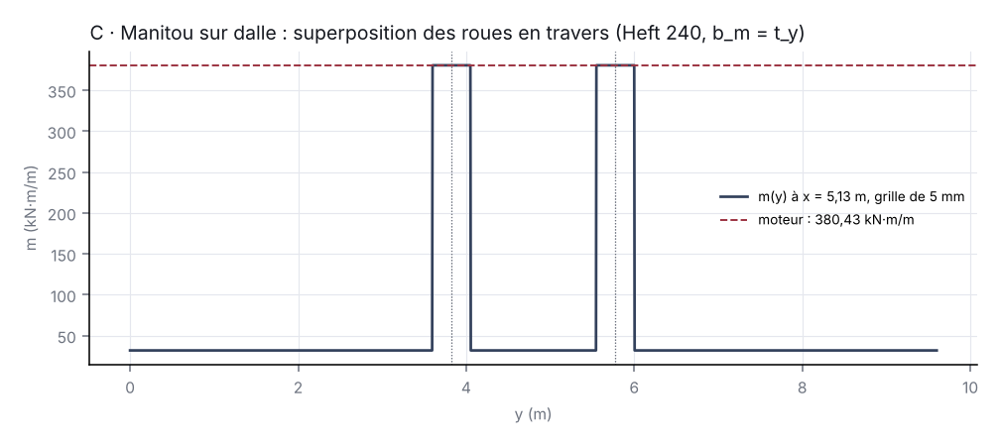
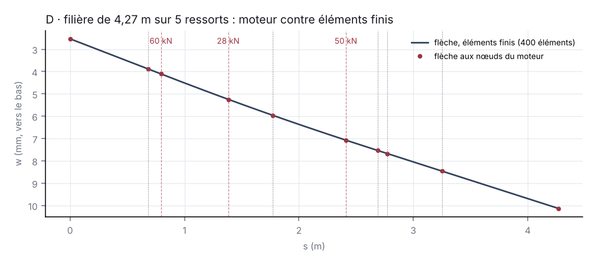

# Validation croisée des charges sur plancher — 2026-11-02

*Lot 4. Méthodes indépendantes du moteur (numpy, hors chemin de production) : grilles fines de sections, superposition des créneaux sur grille, point fixe de la bande plastique, éléments finis de poutre, formules de l'EN 1992-1-1 et du Heft 240 réécrites à part. Script : `tools/validation_charges_plancher.py`. Cette page est une MESURE datée : elle ne se réécrit pas.*

**Verdict : VALIDÉ** — cinq contrôles, 24 filières et 300 jeux de créneaux tirés au sort (graine 20261102), 2 s.

Les cas A à C emploient des résistances d'ESSAI (M_Rd 60 kN·m, V_Rd 80 kN par hourdis ; dalle de 20 cm à 524 mm²/m), pas un catalogue : ils valident les EFFORTS, les largeurs efficaces, les répartiteurs et les effets locaux, pas une valeur de fabricant.

## A · Une roue sur un hourdis

Roue de nacelle 150 × 100 mm, 12 kN, φ 1,4, à 2,00 m de l'appui A sur H3 d'un plancher de 8 hourdis de 1,20 m, portée 7,20 m, g 2,90 kN/m², charges présentes 1,00 kN/m². M_Ed = 1,35·M_G + 1,5·M_Q cherché sur 7 201 sections ; V par statique.

| Grandeur | Moteur | Indépendant | Écart | Tolérance |
|---|---|---|---|---|
| M_Ed de H3 (kN·m) | 71,077 | 71,077 | 3·10⁻⁵ % | 0,0500 % |
| abscisse du maximum (m) | 2,520 | 2,523 | 0,1189 % | 2,0000 % |
| V_Ed de H3 (kN) | 41,593 | 41,593 | 2·10⁻¹⁴ % | 10⁻⁷ % |
| η_M de H3 | 1,185 | 1,185 | 3·10⁻⁵ % | 0,0500 % |
| η_V de H3 | 0,520 | 0,520 | 2·10⁻¹⁴ % | 10⁻⁷ % |
| M_Ed d'un élément non chargé, H1 (kN·m) | 42,107 | 42,107 | 0 % | 10⁻⁷ % |

Le maximum tombe en x = 2,52 m : 71,08 kN·m, contre 70,19 à la charge et 67,31 à mi-portée — c'est le défaut non conservatif corrigé le 02/11/2026 (sections au pas L/60).

## B · Un stabilisateur sur tôle à cheval sur deux hourdis

Semelle 300 × 300 mm, 95 kN, à mi-portée, centrée sur le joint H3 | H4 ; tôle S235 600 × 600 × 20. Bande plastique itérée en point fixe sous la pression ELU, aire efficace, règle du levier (moitié-moitié), moments des deux éléments.

| Grandeur | Moteur | Indépendant | Écart | Tolérance |
|---|---|---|---|---|
| bande plastique c (mm) | 150,000 | 150,000 | 0 % | 10⁻⁴ % |
| aire efficace a_eff (mm) | 600,000 | 600,000 | 0 % | 10⁻⁴ % |
| pression de service sous l'aire efficace (N/mm²) | 0,264 | 0,264 | 0 % | 10⁻⁴ % |
| moment de la part de H3 : M_Q − w_q·L²/8 = (P/2)·L/4 (kN·m) | 85,500 | 85,500 | 0 % | 10⁻⁷ % |
| M_Ed de H3 = M_Ed de H4 (kN·m) | 170,357 | 170,357 | 0 % | 0,0500 % |
| V_Ed de H3 (kN) | 59,018 | 59,018 | 1·10⁻¹⁴ % | 10⁻⁷ % |
| H3 et H4 identiques (kN·m) | 170,357 | 170,357 | 0 % | 10⁻¹⁰ % |

## C · Un Manitou sur une dalle de 20 cm

Gabarit MT 1840 (roues 300 × 250 mm) à (3,60 ; 4,80) m sur une dalle 7,20 × 9,60 m, h 200 mm, d 170 mm, C30/37, As 524 mm²/m ; charges d'essai 60 · 60 · 40 · 40 kN. Heft 240 : t_y = b + 2·h1 + h, b_v = t_y + 0,5·a, b_m = t_y ; superposition des quatre roues sur une grille transversale de 5 mm, 7 201 sections ; §6.7 et §6.4 depuis la norme.

| Grandeur | Moteur | Indépendant | Écart | Tolérance |
|---|---|---|---|---|
| M par mètre en service, bande gouvernante (kN·m/m) | 380,427 | 380,427 | 2·10⁻¹³ % | 0,2000 % |
| abscisse du maximum (m) | 5,135 | 5,135 | 0 % | 2,0000 % |
| V par mètre en service à l'appui le plus chargé (kN/m) | 72,656 | 72,656 | 4·10⁻¹⁴ % | 10⁻⁴ % |
| §6.7 : F_Rdu sous R1 (kN) | 2 598,076 | 2 598,076 | 0 % | 10⁻⁷ % |
| §6.7 : γQ·P sous R1 (kN) | 126,000 | 126,000 | 0 % | 10⁻⁷ % |
| §6.4 : v_Ed sous R1 (N/mm²) | 0,229 | 0,229 | 0 % | 10⁻⁷ % |
| §6.4 : v_Rd,c (N/mm²) | 0,542 | 0,542 | 0 % | 10⁻⁷ % |

## D · Filière sur ressorts : moteur contre éléments finis

24 configurations tirées au sort (longueur 2–6 m, EI 10²–10⁵ kN·m², 2–6 ressorts de 10²–10⁵ kN/m, 1–3 charges de 10–100 kN) ; éléments finis d'Euler-Bernoulli, Hermite cubique, 400 éléments.

| Grandeur | Écart maximal | Tolérance |
|---|---|---|
| Réaction d'un ressort (rapportée à Σ P) | 0,0026 % | 0,5 % |
| Moment maximal | 0,0008 % | 1 % |
| Flèche aux nœuds du moteur (rapportée à la flèche maximale) | 0,0020 % | 1 % |

| # | L (m) | EI (kN·m²) | ressorts | charges | écart R / Σ P | écart M_max | écart w |
|---|---|---|---|---|---|---|---|
| 1 | 4,27 | 90 129 | 5 | 3 | 0,0000 % | 0,0001 % | 0,0001 % |
| 2 | 4,69 | 3 186 | 2 | 1 | 0,0000 % | 0,0000 % | 0,0000 % |
| 3 | 4,27 | 162 | 6 | 3 | 0,0000 % | 0,0000 % | 0,0000 % |
| 4 | 4,69 | 1 108 | 6 | 2 | 0,0000 % | 0,0000 % | 0,0000 % |
| 5 | 2,41 | 261 | 3 | 2 | 0,0000 % | 0,0000 % | 0,0000 % |
| 6 | 3,14 | 6 904 | 5 | 1 | 0,0000 % | 0,0000 % | 0,0000 % |
| 7 | 5,07 | 2 621 | 3 | 1 | 0,0000 % | 0,0000 % | 0,0000 % |
| 8 | 5,12 | 65 138 | 6 | 1 | 0,0000 % | 0,0001 % | 0,0000 % |
| 9 | 3,24 | 420 | 6 | 1 | 0,0000 % | 0,0000 % | 0,0000 % |
| 10 | 5,79 | 17 372 | 4 | 1 | 0,0000 % | 0,0000 % | 0,0000 % |
| 11 | 5,60 | 24 313 | 6 | 2 | 0,0000 % | 0,0000 % | 0,0000 % |
| 12 | 5,05 | 1 857 | 2 | 1 | 0,0000 % | 0,0000 % | 0,0000 % |
| 13 | 3,71 | 345 | 5 | 1 | 0,0000 % | 0,0000 % | 0,0000 % |
| 14 | 4,03 | 9 012 | 6 | 3 | 0,0000 % | 0,0000 % | 0,0000 % |
| 15 | 4,32 | 54 440 | 2 | 1 | 0,0026 % | 0,0005 % | 0,0020 % |
| 16 | 5,67 | 377 | 2 | 2 | 0,0001 % | 0,0000 % | 0,0000 % |
| 17 | 5,72 | 850 | 3 | 3 | 0,0000 % | 0,0000 % | 0,0000 % |
| 18 | 2,68 | 7 104 | 2 | 2 | 0,0001 % | 0,0000 % | 0,0001 % |
| 19 | 5,87 | 4 404 | 5 | 1 | 0,0000 % | 0,0000 % | 0,0000 % |
| 20 | 5,75 | 20 566 | 5 | 3 | 0,0000 % | 0,0000 % | 0,0000 % |
| 21 | 3,15 | 36 493 | 4 | 3 | 0,0003 % | 0,0008 % | 0,0006 % |
| 22 | 5,28 | 12 321 | 6 | 3 | 0,0000 % | 0,0000 % | 0,0000 % |
| 23 | 5,73 | 412 | 2 | 3 | 0,0000 % | 0,0000 % | 0,0000 % |
| 24 | 4,14 | 461 | 5 | 3 | 0,0000 % | 0,0000 % | 0,0000 % |

## E · Créneaux : maximum sur la largeur et fenêtres de bande

300 jeux de 1 à 5 boîtes tirés au sort sur des planchers de 4,80, 7,20 et 9,60 m, avec pour chacun une fenêtre de bande d'un mètre ; évaluation exhaustive aux arêtes, troncature au plancher avec concentration.

| Grandeur | Écart maximal | Tolérance |
|---|---|---|
| Maximum des créneaux (plancher et fenêtres) | 0,000000 % | 0,0001 % |

## Figures

## Ce que cette validation ne couvre pas

- les formules béton armé de l'application (M_adm, V_adm du module Poutre) : elles sont reproduites, pas jugées ;
- le coefficient k du Heft 240 en flexion, les parts de l'annexe C de l'EN 1168 et la résistance du joint : non transcrits, le moteur les signale « à transcrire » ;
- les valeurs de catalogue des hourdis : les cas d'essai en emploient de fictives ;
- l'hypothèse du tranchant à 100 % sur l'élément chargé (P-3) et celle des éléments indépendants sous une filière : décisions du bureau, pas des mesures.
