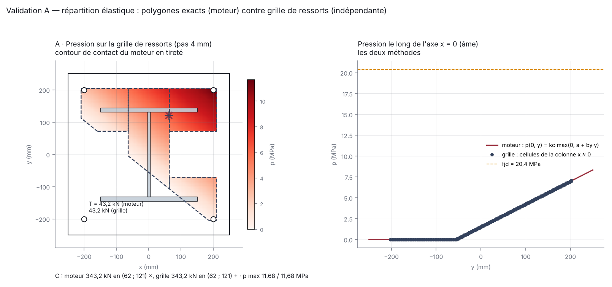
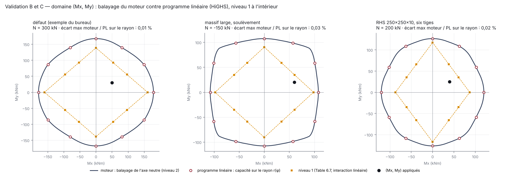
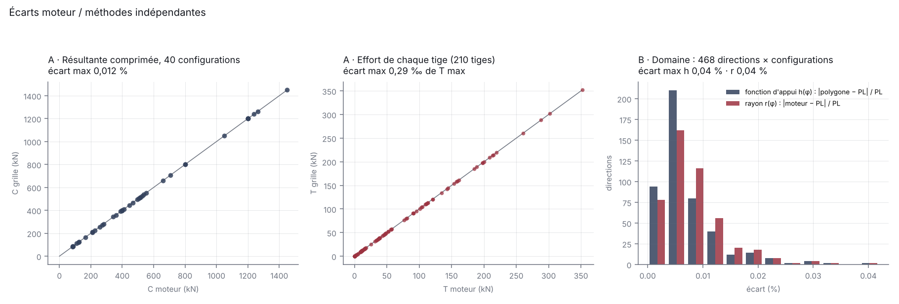

# Validation croisée du pied de poteau — 2026-10-31

*Lot C. Méthodes indépendantes du moteur (numpy + scipy, hors chemin de production) : grille de ressorts pour la répartition élastique, programmation linéaire (HiGHS) pour le domaine résistant. Script : `tools/validation_pied_poteau.py`. Cette page est une MESURE datée : elle ne se réécrit pas.*

**Verdict : VALIDÉ** — 40 configurations (36 tirées au sort, graine 20261031), 468 directions de moment, 150 s.

## A · Répartition élastique : polygones exacts (moteur) contre grille de ressorts

Pas de la grille : 4 mm. Les deux méthodes résolvent le MÊME modèle (platine rigide, lit sans traction sur l'aire efficace, tiges tendues) par deux discrétisations différentes ; l'écart mesure la justesse du découpage des polygones et des intégrales de Green du moteur.

| Grandeur | Écart maximal | Tolérance |
|---|---|---|
| Résultante comprimée C | 0,0121 % | 0,2 % |
| Position de C (xC, yC) | 0,028 mm | 1 mm |
| Pression maximale | 0,0199 % | 0,5 % |
| Effort d'une tige (rapporté à T max de la configuration) | 0,289 ‰ | 5 ‰ |

## B · Domaine résistant (niveau 2) : balayage de l'axe neutre contre programme linéaire

Cellules de 5 mm, 0 ≤ p ≤ fjd, 0 ≤ T ≤ FT,Rd, équilibre de N. La fonction d'appui du polygone du moteur (120 sommets) et la capacité sur chaque rayon sont comparées à l'optimum du programme linéaire — qui est, par le théorème statique, le domaine exact des champs admissibles bornés.

| Grandeur | Écart maximal | Tolérance |
|---|---|---|
| Fonction d'appui h(φ), polygone / PL | 0,042 % | 1 % |
| Capacité sur le rayon r(φ), moteur / PL | 0,042 % | 1 % |

## C · Niveau 1 ≤ niveau 2, et rayon du moteur intérieur

Directions où le niveau 1 dépasse le rayon du programme linéaire : **0** / 468. Directions où le rayon du moteur dépasse celui du programme linéaire (au-delà de 0,2 % + 1 N·mm) : **0** / 468.

## Configurations

| # | Configuration | C moteur / grille (kN) | p max (MPa) | T max moteur / grille (kN) |
|---|---|---|---|---|
| 1 | défaut (exemple du bureau) | 343,2 / 343,2 | 11,68 / 11,68 | 43,2 / 43,2 |
| 2 | massif large, soulèvement | 85,5 / 85,5 | 10,27 / 10,27 | 142,8 / 142,8 |
| 3 | RHS 250×250×10, six tiges | 280,8 / 280,8 | 14,69 / 14,69 | 52,4 / 52,4 |
| 4 | HEB 400, 2 × 3 tiges M30, N fort | 1449,6 / 1449,6 | 25,33 / 25,33 | 153,7 / 153,7 |
| 5 | aléatoire : IPE 400, 450×700×15, 4 tiges M24, N = 50, Mx = 150, My = -20 | 397,8 / 397,8 | 37,27 / 37,28 | 213,5 / 213,5 |
| 6 | aléatoire : HEB 400, 700×400×25, 4 tiges M30, N = 400, Mx = -40, My = 15 | 411,5 / 411,5 | 12,48 / 12,48 | 11,5 / 11,5 |
| 7 | aléatoire : IPE 400, 700×500×15, 4 tiges M30, N = 400, Mx = 30, My = 40 | 494,9 / 494,9 | 22,44 / 22,44 | 56,9 / 56,9 |
| 8 | aléatoire : HEA 200, 500×700×25, 8 tiges M30, N = 1200, Mx = 0, My = -20 | 1200,0 / 1200,0 | 19,48 / 19,48 | 0,0 / 0,0 |
| 9 | aléatoire : HEA 200, 400×600×30, 4 tiges M30, N = 50, Mx = -40, My = -60 | 256,5 / 256,5 | 23,17 / 23,17 | 159,3 / 159,3 |
| 10 | aléatoire : HEB 240, 400×500×40, 4 tiges M20, N = 50, Mx = 150, My = 0 | 446,1 / 446,1 | 19,22 / 19,22 | 198,1 / 198,1 |
| 11 | aléatoire : HEB 400, 700×500×15, 6 tiges M20, N = 50, Mx = 30, My = 15 | 110,7 / 110,7 | 6,83 / 6,84 | 31,9 / 31,9 |
| 12 | aléatoire : HEM 240, 700×500×40, 4 tiges M20, N = -100, Mx = 0, My = -60 | 82,8 / 82,8 | 4,42 / 4,42 | 91,4 / 91,4 |
| 13 | aléatoire : HEM 240, 400×400×15, 6 tiges M20, N = 1200, Mx = 80, My = 0 | 1200,0 / 1200,0 | 34,63 / 34,63 | 0,0 / 0,0 |
| 14 | aléatoire : HEM 240, 500×500×25, 4 tiges M24, N = 800, Mx = 0, My = -20 | 800,0 / 800,0 | 11,03 / 11,03 | 0,0 / 0,0 |
| 15 | aléatoire : HEM 240, 600×800×15, 4 tiges M30, N = 400, Mx = 80, My = 40 | 514,9 / 514,9 | 25,01 / 25,01 | 104,9 / 104,9 |
| 16 | aléatoire : HEA 300, 450×800×20, 6 tiges M24, N = 400, Mx = 0, My = 15 | 400,0 / 400,0 | 6,88 / 6,88 | 0,0 / 0,0 |
| 17 | aléatoire : HEA 300, 700×800×25, 4 tiges M20, N = 1200, Mx = 80, My = 90 | 1238,7 / 1238,7 | 25,82 / 25,82 | 38,7 / 38,7 |
| 18 | aléatoire : HEA 200, 700×600×15, 6 tiges M24, N = 200, Mx = -40, My = 0 | 271,9 / 271,9 | 13,78 / 13,78 | 35,9 / 35,9 |
| 19 | aléatoire : HEA 200, 400×400×20, 4 tiges M20, N = -100, Mx = 0, My = 40 | 121,6 / 121,6 | 18,29 / 18,29 | 110,8 / 110,8 |
| 20 | aléatoire : HEA 300, 500×800×25, 4 tiges M20, N = 50, Mx = -40, My = -60 | 210,4 / 210,4 | 17,51 / 17,52 | 109,5 / 109,5 |
| 21 | aléatoire : HEB 240, 450×800×15, 8 tiges M30, N = 1200, Mx = 0, My = 0 | 1200,0 / 1200,0 | 18,87 / 18,87 | 0,0 / 0,0 |
| 22 | aléatoire : HEB 240, 700×500×20, 6 tiges M24, N = 400, Mx = 80, My = -20 | 527,4 / 527,4 | 23,76 / 23,76 | 76,6 / 76,6 |
| 23 | aléatoire : HEA 200, 500×500×30, 8 tiges M30, N = 50, Mx = 0, My = 15 | 87,3 / 87,3 | 2,88 / 2,88 | 9,3 / 9,3 |
| 24 | aléatoire : HEB 240, 450×600×25, 8 tiges M20, N = 400, Mx = 80, My = 0 | 513,5 / 513,5 | 16,75 / 16,75 | 45,6 / 45,6 |
| 25 | aléatoire : HEA 200, 400×400×20, 4 tiges M30, N = -100, Mx = -40, My = 15 | 125,8 / 125,8 | 17,91 / 17,92 | 144,7 / 144,7 |
| 26 | aléatoire : HEM 240, 500×600×25, 6 tiges M30, N = 1200, Mx = 0, My = 40 | 1200,0 / 1200,0 | 17,44 / 17,44 | 0,0 / 0,0 |
| 27 | aléatoire : HEA 300, 500×500×30, 4 tiges M24, N = 400, Mx = 150, My = 90 | 661,3 / 661,3 | 33,49 / 33,49 | 208,9 / 208,9 |
| 28 | aléatoire : HEA 300, 700×400×40, 4 tiges M30, N = 400, Mx = 80, My = -60 | 506,3 / 506,3 | 18,05 / 18,06 | 100,9 / 100,9 |
| 29 | aléatoire : HEB 400, 500×800×20, 6 tiges M24, N = -100, Mx = -120, My = 0 | 208,4 / 208,4 | 8,68 / 8,68 | 120,6 / 120,6 |
| 30 | aléatoire : HEM 240, 450×400×30, 6 tiges M20, N = 200, Mx = 150, My = 40 | 706,6 / 706,7 | 38,23 / 38,24 | 214,5 / 214,5 |
| 31 | aléatoire : HEB 400, 400×500×25, 4 tiges M24, N = -100, Mx = 150, My = 40 | 359,9 / 359,9 | 25,17 / 25,17 | 260,4 / 260,4 |
| 32 | aléatoire : HEA 200, 700×700×15, 8 tiges M20, N = 800, Mx = 150, My = 0 | 1049,6 / 1049,6 | 49,17 / 49,18 | 112,9 / 112,9 |
| 33 | aléatoire : HEB 400, 600×500×25, 8 tiges M30, N = 800, Mx = 0, My = -20 | 800,0 / 800,0 | 8,74 / 8,74 | 0,0 / 0,0 |
| 34 | aléatoire : HEA 300, 400×600×25, 4 tiges M24, N = 1200, Mx = 150, My = 40 | 1262,6 / 1262,6 | 33,33 / 33,33 | 57,8 / 57,8 |
| 35 | aléatoire : HEM 240, 600×700×25, 4 tiges M20, N = 400, Mx = 30, My = -60 | 466,8 / 466,8 | 17,15 / 17,15 | 48,8 / 48,8 |
| 36 | aléatoire : HEM 240, 600×600×15, 6 tiges M24, N = -100, Mx = 150, My = -20 | 390,3 / 390,3 | 25,81 / 25,81 | 219,6 / 219,6 |
| 37 | aléatoire : HEB 240, 400×400×20, 4 tiges M24, N = -100, Mx = 150, My = -20 | 553,6 / 553,7 | 54,33 / 54,34 | 351,8 / 351,8 |
| 38 | aléatoire : HEA 200, 700×600×15, 4 tiges M30, N = -100, Mx = 80, My = -20 | 165,0 / 165,0 | 16,77 / 16,77 | 161,3 / 161,3 |
| 39 | aléatoire : HEB 400, 700×400×25, 8 tiges M24, N = 200, Mx = 30, My = 15 | 226,4 / 226,4 | 8,56 / 8,56 | 15,1 / 15,1 |
| 40 | aléatoire : HEA 300, 700×400×20, 4 tiges M24, N = 50, Mx = 150, My = 40 | 538,0 / 538,1 | 35,61 / 35,61 | 288,0 / 288,1 |

## Figures

## Ce que cette validation ne couvre pas

- les hypothèses du modèle lui-même (platine rigide, bande c, raideurs k13 / k16) : elles sont celles de l'EN 1993-1-8 et de l'EN 1992-4 section 6 ;
- la longueur efficace des tiges de coin et latérales (modèle d'ingénieur) : il y faut un calcul de plaque élasto-plastique hors outil ;
- les exemples publiés (MSB Part 5 §6.5, SCI P398) : les documents ne sont pas accessibles depuis l'environnement de calcul — fiches à compléter dans `docs/validation/exemples_publies.json`.
